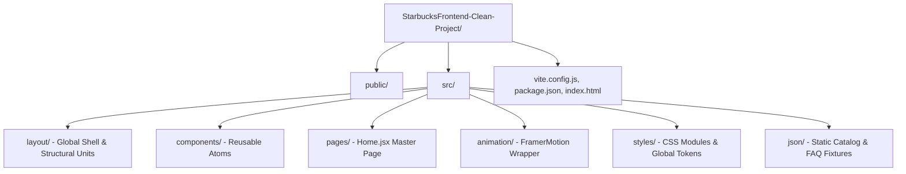

# Project Directory Map & Dependency Audit



---

## 1. Directory Tree & File Inventory

```
StarbucksFrontend-Clean-Project/
├── .eslintrc.cjs            # ESLint static code quality rules for React & Hooks
├── .gitattributes          # Git line-ending normalization configuration
├── .gitignore              # Ignores node_modules, dist, and local environment files
├── index.html              # HTML host document with preconnect tags and #root container
├── LICENSE                 # MIT open-source license
├── package.json            # Project manifest, npm scripts, and exact dependency lock
├── package-lock.json       # Deterministic dependency resolution tree
├── README.md               # Quick-start guide and hackathon acknowledgments
├── vite.config.js          # Vite bundler configuration using @vitejs/plugin-react
├── build.bat               # Windows batch script compiling production bundle
├── install.bat             # Windows batch script installing npm dependencies
├── preview.bat             # Windows batch script previewing production build
├── start-dev.bat           # Windows batch script starting Vite development server
├── public/                 # Static public assets served directly by web server
│   ├── features-1.webp     # Quality storytelling image 1 (Fresh ingredients)
│   ├── features-2.avif     # Quality storytelling image 2 (Hygiene standards)
│   ├── features-3.jpg      # Quality storytelling image 3 (Handcrafted coffee)
│   ├── starbucks.svg       # Official Starbucks green siren logo icon
│   └── starbucks-intro.png # Splash intro coffee cup emblem
└── src/                    # Application source code
    ├── main.jsx            # Application bootstrap mounting React DOM into #root
    ├── App.jsx             # Top-level shell rendering Cursor, Intro, Navbar, Home, Footer
    ├── animation/          # Animation utilities
    │   └── FramerMotion.jsx # Declarative viewport intersection animation wrapper
    ├── components/         # Reusable presentation atoms
    │   ├── Cursor.jsx      # Custom animated mouse-following circle with hover labels
    │   ├── FAQBox.jsx      # Collapsible accordion item with rotating SVG icon
    │   └── ProductBox.jsx  # Catalog card displaying product photo, name, and price
    ├── json/               # Mock data fixtures
    │   ├── bestSellers.json # 6 featured beverages with name, price, and Cloudinary asset
    │   ├── community.json  # 20 customer showcase images for infinite marquee
    │   ├── faqData.json    # 5 customer service questions and detailed answers
    │   └── products.json   # 12 coffee products for horizontal browsing sliders
    ├── layout/             # High-level section and layout components
    │   ├── Footer.jsx      # Corporate footer with newsletter and directory links
    │   ├── InfiniteScroll.jsx # Dual-row CSS keyframe infinite horizontal marquee
    │   ├── Intro.jsx       # Timed splash screen overlay with logo reveal
    │   ├── Navbar.jsx      # Sticky top navigation bar with mobile drawer toggle
    │   └── Slider.jsx      # Mouse-drag horizontal scroll container for products/categories
    ├── pages/              # Primary route views
    │   └── Home.jsx        # Master landing page containing Hero, BestSellers, and Pinned Frames
    └── styles/             # Modular and global styling sheets
        ├── FAQBox.module.css # Scoped styles for accordion containers and transitions
        ├── Footer.module.css # Scoped styles for footer columns and newsletter inputs
        ├── Home.module.css # Scoped styles for Hero, Best Sellers, and Pinned Sections
        ├── Intro.module.css # Scoped styles for splash screen overlay and keyframe shrink
        ├── main.css        # Global CSS variables, reset, font imports, and body scrollbars
        ├── Navbar.module.css # Scoped styles for desktop header and mobile slide-down drawer
        └── ProductBox.module.css # Scoped styles for product cards and hover shadows
```

---

## 2. Tech Stack & Exact Dependency Audit

All version numbers are verified against [`StarbucksFrontend-Clean-Project/package.json`](file:///Users/avishjain/avishjain9-repos/50-starbugs-frontend-copy/StarbucksFrontend-Clean-Project/package.json#L12-L31):

### Production Dependencies (`dependencies`)

| Package Name | Exact Version | Primary Purpose in Codebase | File Usage Reference |
| :--- | :--- | :--- | :--- |
| **`react`** | `^18.3.1` | Core UI component abstraction, hooks (`useState`, `useEffect`, `useRef`), and Virtual DOM reconciliation. | [`src/App.jsx:1`](file:///Users/avishjain/avishjain9-repos/50-starbugs-frontend-copy/StarbucksFrontend-Clean-Project/src/App.jsx#L1), [`src/pages/Home.jsx:5`](file:///Users/avishjain/avishjain9-repos/50-starbugs-frontend-copy/StarbucksFrontend-Clean-Project/src/pages/Home.jsx#L5) |
| **`react-dom`** | `^18.3.1` | Browser DOM rendering engine providing `createRoot` for concurrent hydration. | [`src/main.jsx:2`](file:///Users/avishjain/avishjain9-repos/50-starbugs-frontend-copy/StarbucksFrontend-Clean-Project/src/main.jsx#L2) |
| **`framer-motion`** | `^11.3.6` | Declarative physics animations, spring transitions, and viewport-driven scroll triggers. | [`src/animation/FramerMotion.jsx:1`](file:///Users/avishjain/avishjain9-repos/50-starbugs-frontend-copy/StarbucksFrontend-Clean-Project/src/animation/FramerMotion.jsx#L1) |
| **`gsap`** | `^3.12.5` | High-performance timeline animation engine and `ScrollTrigger` plugin for sticky pinning and scrubbing. | [`src/pages/Home.jsx:1-2`](file:///Users/avishjain/avishjain9-repos/50-starbugs-frontend-copy/StarbucksFrontend-Clean-Project/src/pages/Home.jsx#L1-L2), [`src/components/Cursor.jsx:2`](file:///Users/avishjain/avishjain9-repos/50-starbugs-frontend-copy/StarbucksFrontend-Clean-Project/src/components/Cursor.jsx#L2) |
| **`locomotive-scroll`** | `^5.0.0-beta.13` | Inertial smooth scrolling engine with parallax data-attribute speed recalculations. | [`src/pages/Home.jsx:3`](file:///Users/avishjain/avishjain9-repos/50-starbugs-frontend-copy/StarbucksFrontend-Clean-Project/src/pages/Home.jsx#L3) |
| **`react-icons`** | `^5.2.1` | Icon sets (`ai`, `io`, `io5`, `si`, `bs`, `fa`, `fa6`, `rx`, `md`) compiled into lightweight SVG symbols. | [`src/layout/Navbar.jsx:3-10`](file:///Users/avishjain/avishjain9-repos/50-starbugs-frontend-copy/StarbucksFrontend-Clean-Project/src/layout/Navbar.jsx#L3-L10), [`src/pages/Home.jsx:6-9`](file:///Users/avishjain/avishjain9-repos/50-starbugs-frontend-copy/StarbucksFrontend-Clean-Project/src/pages/Home.jsx#L6-L9) |
| **`react-intersection-observer`** | `^9.13.0` | React hook wrapping the native browser `IntersectionObserver` API for viewport detection. | [`src/animation/FramerMotion.jsx:2`](file:///Users/avishjain/avishjain9-repos/50-starbugs-frontend-copy/StarbucksFrontend-Clean-Project/src/animation/FramerMotion.jsx#L2) |
| **`react-router-dom`** | `^6.25.0` | Client-side routing harness providing `<BrowserRouter>` and `<Link>` navigation wrappers. | [`src/main.jsx:5`](file:///Users/avishjain/avishjain9-repos/50-starbugs-frontend-copy/StarbucksFrontend-Clean-Project/src/main.jsx#L5), [`src/components/ProductBox.jsx:3`](file:///Users/avishjain/avishjain9-repos/50-starbugs-frontend-copy/StarbucksFrontend-Clean-Project/src/components/ProductBox.jsx#L3) |

### Development Dependencies (`devDependencies`)

| Package Name | Exact Version | Role in Engineering Workflow |
| :--- | :--- | :--- |
| **`vite`** | `^5.3.1` | Next-generation frontend tooling providing native ESM dev server and Rollup bundling. |
| **`@vitejs/plugin-react`** | `^4.3.1` | Official Vite plugin providing Fast Refresh (HMR) and Babel/swc JSX transformations. |
| **`eslint`** | `^8.57.0` | Static analysis tool identifying syntax problems and stylistic violations. |
| **`eslint-plugin-react`** | `^7.34.2` | React-specific linting rules (validating JSX, prop types, and DOM rules). |
| **`eslint-plugin-react-hooks`** | `^4.6.2` | Enforces the Rules of Hooks (preventing hooks inside conditional blocks). |
| **`eslint-plugin-react-refresh`** | `^0.4.7` | Validates that components are exportable for seamless HMR updates. |
| **`@types/react`** | `^18.3.3` | TypeScript type declarations for React symbols, hooks, and JSX element types. |
| **`@types/react-dom`** | `^18.3.0` | TypeScript definitions for browser DOM rendering functions. |

---

## 3. Environment Variables & External Endpoints

### Secrets & Environment Variables Audit
- **Status**: **None Required**. The application is entirely self-sufficient, requiring no API keys, private tokens, or external backend secrets.

### Third-Party Endpoints Audit
- **Cloudinary CDN (`res.cloudinary.com`)**: Hosts transparent PNG coffee cups, marketing banners, and Instagram community imagery.
- **Cognizant OrderServ (`starbucksstatic.cognizantorderserv.com`)**: Hosts standard Starbucks category thumbnails.
- **Google Fonts API (`fonts.googleapis.com`)**: Delivers `Roboto`, `Open Sans`, and `Oswald` typography files.
