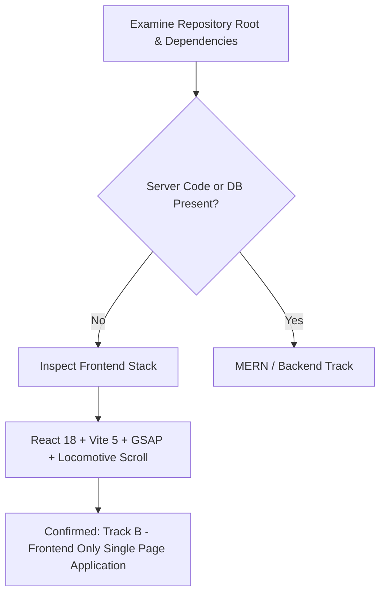

# Project Type Classification & Track Selection

## 1. Project Type Determination

**Detected Type**: **Type B: Frontend Only (Single Page Application / Interactive UI Showcase)**

This project is a high-fidelity frontend redesign of the **Starbucks Coffee Company** web experience. It contains client-side React code, modular styling, complex physics and animation pipelines (GSAP, Locomotive Scroll, and Framer Motion), and static JSON data fixtures. It does **not** contain custom server-side execution runtimes (Node.js Express, Python, Go, Java), database servers (MongoDB, PostgreSQL), or custom authentication microservices.

---

## 2. Hard Code Evidence & Audit

| Verification Checkpoint | File Path in Codebase | Specific Code Evidence | Interpretation |
| :--- | :--- | :--- | :--- |
| **Dependencies** | [`StarbucksFrontend-Clean-Project/package.json:12-21`](file:///Users/avishjain/avishjain9-repos/50-starbugs-frontend-copy/StarbucksFrontend-Clean-Project/package.json#L12-L21) | `"react": "^18.3.1"`, `"react-dom": "^18.3.1"`, `"framer-motion": "^11.3.6"`, `"gsap": "^3.12.5"`, `"locomotive-scroll": "^5.0.0-beta.13"`, `"react-router-dom": "^6.25.0"` | Modern React 18 client bundle with specialized animation libraries. No `express`, `mongoose`, `prisma`, or `jsonwebtoken`. |
| **Dev Tooling** | [`StarbucksFrontend-Clean-Project/package.json:22-31`](file:///Users/avishjain/avishjain9-repos/50-starbugs-frontend-copy/StarbucksFrontend-Clean-Project/package.json#L22-L31) | `"vite": "^5.3.1"`, `"@vitejs/plugin-react": "^4.3.1"`, `"eslint": "^8.57.0"` | Client-side bundler leveraging native ES Modules (ESM) and Rollup production builds. |
| **Client Entry Point** | [`StarbucksFrontend-Clean-Project/src/main.jsx:7-13`](file:///Users/avishjain/avishjain9-repos/50-starbugs-frontend-copy/StarbucksFrontend-Clean-Project/src/main.jsx#L7-L13) | `ReactDOM.createRoot(document.getElementById('root')).render(<BrowserRouter><App /></BrowserRouter>)` | Pure browser client hydration mounting into DOM element `#root`. |
| **HTML Host** | [`StarbucksFrontend-Clean-Project/index.html:17-18`](file:///Users/avishjain/avishjain9-repos/50-starbugs-frontend-copy/StarbucksFrontend-Clean-Project/index.html#L17-L18) | `

` | Classic Single Page Application (SPA) entry container. |
| **Data Architecture** | [`StarbucksFrontend-Clean-Project/src/pages/Home.jsx:13-21`](file:///Users/avishjain/avishjain9-repos/50-starbugs-frontend-copy/StarbucksFrontend-Clean-Project/src/pages/Home.jsx#L13-L21) | `import communityPosts from '../json/community.json'`, `import productsData from '../json/products.json'`, `import bestSellers from '../json/bestSellers.json'` | Data is statically embedded and bundled as JSON fixtures rather than fetched over REST/GraphQL endpoints. |
| **Backend / DB Check** | Entire Workspace | **Zero** backend routes, zero server controllers, zero database connection strings (`mongodb://`, `postgres://`). | No server runtime exists in this repository. |

---

## 3. How This Documentation Set Adapts

In accordance with **RULE 8 (Adapt to the Project Type - Track B)**:
1. **Frontend Mastery Deep Dive**:
   - We go exhaustively deep into React 18 component design, reconciliation, lifecycle management, hooks, and clean unmounting.
   - We dissect the collision and coexistence between **Locomotive Scroll 5 (inertial smooth scrolling)** and **GSAP ScrollTrigger (pinning, timeline scrubs)**.
   - We examine physics-based mouse-drag velocity algorithms, Framer Motion viewport intersection observers, and CSS keyframe GPU pipelines.
2. **Backend & Database Sections**:
   - Backend-only topics (Node/Express middleware pipelines, Mongoose schemas, MongoDB replica sets, server-side JWT auth) are marked explicitly as **"Not applicable for this project type (Frontend-only client application)"** with concrete technical rationale.
   - We preserve all 275 items in the master checklist without inventing phantom server code.
3. **Hypothetical Scaling & System Design**:
   - System design chapters evaluate frontend edge delivery, CDN caching tiers, browser asset pipelining, Cloudinary image transformations, client-side rate limiting, and architect a realistic enterprise backend (API Gateway, microservices, MongoDB/PostgreSQL, Redis, and AI Barista RAG) for how Starbucks scales to millions of daily orders.
4. **Mandatory Diagrams & Say It Out Loud Scripts**:
   - Every single feature and architectural concept includes precise Mermaid diagrams and first-person spoken interview scripts.
