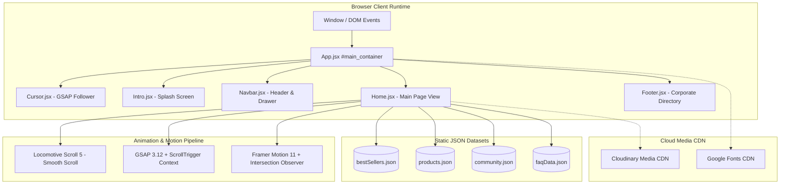
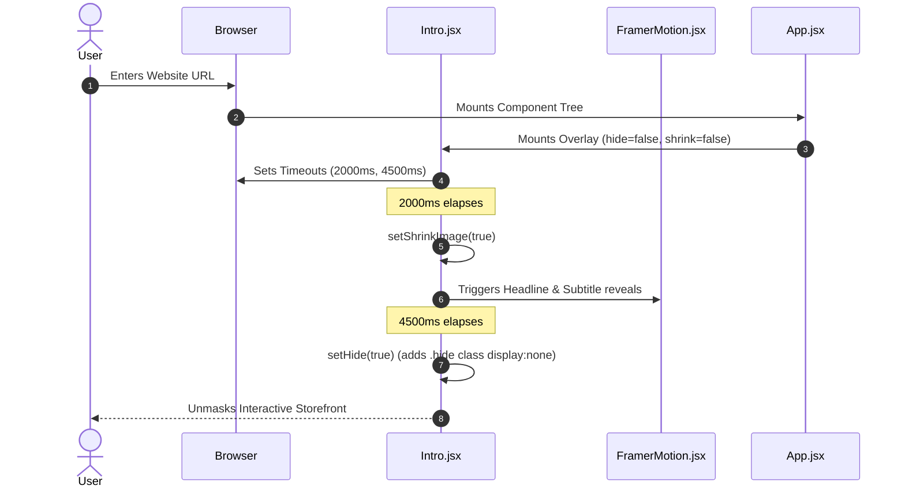
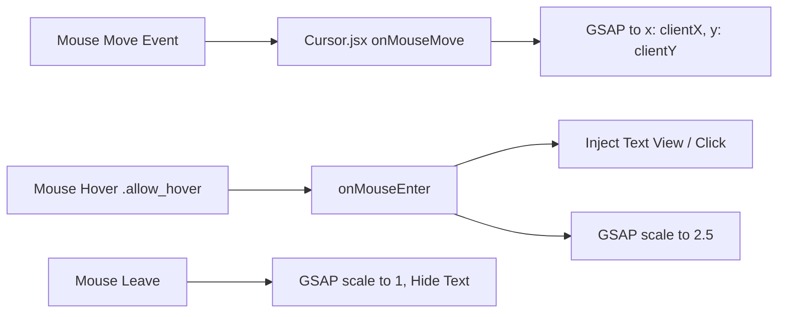
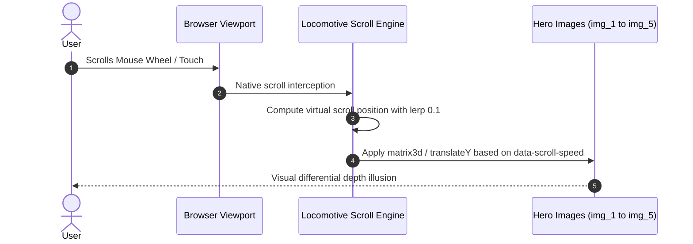
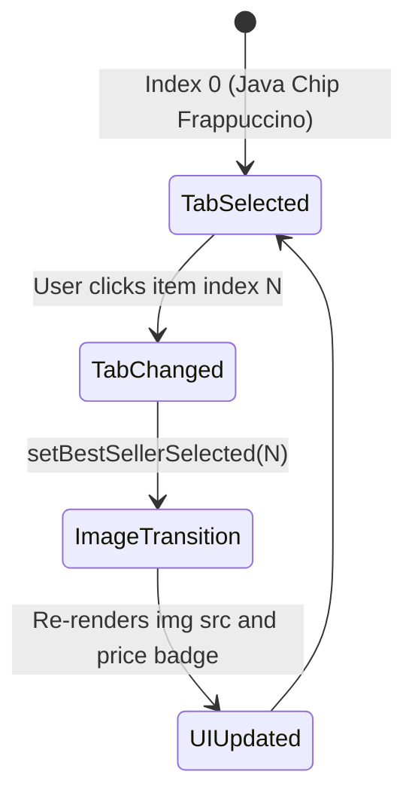
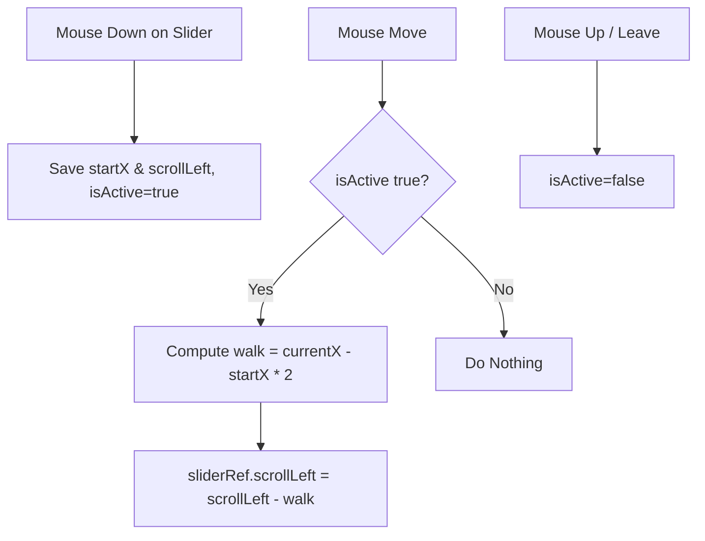
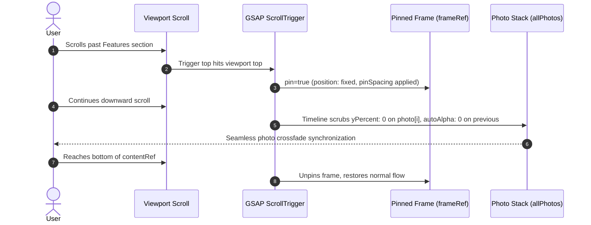
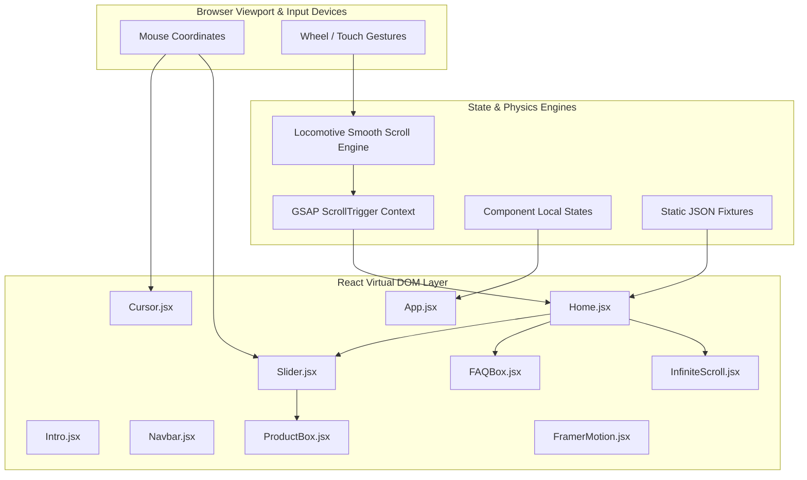

# Deep Project Analysis & System Inventory

---

## 0.1 What the Project Is

### Executive Overview
- **Project Name**: Starbucks Modern Frontend Redesign (`starbucks-redesign`)
- **Repository Origin**: Recreated during the *Sheryians ReImagine Hackathon* by Aayush Singh & Srinivash R.T, maintained in repository `AVISHJAIN9/starbugs-frontend-copy-1`.
- **Purpose**: A radical visual and interactive overhaul of the official Starbucks e-commerce and brand presence. It replaces standard corporate layouts with an immersive, dark-emerald aesthetic, inertia-driven smooth scrolling, multi-layer parallax depth, interactive product carousels, sticky pinned storytelling frames, and dynamic cursor physics.
- **Problem Solved**: Standard quick-service restaurant (QSR) web applications often suffer from visual monotony, clunky page reloads, and lifeless scrolling. This redesign elevates brand affinity and product desirability by translating the tactile, premium experience of a physical Starbucks Reserve roastery into digital web interactions.
- **Target Audience**: Modern coffee enthusiasts, digital natives, Starbucks Rewards members, and design-forward consumers seeking an inspiring browsing experience across desktop and mobile devices.

### Primary User Journeys
1. **Initial Brand Immersion**:
   - User opens the URL (`/`).
   - Greeted by a timed cinematic splash intro (`Intro.jsx`) with a scale-down coffee cup logo reveal and staggered headline reveals (`STARBUCKS - COFFEE THAT INSPIRES`).
   - The splash screen smoothly fades out after 4.5 seconds, unmasking the dark emerald storefront.
2. **Interactive Hero & Parallax Exploration**:
   - User scrolls down. Locomotive Scroll applies inertia smoothing while multiple layers of transparent beverages glide at distinct speeds (`data-scroll-speed="1.0"` to `"2.5"`).
   - Dynamic custom cursor tracks mouse position with fluid GSAP interpolation and enlarges to reveal `"View"` or `"Click"` labels when hovering over actionable items (`.allow_hover`).
3. **Best Sellers Discovery & Cart Intent**:
   - User reaches the Best Sellers section pinned smoothly against the viewport.
   - User clicks category tabs (`Cappuccino`, `Cold Brew`, `Mocha`); the state updates immediately, swapping the featured high-res beverage graphic, price, and CTA.
4. **Interactive Category & Product Drag Carousel**:
   - User browses categorized offerings (`Drinks`, `Foods`, `Merchandise`) and product grids.
   - User drags horizontally using mouse velocity to scroll through items with realistic momentum.
5. **Quality Storytelling (Sticky Pinned GSAP Frame)**:
   - User scrolls through core quality pillars (*Fresh Ingredients*, *Hygiene Standards*, *Handcrafted with Heart*).
   - On desktop, the central image frame pins to the screen while text milestones scrub past, transitioning background photos smoothly. On mobile, cards render directionally with Framer Motion triggers.
6. **Community Social Proof & FAQ Self-Service**:
   - User observes a continuous dual-row bidirectional marquee of customer moments.
   - User clicks FAQ questions, triggering rotating plus icons and expandable CSS accordion drawers.

### Pages & Routes
| Route | Component | File Path | Line Range | Capabilities & User Actions |
| :--- | :--- | :--- | :--- | :--- |
| `/` | `Home` | [`src/pages/Home.jsx`](file:///Users/avishjain/avishjain9-repos/50-starbugs-frontend-copy/StarbucksFrontend-Clean-Project/src/pages/Home.jsx#L24-L337) | L24-337 | Single-page application root view containing Hero, Best Sellers, Product/Category Sliders, Sticky Storytelling, Community Marquee, Accordion FAQ, and Brewing CTA. |
| Global Layout | `App` | [`src/App.jsx`](file:///Users/avishjain/avishjain9-repos/50-starbugs-frontend-copy/StarbucksFrontend-Clean-Project/src/App.jsx#L9-L25) | L9-25 | Mounts global `Cursor`, `Intro` modal, `Navbar`, `Home`, and `Footer`. |

---

## 0.2 Every Feature with Full Technical Trace

The codebase implements **12 distinct features (F1 - F12)**:

### Feature F1: Splash Intro & Cinematic Logo Reveal Engine
- **User Experience**: Upon loading, an overlay locks viewport interaction, reveals a centered Starbucks cup graphic that shrinks smoothly at 2.0s, reveals typography at 2.0s and 2.3s, and auto-hides at 4.5s.
- **Frontend Flow**: [`Intro.jsx:9-17`](file:///Users/avishjain/avishjain9-repos/50-starbugs-frontend-copy/StarbucksFrontend-Clean-Project/src/layout/Intro.jsx#L9-L17) triggers two `setTimeout` calls within `useEffect` updating state `setShrinkImage(true)` and `setHide(true)`.
- **Component Hierarchy**: `App.jsx` -> `Intro.jsx` -> `FramerMotion.jsx` -> `motion.div`.
- **Data Touched**: Client state `hide` (boolean), `shrinkImage` (boolean).
- **Failure Path**: If timer unmounts early or tab is inactive, timer clears or completes on return. Keyboard inputs are blocked via `onKeyDown={(e) => e.preventDefault()}`.

---

### Feature F2: Custom Dynamic Interactive Cursor
- **User Experience**: A vibrant circular cursor (`#00c684`) tracks the mouse pointer with zero lag. When hovering over interactive links or buttons marked with `.allow_hover`, it scales up 2.5x and renders contextual text (`"View"` or `"Click"`).
- **Frontend Flow**: [`Cursor.jsx:9-49`](file:///Users/avishjain/avishjain9-repos/50-starbugs-frontend-copy/StarbucksFrontend-Clean-Project/src/components/Cursor.jsx#L9-L49) listens to global `mousemove` on `document`. GSAP interpolates cursor `x` and `y` coordinates. Event listeners on `a` and `button` inspect `classList.contains("allow_hover")` to trigger `gsap.to(cursor, { scale: 2.5 })`.
- **CSS Safeguards**: Disabled on mobile screens (`@media (max-width: 850px) { .cursor { display: none !important; } }`) and marked `pointer-events: none` to prevent blocking native clicks.

---

### Feature F3: Multi-Layer Parallax Hero Section
- **User Experience**: The hero displays bold typography (*"It's not just coffee. It's Starbucks"*) with 5 floating transparent coffee cups that move at differential velocities as the user scrolls.
- **Frontend Flow**: [`Home.jsx:174-202`](file:///Users/avishjain/avishjain9-repos/50-starbugs-frontend-copy/StarbucksFrontend-Clean-Project/src/pages/Home.jsx#L174-L202) defines `data-scroll` and `data-scroll-speed` tags (`0.8` to `2.5`). Responsive state `windowWidth > 700` dynamically calculates speed multipliers.
- **Assets**: High-resolution Cloudinary transparent renders loaded with `loading="eager"`.

---

### Feature F4: Interactive Best Sellers Tabbed Showcase
- **User Experience**: Users select coffee items from a vertical list (`bestSellers.json`); the central showcase smoothly animates the corresponding product image, price, and "Add To Bag" action.
- **Frontend Flow**: [`Home.jsx:204-226`](file:///Users/avishjain/avishjain9-repos/50-starbugs-frontend-copy/StarbucksFrontend-Clean-Project/src/pages/Home.jsx#L204-L226) stores selected tab index in `bestSellerSelected` state (defaults to `0`). Clicking `h3` triggers `setBestSellerSelected(index)`, which immediately re-renders the image and price badge. Framer Motion provides directional entrance animations.

---

### Feature F5: Drag-to-Scroll Product & Category Sliders
- **User Experience**: Users click and drag horizontally across product boxes or category icons with fluid velocity and mouse capture.
- **Frontend Flow**: [`Slider.jsx:8-35`](file:///Users/avishjain/avishjain9-repos/50-starbugs-frontend-copy/StarbucksFrontend-Clean-Project/src/layout/Slider.jsx#L8-L35). `onMouseDown` records `startX = e.pageX - sliderRef.current.offsetLeft` and `scrollLeft`. `onMouseMove` calculates distance walked `walk = (currentX - startX) * 2` and updates `sliderRef.current.scrollLeft = scrollLeft - walk`.

---

### Feature F6: Sticky Pinned GSAP ScrollTrigger Split Frame
- **User Experience**: On desktop, a large square image frame pins to the screen (`pin: frameRef.current`) while descriptive copy scrolls alongside. As each headline crosses viewport trigger thresholds, the corresponding image reveals itself with smooth crossfades.
- **Frontend Flow**: [`Home.jsx:55-156`](file:///Users/avishjain/avishjain9-repos/50-starbugs-frontend-copy/StarbucksFrontend-Clean-Project/src/pages/Home.jsx#L55-L156). Inside `gsap.context()`, `ScrollTrigger.create` pins `frameRef.current` against `contentRef.current`. Individual headline triggers scrub `yPercent: 0` on matching `.frame-image`.

---

### Feature F7: Mobile-Optimized Split Feature Cards
- **User Experience**: On smaller screens (`max-width: 850px`), the pinned GSAP frame is hidden (`display: none` in CSS module) and replaced with alternating directional cards.
- **Frontend Flow**: [`Home.jsx:270-304`](file:///Users/avishjain/avishjain9-repos/50-starbugs-frontend-copy/StarbucksFrontend-Clean-Project/src/pages/Home.jsx#L270-L304). Cards alternate between `type={"leftToRight"}` and `type={"rightToLeft"}` with `xAxis={200}` wrapped in `FramerMotion`.

---

### Feature F8: Bidirectional Infinite Marquee (Social Proof)
- **User Experience**: Two rows of customer photos from Instagram/Community glide perpetually across the screen without stutter or pauses. Row 1 glides right; Row 2 glides left.
- **Frontend Flow**: [`InfiniteScroll.jsx:4-37`](file:///Users/avishjain/avishjain9-repos/50-starbugs-frontend-copy/StarbucksFrontend-Clean-Project/src/layout/InfiniteScroll.jsx#L4-L37) duplicates data array into two identical sibling `<ul>` elements. CSS animation `scrollX` translates `-100%` infinitely. Direction attribute `data-direction="right"` applies `animation-direction: reverse`. GPU linear gradient masks soften edges.

---

### Feature F9: Animated Accordion FAQ Engine
- **User Experience**: Users click any FAQ question; the question container expands smoothly from `0px` to `160px` height while the plus icon rotates 134 degrees into a dismiss cross.
- **Frontend Flow**: [`FAQBox.jsx:4-26`](file:///Users/avishjain/avishjain9-repos/50-starbugs-frontend-copy/StarbucksFrontend-Clean-Project/src/components/FAQBox.jsx#L4-L26). Local state `isExpanded` toggles on click. Inline style sets `height: isExpanded ? "160px" : "0px"` and `transform: rotate(isExpanded ? "134deg" : "0deg")` with transition `.5s ease-in-out`.

---

### Feature F10: Responsive Navbar & Store Finder Drawer
- **User Experience**: Desktop users see links and "Find a Store", "Sign In", "Join Now". Mobile users see a brand logo, search icon, and hamburger button that toggles an animated slide-down navigation drawer.
- **Frontend Flow**: [`Navbar.jsx:13-59`](file:///Users/avishjain/avishjain9-repos/50-starbugs-frontend-copy/StarbucksFrontend-Clean-Project/src/layout/Navbar.jsx#L13-L59). States `isMenuOpen` and `isStoreLocatorOpen` manage drawer visibility via conditional CSS classes (`styles.open`, `styles.show`).

---

### Feature F11: Brand Footer & Newsletter Subscription
- **User Experience**: Rich corporate footer with brand history, email input with subscribe action, social media icons (Facebook, Instagram, Spotify, Twitter), and organized link groups (*About Us*, *Careers*, *Social Impact*).
- **Frontend Flow**: [`Footer.jsx:11-82`](file:///Users/avishjain/avishjain9-repos/50-starbugs-frontend-copy/StarbucksFrontend-Clean-Project/src/layout/Footer.jsx#L11-L82). Semantic `<footer>` container styled via `Footer.module.css`.

---

### Feature F12: Reusable Viewport Motion Wrapper
- **User Experience**: Content elements throughout the app glide into view when scrolled into the viewport.
- **Frontend Flow**: [`FramerMotion.jsx:5-96`](file:///Users/avishjain/avishjain9-repos/50-starbugs-frontend-copy/StarbucksFrontend-Clean-Project/src/animation/FramerMotion.jsx#L5-L96). Encapsulates `useInView` from `react-intersection-observer` and `useAnimation` from `framer-motion`. Maps property `type` (`topToBottom`, `bottomToTop`, `leftToRight`, `rightToLeft`, `popup`) to motion variants.

---

## 0.3 Every API & Data Source

### Internal Static Data Files
| File Name | Relative Code Path | Total Records | Schema Shape | Consumers |
| :--- | :--- | :--- | :--- | :--- |
| `bestSellers.json` | [`src/json/bestSellers.json`](file:///Users/avishjain/avishjain9-repos/50-starbugs-frontend-copy/StarbucksFrontend-Clean-Project/src/json/bestSellers.json) | 6 products | `{ name: string, image: string (Cloudinary URL), price: number }` | `Home.jsx` (Best Sellers Showcase) |
| `products.json` | [`src/json/products.json`](file:///Users/avishjain/avishjain9-repos/50-starbugs-frontend-copy/StarbucksFrontend-Clean-Project/src/json/products.json) | 12 products | `{ id: number, name: string, image: string, price: number }` | `Home.jsx`, `Slider.jsx`, `ProductBox.jsx` |
| `community.json` | [`src/json/community.json`](file:///Users/avishjain/avishjain9-repos/50-starbugs-frontend-copy/StarbucksFrontend-Clean-Project/src/json/community.json) | 20 posts | `{ image: string (Cloudinary URL) }` | `Home.jsx`, `InfiniteScroll.jsx` |
| `faqData.json` | [`src/json/faqData.json`](file:///Users/avishjain/avishjain9-repos/50-starbugs-frontend-copy/StarbucksFrontend-Clean-Project/src/json/faqData.json) | 5 FAQs | `{ question: string, answer: string }` | `Home.jsx`, `FAQBox.jsx` |

### External Media CDNs & Cloud Endpoints
| Provider | Delivery URL Base | Purpose | Authentication |
| :--- | :--- | :--- | :--- |
| **Cloudinary** | `https://res.cloudinary.com/dvk80x6fi/` and `dvmuf6jfj/` | High-res coffee product images, transparent cups, and social feed assets | Public asset URLs |
| **Cognizant OrderServ** | `https://starbucksstatic.cognizantorderserv.com/Category/Small/` | Category thumbnail images (Drinks, Food, Merchandise, etc.) | Public CDN |
| **Google Fonts** | `https://fonts.googleapis.com` | Typography (`Roboto`, `Open Sans`, `Oswald`) | Free public API |

### Environment Variables & Secrets Audit
- **Audit Result**: Zero environment variables (`.env`, `.env.local`) required or detected. All data fixtures and asset links are static, public, and self-contained.

---

## 0.4 Hooks, Helpers, and Shared Architecture

### React Built-In Hooks Used
- `useState`:
  - `Home.jsx`: `bestSellerSelected` (number), `windowWidth` (number)
  - `Navbar.jsx`: `isMenuOpen` (boolean), `isStoreLocatorOpen` (boolean)
  - `Intro.jsx`: `hide` (boolean), `shrinkImage` (boolean)
  - `FAQBox.jsx`: `isExpanded` (boolean)
- `useEffect`:
  - `Home.jsx`: Locomotive Scroll lifecycle instantiation and cleanup; GSAP context creation; window resize listener
  - `Cursor.jsx`: Mouse position and hover target event binding
  - `Intro.jsx`: Splash timers
  - `FramerMotion.jsx`: Intersection observer triggering `mainControls.start("visible")`
- `useRef`:
  - `Home.jsx`: DOM node references (`scrollRef`, `bestSellerRef`, `productsSectionRef`, `productSlider1Ref`, `productSlider2Ref`, `contentRef`, `frameRef`, `shadowRef`, `reviewsRef`, `categoriesRef`)
  - `Cursor.jsx`: `cursorRef`, `cursorTxtRef`
  - `Slider.jsx`: `sliderRef`

### Custom & External Hooks
- `useInView` (`react-intersection-observer`): Triggers Framer Motion animations when elements scroll into view.
- `useAnimation` (`framer-motion`): Imperatively controls Framer Motion variant transitions.

---

## 0.5 Connection Map & Data Flow

---

## 0.6 Inventory Totals

Every subsequent document in this repository strictly adheres to these audited figures:
- **Total Pages / Main Views**: 1 (`Home.jsx` mounted within `App.jsx` layout)
- **Total React Components**: 9 (`App`, `Home`, `Navbar`, `Footer`, `Intro`, `Cursor`, `Slider`, `ProductBox`, `FAQBox`, `InfiniteScroll`, `FramerMotion` = 11 modular components)
- **Total Features Documented**: 12 (F1 through F12)
- **Total Hooks Employed**: 5 (`useState`, `useEffect`, `useRef`, `useInView`, `useAnimation`)
- **Total Static JSON Datasets**: 4 (`bestSellers.json`, `products.json`, `community.json`, `faqData.json`)
- **Total External APIs / CDNs**: 3 (Cloudinary, Cognizant OrderServ, Google Fonts)
- **Total Environment Variables**: 0 (Fully client-contained)
- **Total Production Dependencies**: 8 (`react`, `react-dom`, `framer-motion`, `gsap`, `locomotive-scroll`, `react-icons`, `react-intersection-observer`, `react-router-dom`)
