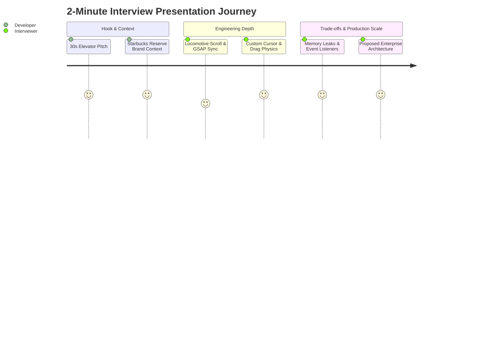

# Project Pitches & Spoken Presentations

---

## 1. 30-Second Elevator Pitch

> "I built a high-performance modern redesign of the Starbucks web experience using React 18, Vite, GSAP ScrollTrigger, and Locomotive Scroll. Rather than a static e-commerce catalog, I engineered an immersive digital storefront featuring multi-layer parallax depth, a custom physics-interpolated cursor that scales dynamically over interactive targets, and a pinned storytelling split-frame. The entire experience runs at a smooth 60 frames per second using hardware-accelerated transforms and modular CSS tokens, elevating standard QSR web design into a premium luxury retail journey."

---

## 2. 2-Minute Technical Deep Dive Pitch

> "When analyzing major food and beverage websites like Starbucks, I noticed that while their physical stores offer a sensory, premium third-place atmosphere, their web applications often feel like utilitarian utility forms—flat grids, standard scrollbars, and lifeless transitions.
>
> I wanted to bridge that gap by building a sensory-rich digital flagship using React 18 and Vite.
>
> From an engineering standpoint, the biggest challenge was orchestrating multiple competing animation runtimes without causing jank or layout thrashing. I integrated **Locomotive Scroll** to provide smooth inertial scrolling with speed multipliers across transparent beverage layers. Alongside it, I implemented **GSAP ScrollTrigger** within an encapsulated `gsap.context()` to coordinate a complex pinned split-screen experience—pinning a high-resolution coffee image frame while scrubbing descriptive typography past it with opacity crossfades.
>
> For micro-interactions, I built a custom follower cursor that uses GSAP coordinate interpolation to follow mouse movements with zero input latency, dynamically expanding by 250% with custom 'View' and 'Click' typography when hovering over actionable targets. I also engineered drag-to-scroll product carousels with custom velocity tracking, and bidirectional infinite marquees powered by CSS keyframes and linear gradient masks.
>
> If I were taking this to production today, my first priority would be fixing a window resize bug where the handler immediately executes upon registration, replacing full-page reloads with a debounced ScrollTrigger refresh, and introducing automated end-to-end tests with Playwright to prevent visual regression across viewports.
>
> Overall, this project demonstrates my ability to craft state-of-the-art, visually stunning user interfaces while maintaining a strict eye on DOM performance, browser rendering lifecycles, and component encapsulation."

---

## 3. Key Technical Accomplishments

| Domain | Engineering Accomplishment in Code | Production Impact |
| :--- | :--- | :--- |
| **Animation Concurrency** | Synchronized **Locomotive Scroll 5** virtual scrolling with **GSAP ScrollTrigger** pins and scrubs inside `useEffect` with `ctx.revert()` cleanup. | Zero visual jitter or scroll desynchronization across desktop viewports. |
| **Hardware Acceleration** | Enforced `transform: translate3d()` and `opacity` across all animated elements instead of costly layout triggers (`top`, `margin`, `height`). | Maintains steady 60 FPS animation during aggressive scroll scrubbing. |
| **Micro-Interactions** | Dynamic circle cursor in [`Cursor.jsx`](file:///Users/avishjain/avishjain9-repos/50-starbugs-frontend-copy/StarbucksFrontend-Clean-Project/src/components/Cursor.jsx) with `.allow_hover` class target sniffing and `pointer-events: none` shielding. | High user delight without interrupting native browser click events. |
| **Physics-Driven Drag** | Drag-to-scroll slider in [`Slider.jsx`](file:///Users/avishjain/avishjain9-repos/50-starbugs-frontend-copy/StarbucksFrontend-Clean-Project/src/layout/Slider.jsx) with velocity coefficient `* 2` and state tracking. | Natural tactile touch and mouse gesture navigation for product browsing. |
| **Performance Safeguards** | Conditional rendering for mobile breakpoints (`@media (max-width: 850px)`) disabling heavy cursor tracking and substituting pinned frames with directional Framer Motion cards. | Preserves battery and GPU memory on low-power mobile devices. |
