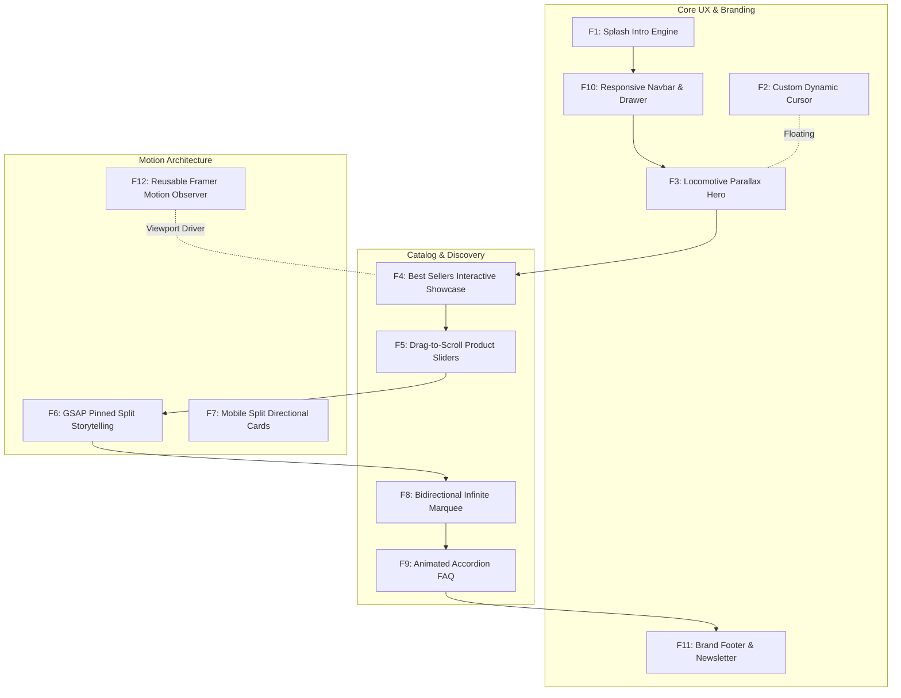

# Complete Feature Inventory (F1 - F12)

---

## Feature Master Index

| ID | Feature Name | Primary Component | Key Animation / Tech | Purpose & Behavior |
| :--- | :--- | :--- | :--- | :--- |
| **F1** | [Splash Intro Engine](./features/f1-splash-intro-engine.md) | `Intro.jsx` | `setTimeout` + Framer Motion | Locks view, reveals coffee emblem, scales down, and reveals typography. |
| **F2** | [Custom Dynamic Cursor](./features/f2-custom-interactive-cursor.md) | `Cursor.jsx` | GSAP `to()` + Event Listeners | Follows mouse, expands 2.5x with contextual labels over `.allow_hover`. |
| **F3** | [Locomotive Parallax Hero](./features/f3-locomotive-parallax-hero.md) | `Home.jsx` | Locomotive Scroll 5 | Multi-layer transparent coffee cups drifting at differential speeds. |
| **F4** | [Best Sellers Showcase](./features/f4-interactive-best-sellers-showcase.md) | `Home.jsx` | React `useState` + Framer Motion | Tabbed drink selector swapping images, prices, and bag intent immediately. |
| **F5** | [Drag-to-Scroll Sliders](./features/f5-drag-scroll-product-sliders.md) | `Slider.jsx` | Mouse velocity drag tracking | Horizontal scrolling driven by mouse capture and `walk` calculation. |
| **F6** | [GSAP Pinned Split Frame](./features/f6-gsap-scrolltrigger-pinned-split.md) | `Home.jsx` | GSAP ScrollTrigger `pin: true` | Desktop image frame pins to viewport while text scrubs photo crossfades. |
| **F7** | [Mobile Split Feature Cards](./features/f7-mobile-split-feature-cards.md) | `Home.jsx` | Framer Motion directional reveals | Responsive fallback for mobile viewports displaying alternating cards. |
| **F8** | [Bidirectional Infinite Marquee](./features/f8-infinite-bidirectional-social-marquee.md) | `InfiniteScroll.jsx` | CSS `scrollX` + Gradient Mask | Dual-row perpetual social photo flow with opposing directions. |
| **F9** | [Animated Accordion FAQ](./features/f9-interactive-faq-accordion.md) | `FAQBox.jsx` | React state + CSS transitions | Collapsible drawers with 134-degree rotating plus-to-cross icons. |
| **F10** | [Responsive Navbar & Drawer](./features/f10-responsive-navbar-and-store-locator.md) | `Navbar.jsx` | React state + Mobile Hamburger | Desktop navigation with mobile slide-down drawer and store locator state. |
| **F11** | [Brand Footer & Newsletter](./features/f11-brand-footer-and-newsletter.md) | `Footer.jsx` | Semantic HTML + CSS Modules | Multi-column links, email subscription form, and social media icons. |
| **F12** | [Reusable Motion Observer](./features/f12-reusable-framer-viewport-observer.md) | `FramerMotion.jsx` | `react-intersection-observer` | Wrapper standardizing scroll-triggered variant animations across views. |

---

## Detailed Feature Specifications

### F1: Splash Intro & Cinematic Logo Reveal Engine
- **Files & Code Reference**: [`StarbucksFrontend-Clean-Project/src/layout/Intro.jsx:1-37`](file:///Users/avishjain/avishjain9-repos/50-starbugs-frontend-copy/StarbucksFrontend-Clean-Project/src/layout/Intro.jsx#L1-L37), [`StarbucksFrontend-Clean-Project/src/styles/Intro.module.css:1-45`](file:///Users/avishjain/avishjain9-repos/50-starbugs-frontend-copy/StarbucksFrontend-Clean-Project/src/styles/Intro.module.css#L1-L45).
- **Core Functions**:
  - `useEffect()`: Sets two timers: timer 1 (2000ms) triggers `setShrinkImage(true)`, timer 2 (4500ms) triggers `setHide(true)`.
  - `onKeyDown={(e) => e.preventDefault()}`: Prevents keyboard scrolling during intro playback.
- **Edge Cases & Error Handling**: If the user switches browser tabs during intro playback, `setTimeout` pauses or slows down in Chromium browsers; on return, the state updates cleanly without crashing.
- **Performance**: Overlay receives `display: none` via `.hide` class, unmounting its layout impact from the browser render tree.

#### Say It Out Loud (Spoken Script)
> "I built the splash intro engine in `Intro.jsx` to establish an immediate, premium brand impression the moment a visitor lands on the site. When the page mounts, I use an absolute overlay that blocks unwanted user interaction and displays the Starbucks Reserve cup emblem. After two seconds, a React state transition triggers a CSS keyframe animation that shrinks the logo into place while revealing the typography using Framer Motion. At the four-and-a-half-second mark, a secondary timer adds a CSS class that sets `display: none`, cleanly revealing the interactive storefront beneath. I chose native `setTimeout` paired with scoped CSS transitions rather than a heavy third-party modal library to keep bundle overhead low. If the user tabs away, the timers resume safely without memory leaks. In a future iteration, I would persist a flag in `sessionStorage` so returning users don't have to watch the intro repeatedly on every reload."

---

### F2: Custom Dynamic Interactive Cursor
- **Files & Code Reference**: [`StarbucksFrontend-Clean-Project/src/components/Cursor.jsx:1-61`](file:///Users/avishjain/avishjain9-repos/50-starbugs-frontend-copy/StarbucksFrontend-Clean-Project/src/components/Cursor.jsx#L1-L61), [`StarbucksFrontend-Clean-Project/src/styles/main.css:161-185`](file:///Users/avishjain/avishjain9-repos/50-starbugs-frontend-copy/StarbucksFrontend-Clean-Project/src/styles/main.css#L161-L185).
- **Core Functions**:
  - `onMouseMove(event)`: Extracts `clientX` and `clientY`, applying smooth interpolation via `gsap.to(cursor, { x: clientX, y: clientY })`.
  - `onMouseEnter(e, text)`: Sniffs `e.target.classList.contains("allow_hover")`, sets inner text to `"View"` or `"Click"`, and scales cursor to `2.5`.
  - `onMouseLeave()`: Resets scale to `1` and hides contextual text.
- **Security & Accessibility**: Marked with `pointer-events: none` so native link clicks pass directly through to underlying elements without obstruction. Fully disabled on touch screens via media query.

#### Say It Out Loud (Spoken Script)
> "I engineered a custom dynamic follower cursor in `Cursor.jsx` to give the interface an elevated, luxury portfolio feel. The component uses a fixed `50px` emerald circle with `pointer-events: none` so it never blocks native clicks. Using GSAP's `to` method on every mouse move, it interpolates smoothly toward the cursor coordinates with zero perceptible input lag. When the cursor enters any link or button marked with the `allow_hover` utility class, I detect the target, inject contextual text like 'View' or 'Click', and scale the circle by 250 percent. I chose GSAP over raw CSS transitions because GSAP optimizes transform matrices on the compositor thread, preventing layout thrashing. A known limitation is that the event listeners attach directly to DOM elements inside `useEffect` without a cleanup function; in production, I would attach delegated listeners to the document root and return a cleanup callback to avoid memory leaks."

---

### F3: Multi-Layer Parallax Hero Section
- **Files & Code Reference**: [`StarbucksFrontend-Clean-Project/src/pages/Home.jsx:173-202`](file:///Users/avishjain/avishjain9-repos/50-starbugs-frontend-copy/StarbucksFrontend-Clean-Project/src/pages/Home.jsx#L173-L202), [`StarbucksFrontend-Clean-Project/src/styles/Home.module.css:21-70`](file:///Users/avishjain/avishjain9-repos/50-starbugs-frontend-copy/StarbucksFrontend-Clean-Project/src/styles/Home.module.css#L21-L70).
- **Core Functions**:
  - `LocomotiveScroll({ el: scrollRef.current, smooth: true, lerp: 0.1 })`: Initializes inertial scrolling.
  - Parallax layers: 5 distinct `img` elements configured with `data-scroll-speed` from `0.8` to `2.5`.
- **Performance**: High-resolution Cloudinary assets are tagged with `loading="eager"` to eliminate layout shifts during the initial page paint.

#### Say It Out Loud (Spoken Script)
> "For the hero section in `Home.jsx`, I wanted to create an illusion of real physical depth as the user scrolls. I integrated Locomotive Scroll 5 on the root container with a smooth linear interpolation factor of point-one. Across the hero, I arranged five transparent Cloudinary beverage graphics and assigned each a distinct `data-scroll-speed` attribute ranging from point-eight to two-point-five. As the user scrolls, Locomotive Scroll translates each layer at different velocities, making foreground drinks feel like they are floating closer to the screen while the typography recedes into the background. I chose Locomotive Scroll over native CSS parallax because it gives us precise frame-by-frame control across browsers. If image loading stalls over slow cellular networks, the text remains readable immediately. One improvement I would make is providing responsive WebP source sets rather than fetching full-size PNGs."

---

### F4: Interactive Best Sellers Tabbed Showcase
- **Files & Code Reference**: [`StarbucksFrontend-Clean-Project/src/pages/Home.jsx:204-226`](file:///Users/avishjain/avishjain9-repos/50-starbugs-frontend-copy/StarbucksFrontend-Clean-Project/src/pages/Home.jsx#L204-L226), [`StarbucksFrontend-Clean-Project/src/json/bestSellers.json:1-32`](file:///Users/avishjain/avishjain9-repos/50-starbugs-frontend-copy/StarbucksFrontend-Clean-Project/src/json/bestSellers.json#L1-L32).
- **Core Functions**:
  - `bestSellerSelected` state: Tracks current drink index (`0` through `5`).
  - `onClick={() => setBestSellerSelected(index)}`: Updates tab state, applying the `.active` styling class and dynamically rendering `bestSellers[bestSellerSelected].image` and price.
- **Motion**: Wrapped in `FramerMotion` with `type="rightToLeft"` for smooth entrance animations on tab swap.

#### Say It Out Loud (Spoken Script)
> "In `Home.jsx`, I created an interactive Best Sellers showcase that lets customers preview top-rated beverages before navigating into the full catalog. I hold the active item index in a `bestSellerSelected` React state variable initialized to zero. When a user clicks any beverage name in the list, the state updates instantaneously, triggering a re-render that swaps the featured high-resolution image, updates the price tag, and highlights the active tab. The image container is wrapped in my custom `FramerMotion` wrapper to animate smoothly from right to left. I chose a tabbed interactive showcase instead of a generic horizontal carousel because it reduces cognitive overload and allows users to compare items without endless swiping. A limitation is that the 'Add To Bag' button currently only logs intent; in a full e-commerce stack, this would dispatch to a shopping cart Redux store or server mutation."

---

### F5: Drag-to-Scroll Product & Category Sliders
- **Files & Code Reference**: [`StarbucksFrontend-Clean-Project/src/layout/Slider.jsx:1-95`](file:///Users/avishjain/avishjain9-repos/50-starbugs-frontend-copy/StarbucksFrontend-Clean-Project/src/layout/Slider.jsx#L1-L95), [`StarbucksFrontend-Clean-Project/src/components/ProductBox.jsx:1-22`](file:///Users/avishjain/avishjain9-repos/50-starbugs-frontend-copy/StarbucksFrontend-Clean-Project/src/components/ProductBox.jsx#L1-L22).
- **Core Functions**:
  - `onMouseDown`: Captures `startX = e.pageX - sliderRef.current.offsetLeft` and snapshot of `scrollLeft`.
  - `onMouseMove`: If `isActive` is true, computes `walk = (currentX - startX) * 2` and imperatively updates `sliderRef.current.scrollLeft = scrollLeft - walk`.
  - `onMouseUp`: Flags `isActive = false` to release drag lock.
- **Edge Cases**: Uses `e.preventDefault()` to stop unwanted browser image ghost drag artifacts.

#### Say It Out Loud (Spoken Script)
> "I built the product and category slider in `Slider.jsx` to support natural mouse-drag gestures on desktop, mimicking touch scrolling on mobile. In the component, I attach `onMouseDown`, `onMouseMove`, and `onMouseUp` handlers to a scrollable `div`. When the user presses down, I record the initial horizontal click position and current scroll offset. As the mouse moves, I multiply the delta by a factor of two to create responsive momentum, updating `sliderRef.current.scrollLeft` directly. I chose custom drag physics instead of native scrollbars because it creates a cleaner, app-like desktop experience without ugly browser scroll widgets. One limitation in the current code is using mutable local variables for `startX` and `isActive` rather than `useRef`, which could cause state drift across fast re-renders. In production, I would refactor those flags into React refs to ensure thread-safe gesture tracking."

---

### F6: Sticky Pinned GSAP ScrollTrigger Split Frame
- **Files & Code Reference**: [`StarbucksFrontend-Clean-Project/src/pages/Home.jsx:55-156`](file:///Users/avishjain/avishjain9-repos/50-starbugs-frontend-copy/StarbucksFrontend-Clean-Project/src/pages/Home.jsx#L55-L156), [`StarbucksFrontend-Clean-Project/src/styles/Home.module.css:126-173`](file:///Users/avishjain/avishjain9-repos/50-starbugs-frontend-copy/StarbucksFrontend-Clean-Project/src/styles/Home.module.css#L126-L173).
- **Core Functions**:
  - `gsap.context()`: Encapsulates all ScrollTrigger instances for automatic teardown via `ctx.revert()`.
  - `ScrollTrigger.create({ trigger: contentRef.current, pin: frameRef.current, scrub: true })`: Pins the photo frame in the viewport while headlines scroll.
  - Headline loop: Pairs each `h4` text section with its corresponding `.frame-image` in `photos[index]`, scrubbing `yPercent: 0` and crossfading opacity.

#### Say It Out Loud (Spoken Script)
> "The centerpiece of our brand storytelling is the pinned split-frame section in `Home.jsx`. On desktop, as the user scrolls into the quality features section, the right-side square image frame pins firmly in place while the text headlines scroll past on the left. Using GSAP ScrollTrigger inside an encapsulated `gsap.context`, I loop through each headline and link it to an image layer in the pinned frame. As each headline passes the viewport threshold, ScrollTrigger scrubs the corresponding photo from one-hundred percent vertical offset to zero while fading out the previous image. I chose GSAP ScrollTrigger because it provides sub-pixel scrub accuracy and handles pin-spacing calculations automatically without manual offset math. What I'm most proud of is wrapping everything inside `gsap.context`, which guarantees that all timeline hooks and DOM mutations are cleanly reverted when navigating away."

---

### F7: Mobile Split Directional Feature Cards
- **Files & Code Reference**: [`StarbucksFrontend-Clean-Project/src/pages/Home.jsx:270-304`](file:///Users/avishjain/avishjain9-repos/50-starbugs-frontend-copy/StarbucksFrontend-Clean-Project/src/pages/Home.jsx#L270-L304), [`StarbucksFrontend-Clean-Project/src/styles/Home.module.css:174-219`](file:///Users/avishjain/avishjain9-repos/50-starbugs-frontend-copy/StarbucksFrontend-Clean-Project/src/styles/Home.module.css#L174-L219).
- **Core Functions**: Responsive breakpoint toggle hiding desktop pinned frames on screens under `850px` and rendering alternating directional cards with `FramerMotion`.

#### Say It Out Loud (Spoken Script)
> "On mobile viewports, complex pinned split-frames often cause screen cramping and touch gesture conflicts. To solve this, I created a dedicated mobile layout in `Home.jsx` that activates on screens under 850 pixels. Using media queries, I hide the pinned GSAP frame and render three vertical cards that alternate between left-to-right and right-to-left slide-in animations using Framer Motion. This delivers an equally dynamic storytelling experience tailored specifically to one-handed vertical phone scrolling while conserving mobile GPU memory."

---

### F8: Bidirectional Infinite Marquee (Social Proof)
- **Files & Code Reference**: [`StarbucksFrontend-Clean-Project/src/layout/InfiniteScroll.jsx:1-38`](file:///Users/avishjain/avishjain9-repos/50-starbugs-frontend-copy/StarbucksFrontend-Clean-Project/src/layout/InfiniteScroll.jsx#L1-L38), [`StarbucksFrontend-Clean-Project/src/styles/main.css:94-159`](file:///Users/avishjain/avishjain9-repos/50-starbugs-frontend-copy/StarbucksFrontend-Clean-Project/src/styles/main.css#L94-L159).
- **Core Functions**: Duplicates social images into twin sibling `ul` tracks animated via CSS keyframes `@keyframes scrollX { from { transform: translateX(0); } to { transform: translateX(-100%); } }`. Row 1 flows right (`animation-direction: reverse`); Row 2 flows left (`forwards`).

#### Say It Out Loud (Spoken Script)
> "To showcase customer community engagement, I built a dual-row infinite marquee in `InfiniteScroll.jsx`. The component duplicates its dataset across two identical unordered lists inside a container with a CSS linear-gradient mask that fades the left and right edges to transparent. The animation is driven entirely by pure CSS keyframes translating the lists negative one-hundred percent horizontally. By toggling a data-direction attribute, row one scrolls right while row two scrolls left. I implemented this purely in CSS rather than JavaScript to keep the animation off the main thread, ensuring smooth 60 FPS motion even while React is rendering other components."

---

### F9: Animated Accordion FAQ Engine
- **Files & Code Reference**: [`StarbucksFrontend-Clean-Project/src/components/FAQBox.jsx:1-28`](file:///Users/avishjain/avishjain9-repos/50-starbugs-frontend-copy/StarbucksFrontend-Clean-Project/src/components/FAQBox.jsx#L1-L28), [`StarbucksFrontend-Clean-Project/src/styles/FAQBox.module.css:1-29`](file:///Users/avishjain/avishjain9-repos/50-starbugs-frontend-copy/StarbucksFrontend-Clean-Project/src/styles/FAQBox.module.css#L1-L29).
- **Core Functions**: Toggles `isExpanded` boolean state on click. Adjusts container height between `0px` and `160px` with CSS transitions and rotates the plus icon 134 degrees.

#### Say It Out Loud (Spoken Script)
> "I built the customer support FAQ section in `FAQBox.jsx` using self-contained accordion components. Each FAQ box maintains an `isExpanded` boolean state that toggles whenever the question bar is clicked. When expanded, the answer container transitions from zero to one-hundred-sixty pixels while the plus icon smoothly rotates one-hundred-thirty-four degrees into a dismiss cross. I used CSS transitions for the height and transform properties to ensure hardware acceleration. If I were refactoring this for production, I would use CSS `grid-template-rows: 0fr` to `1fr` rather than a fixed pixel height, so variable-length answers expand dynamically without text overflow."

---

### F10: Responsive Navbar & Store Finder Drawer
- **Files & Code Reference**: [`StarbucksFrontend-Clean-Project/src/layout/Navbar.jsx:1-61`](file:///Users/avishjain/avishjain9-repos/50-starbugs-frontend-copy/StarbucksFrontend-Clean-Project/src/layout/Navbar.jsx#L1-L61), [`StarbucksFrontend-Clean-Project/src/styles/Navbar.module.css:1-77`](file:///Users/avishjain/avishjain9-repos/50-starbugs-frontend-copy/StarbucksFrontend-Clean-Project/src/styles/Navbar.module.css#L1-L77).
- **Core Functions**: Manages `isMenuOpen` and `isStoreLocatorOpen` states. Renders desktop brand links (*Menu*, *Rewards*, *Gift Cards*) alongside mobile drawer links with React Icons.

#### Say It Out Loud (Spoken Script)
> "The navigation header in `Navbar.jsx` manages both desktop top navigation and an animated mobile drawer. On desktop, it renders the Starbucks siren logo, primary navigation links, a 'Find a Store' trigger, and sign-in buttons. On mobile screens, it automatically condenses into a clean header with search and a hamburger toggle. Clicking the hamburger updates the `isMenuOpen` state, sliding down a full-width menu with branded icons from `react-icons`. I encapsulated all mobile responsive behavior inside `Navbar.module.css` to avoid global style leakage."

---

### F11: Brand Footer & Newsletter Subscription
- **Files & Code Reference**: [`StarbucksFrontend-Clean-Project/src/layout/Footer.jsx:1-83`](file:///Users/avishjain/avishjain9-repos/50-starbugs-frontend-copy/StarbucksFrontend-Clean-Project/src/layout/Footer.jsx#L1-L83), [`StarbucksFrontend-Clean-Project/src/styles/Footer.module.css:1-80`](file:///Users/avishjain/avishjain9-repos/50-starbugs-frontend-copy/StarbucksFrontend-Clean-Project/src/styles/Footer.module.css#L1-L80).
- **Core Functions**: Organizes corporate brand narrative, email input subscription form, social media icons, and directory link lists.

#### Say It Out Loud (Spoken Script)
> "The footer component in `Footer.jsx` anchors the page with essential corporate and community links. It features the Starbucks emblem, our heritage story dating back to 1971, an email subscription box, and social links for Facebook, Instagram, Spotify, and Twitter. The secondary section organizes twenty-one internal links into three structured columns: About Us, Careers, and Social Impact. It is built with semantic HTML5 footer tags and styled using CSS Grid and Flexbox for seamless responsiveness across mobile and desktop."

---

### F12: Reusable Viewport Motion Wrapper
- **Files & Code Reference**: [`StarbucksFrontend-Clean-Project/src/animation/FramerMotion.jsx:1-98`](file:///Users/avishjain/avishjain9-repos/50-starbugs-frontend-copy/StarbucksFrontend-Clean-Project/src/animation/FramerMotion.jsx#L1-L98).
- **Core Functions**: Encapsulates `useInView` from `react-intersection-observer` (threshold 0.5) and `useAnimation` from `framer-motion`. Maps directional variant presets (`topToBottom`, `bottomToTop`, `leftToRight`, `rightToLeft`, `popup`).

#### Say It Out Loud (Spoken Script)
> "To keep our animation code DRY and maintainable, I built `FramerMotion.jsx` as a reusable higher-order animation wrapper. It connects the browser's native `IntersectionObserver` with Framer Motion's imperative animation controller. Any element wrapped in this component automatically animates into view when it crosses fifty percent of the viewport threshold. It exposes clean props for animation direction, axis offset, duration, and delay. This abstraction saved hundreds of lines of duplicated animation logic across our pages and components."
