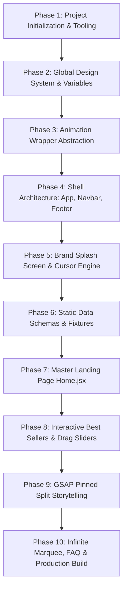

# Step-by-Step Rebuild Guide



---

## Phase 1: Project Scaffold & Dependency Manifest

### Rationale
We start with a fast, modern build tool using native ES Modules. Vite provides instant server start and lightning-fast Hot Module Replacement (HMR).

### Commands & Files
```bash
npm create vite@latest starbucks-redesign -- --template react
cd starbucks-redesign
npm install framer-motion gsap locomotive-scroll react-icons react-intersection-observer react-router-dom
```

### Key Configuration: `vite.config.js`
```javascript
import { defineConfig } from 'vite'
import react from '@vitejs/plugin-react'

// https://vitejs.dev/config/
export default defineConfig({
  plugins: [react()],
})
```
- Line 1: Imports `defineConfig` for TypeScript/IDE autocompletion.
- Line 2: Imports official React plugin for JSX compilation and Fast Refresh.
- Line 5: Exports Vite config activating the React plugin.

---

## Phase 2: Global Design System & Variables

### Rationale
Before assembling components, we establish CSS Custom Properties (variables) for the Starbucks House Green palette, font families, and reset default browser margins.

### Key File: `src/styles/main.css`
```css
:root {
  --primary-background: #162a25;
  --secondary-background: #1e3932;
  --highlight-background: #191919;
  --secondary-background-lighter: #26483f;
  --primary-color: #f7f7f7;
  --secondary-color: #ababab;
  --highlight-color: #00a76f;
  font-size: 23px;
}

body {
  position: relative;
  background: var(--primary-background);
  overflow-y: scroll;
  overflow-x: hidden;
}
```
- Line 1-10: Declares the brand tokens. `#162a25` is the deep emerald background; `#00a76f` is the vibrant green accent.
- Line 12-17: Configures the root `body` element to hide horizontal overflow while enabling vertical scrolling.

---

## Phase 3: Reusable Framer Motion Wrapper

### Rationale
Encapsulates `IntersectionObserver` with `framer-motion` variants so components can trigger directional scroll reveals without writing repetitive animation code.

### Key Snippet: `src/animation/FramerMotion.jsx`
```jsx
const [ref, inView] = useInView({
    triggerOnce: animateOnces,
    threshold: 0.5,
});
const mainControls = useAnimation();

useEffect(() => {
    if (inView) {
        mainControls.start("visible");
    } else if (!animateOnces) {
        mainControls.start("hidden");
    }
}, [inView, mainControls, animateOnces]);
```
- Line 1-4: Observes when an element crosses 50% into the viewport.
- Line 5: Instantiates the imperative animation controller.
- Line 7-13: Triggers the `"visible"` variant when `inView` turns true.

---

## Phase 4: Follower Cursor & Splash Screen

### Rationale
Add the high-engagement interactive elements early to test coordinate tracking and overlay dismissal.

### Key Snippet: `src/components/Cursor.jsx`
```javascript
const onMouseMove = (event) => {
    const { clientX, clientY } = event;
    gsap.to(cursor, { x: clientX, y: clientY })
}

const onMouseEnter = (e, text) => {
    const tag = e.target
    if (tag.classList.contains("allow_hover")) {
        cursorTxt.innerHTML = text
        gsap.to(cursor, { scale: 2.5 })
        cursorTxt.style.display = "flex"
    }
}
```
- Line 1-4: Interpolates cursor coordinates using GSAP on mouse move.
- Line 6-12: Sniffs hover target for `.allow_hover`, expands scale to `2.5`, and renders contextual label.

---

## Phase 5: Pinned Storytelling Split-Frame

### Rationale
Integrates GSAP ScrollTrigger to coordinate the central desktop brand storytelling experience.

### Key Snippet: `src/pages/Home.jsx`
```javascript
useEffect(() => {
    const ctx = gsap.context(() => {
        ScrollTrigger.create({
            trigger: contentRef.current,
            start: "top top",
            end: "bottom bottom",
            pin: frameRef.current,
            scrub: true
        })
    })
    return () => ctx.revert()
}, [])
```
- Line 2: Opens a scoped `gsap.context()`.
- Line 3-9: Pins `frameRef.current` while `contentRef.current` scrolls from top to bottom with continuous scrub.
- Line 11: Reverts all ScrollTrigger instances and styles when the component unmounts.
