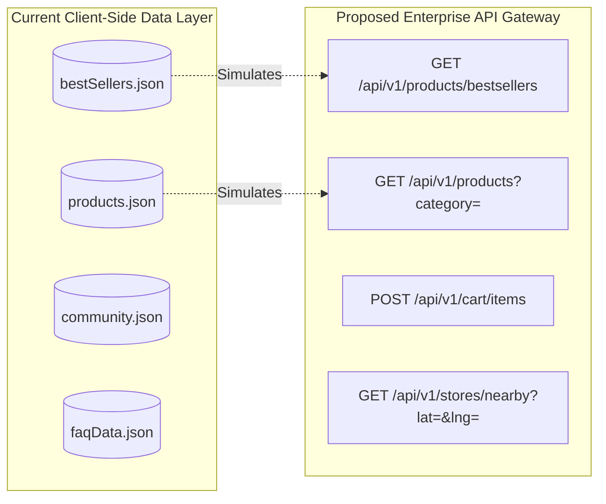

# API Reference & Data Contracts



---

## 1. Project Type Context (Track B Adaptation)

> **Notice**: As verified in [00. Project Type & Pre-Check](./00-project-type.md), this application is a **Track B (Frontend-Only Single Page Application)**. It does **not** expose or consume a live server-side REST API in its current codebase.
>
> Below, we provide:
> 1. Complete schemas and data contracts for all **static JSON datasets** currently bundled with the frontend.
> 2. Complete endpoint specifications for **external Cloudinary and third-party CDNs**.
> 3. An enterprise-grade **Proposed REST API Specification** designed for full-stack production scaling.

---

## 2. Bundled Static JSON Data Contracts

### 2.1 Best Sellers (`src/json/bestSellers.json`)
- **Total Records**: 6 items
- **Schema**:
```typescript
interface BestSellerItem {
  name: string;        // Beverage title (e.g., "Java Chip Frappuccino")
  image: string;       // Public HTTPS URL to high-res Cloudinary graphic
  price: number;       // Integer unit price in Indian Rupees (INR)
}
```
- **Sample Payload**:
```json
[
  {
    "name": "Java Chip Frappuccino",
    "image": "https://res.cloudinary.com/dvk80x6fi/image/upload/v1720329633/cup-1_transparent_Craiyon_oddwqr.png",
    "price": 380
  },
  {
    "name": "Caffe Americano",
    "image": "https://res.cloudinary.com/dvk80x6fi/image/upload/v1720959889/image_transparent_Craiyon_7_zpbwaf.png",
    "price": 270
  }
]
```

### 2.2 Products Catalog (`src/json/products.json`)
- **Total Records**: 12 items
- **Schema**:
```typescript
interface ProductItem {
  id: number;          // Unique sequential product identifier
  name: string;        // Product name
  image: string;       // Cloudinary beverage graphic URL
  price: number;       // Unit price in INR
}
```

### 2.3 Community Social Proof (`src/json/community.json`)
- **Total Records**: 20 items
- **Schema**:
```typescript
interface CommunityPost {
  image: string;       // HTTPS URL to square customer moment photo
}
```

### 2.4 FAQ Dataset (`src/json/faqData.json`)
- **Total Records**: 5 items
- **Schema**:
```typescript
interface FAQItem {
  question: string;    // Inquiring customer question
  answer: string;      // Official Starbucks brand policy answer
}
```

---

## 3. External CDN & Media Endpoints

| Endpoint Host | URL Pattern | Media Format | Cache Policy | Authentication |
| :--- | :--- | :--- | :--- | :--- |
| **Cloudinary** | `https://res.cloudinary.com/dvk80x6fi/image/upload/v.../*.png` | PNG / Transparent | Immutable / Cloudflare CDN edge cached | Public |
| **Cognizant OrderServ** | `https://starbucksstatic.cognizantorderserv.com/Category/Small/*.jpg` | JPEG | Static Edge Cached | Public |
| **Google Fonts** | `https://fonts.googleapis.com/css2?family=Roboto...` | CSS / WOFF2 | Cache-Control: max-age=31536000 | Public |

---

## 4. Proposed Production Backend API Specification

If backed by a Node/Express microservice architecture, the client components would consume the following REST endpoints:

### Endpoint: `GET /api/v1/products/bestsellers`
- **Purpose**: Fetch curated top-selling beverages for the interactive showcase.
- **Headers**: `Accept: application/json`
- **Response `200 OK`**:
```json
{
  "status": "success",
  "data": {
    "items": [
      {
        "id": "prod_01",
        "name": "Java Chip Frappuccino",
        "price": 380,
        "currency": "INR",
        "imageUrl": "https://cdn.starbucks.com/drinks/java-chip.webp"
      }
    ]
  }
}
```

### Endpoint: `POST /api/v1/cart/items`
- **Purpose**: Add selected beverage from `Home.jsx` to customer's active shopping session.
- **Request Body**:
```json
{
  "productId": "prod_01",
  "quantity": 1,
  "size": "Grande",
  "customizations": {
    "milk": "Oat Milk",
    "syrupPumps": 2
  }
}
```
- **Response `201 Created`**:
```json
{
  "status": "success",
  "data": {
    "cartId": "cart_9876",
    "itemCount": 1,
    "subtotal": 380
  }
}
```
