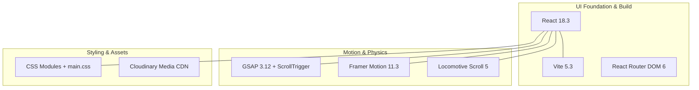

# Comprehensive Technology Choice Comparisons

---

## 1. UI Framework: React 18

### 1.1 What I Used
- **Detected**: `react@^18.3.1` and `react-dom@^18.3.1` in [`package.json:16-17`](file:///Users/avishjain/avishjain9-repos/50-starbugs-frontend-copy/StarbucksFrontend-Clean-Project/package.json#L16-L17), mounted via `ReactDOM.createRoot` in [`src/main.jsx:7`](file:///Users/avishjain/avishjain9-repos/50-starbugs-frontend-copy/StarbucksFrontend-Clean-Project/src/main.jsx#L7).

### 1.2 What It Does in This Project
Provides declarative component hierarchy, concurrent root hydration, state management hooks (`useState`, `useEffect`, `useRef`), and seamless DOM reconciliation across complex interactive sections.

### 1.3 Comparison Table
| Feature / Factor | React 18 (Used) | Vue 3 | Svelte 4 / 5 | Angular 17 | Solid.js | Vanilla JavaScript |
| :--- | :--- | :--- | :--- | :--- | :--- | :--- |
| **Reconciliation** | Concurrent Virtual DOM | Proxy-based Virtual DOM | Compiler-generated code (No VDOM) | Incremental DOM + Zones | Fine-grained reactive DOM | Manual imperative DOM mutations |
| **Animation Ecosystem** | Unmatched (GSAP, Framer Motion, Three.js) | Strong (Vue Transition, GSAP) | Good (built-in motion) | Moderate (Angular Animations) | Emerging | Manual `requestAnimationFrame` |
| **State Paradigm** | Unidirectional Hooks | Mutable reactive refs | Svelte Stores / Runes | RxJS Signals & Observables | Fine-grained Signals | Manual Event Bus |
| **Ecosystem Size** | Massive (#1 worldwide) | Large | Growing | Enterprise heavy | Small | Universal |
| **Bundle Overhead** | ~42 KB gzip | ~34 KB gzip | ~2 KB gzip | ~120 KB gzip | ~7 KB gzip | 0 KB |

### 1.4 Why I Used This [CONFIRM WITH DEVELOPER]
React 18 provides the industry's most robust animation ecosystem, allowing seamless integration with GSAP ScrollTrigger and Framer Motion while maintaining full architectural modularity.

### 1.5 Why I Did NOT Use Each Alternative
- **Vue 3**: Lacks a first-class equivalent to Framer Motion's declarative layout transitions.
- **Svelte**: Smaller third-party library support for pre-built Starbucks UI primitives and icons.
- **Angular**: Excessive enterprise boilerplate and heavy initial bundle size for a consumer UI redesign.
- **Solid.js**: Community ecosystem around GSAP timeline hooks is significantly smaller than React's.
- **Vanilla JS**: Managing state across best seller tabs, accordion heights, and cursor hovers would devolve into fragile imperative spaghetti code.

### 1.6 Benefits & Trade-offs
- **Benefits**: Component encapsulation, declarative props, and robust lifecycle hooks (`useEffect`, `useRef`).
- **Trade-offs**: Virtual DOM overhead and potential re-render jank if hooks are not memoized.

### 1.7 30-Second Interview Answer
> "I chose React 18 because it combines enterprise-grade component modularity with the most mature animation ecosystem in frontend engineering. While libraries like Svelte offer smaller bundles, React's rich ecosystem made it effortless to combine GSAP ScrollTrigger with Framer Motion, letting me build complex physics-based UI micro-interactions without reinventing basic lifecycle primitives."

---

## 2. Bundler & Dev Tooling: Vite 5

### 2.1 What I Used
- **Detected**: `vite@^5.3.1` in [`package.json:30`](file:///Users/avishjain/avishjain9-repos/50-starbugs-frontend-copy/StarbucksFrontend-Clean-Project/package.json#L30) with `vite.config.js`.

### 2.2 What It Does in This Project
Provides an instantaneous development server leveraging native browser ES Modules, lightning-fast Fast Refresh (HMR), and automated Rollup production chunking.

### 2.3 Comparison Table
| Factor | Vite 5 (Used) | Webpack 5 | Turbopack | Parcel 2 | Rollup CLI |
| :--- | :--- | :--- | :--- | :--- | :--- |
| **Dev Server Start** | Instant (<300ms, ESM based) | Slow (bundles everything upfront) | Instant (Rust based) | Fast | Manual setup |
| **HMR Latency** | Sub-50ms regardless of app size | Increases linearly with file count | Sub-30ms | Fast | Manual |
| **Configuration** | Minimal zero-config | Complex multi-page config | Next.js tight coupling | Zero config | Verbose |
| **Production Bundler** | Rollup (highly optimized tree-shaking) | Webpack compiler | Custom engine | SWC based | Rollup |

### 2.4 Why I Used This [CONFIRM WITH DEVELOPER]
Vite eliminates bundler lag during development, enabling rapid visual iteration when fine-tuning delicate GSAP timings and CSS module styling.

### 2.5 Why I Did NOT Use Each Alternative
- **Webpack 5**: Requires verbose loader configurations (babel-loader, css-loader, style-loader) and suffers from sluggish dev startup.
- **Turbopack**: Tightly coupled to Next.js; independent SPA support was not yet stable.
- **Parcel**: Obscure configuration overrides when handling complex third-party ESM dependencies like Locomotive Scroll.

### 2.6 30-Second Interview Answer
> "I chose Vite 5 over Webpack because of its native ES Module development architecture. Instead of bundling the entire project into memory before serving, Vite serves source files over native browser ESM, giving us sub-300 millisecond cold starts and instantaneous Hot Module Replacement. For production, it leverages Rollup to produce clean, tree-shaken static assets."

---

## 3. Timeline & Sticky Scroll Animation: GSAP 3.12 + ScrollTrigger

### 3.1 What I Used
- **Detected**: `gsap@^3.12.5` in [`package.json:14`](file:///Users/avishjain/avishjain9-repos/50-starbugs-frontend-copy/StarbucksFrontend-Clean-Project/package.json#L14) used in [`src/pages/Home.jsx:55-156`](file:///Users/avishjain/avishjain9-repos/50-starbugs-frontend-copy/StarbucksFrontend-Clean-Project/src/pages/Home.jsx#L55-L156) and [`src/components/Cursor.jsx:17`](file:///Users/avishjain/avishjain9-repos/50-starbugs-frontend-copy/StarbucksFrontend-Clean-Project/src/components/Cursor.jsx#L17).

### 3.2 What It Does in This Project
Coordinates the desktop sticky split-frame pinning (`pin: true`), headline scrubbed opacity crossfades, and smooth cursor coordinate interpolation.

### 3.3 Comparison Table
| Factor | GSAP 3 + ScrollTrigger (Used) | Framer Motion Scroll | Native CSS Scroll-Driven | Anime.js |
| :--- | :--- | :--- | :--- | :--- |
| **Pinning Engine** | Sub-pixel pin spacing calculation | Basic sticky CSS wrapper | No pinning support | None |
| **Scrub Accuracy** | Smooth sub-frame timeline scrub | Good | Browser timeline | Manual scroll listener |
| **Cleanup Abstraction** | `gsap.context()` with `ctx.revert()` | React component lifecycle | Automatic | Manual removal |
| **Browser Support** | All modern & legacy browsers | React only | Chrome/Edge only (Incomplete) | Broad |

### 3.4 Why I Used This [CONFIRM WITH DEVELOPER]
GSAP ScrollTrigger is the gold standard for pinned scroll interactions. It handles pin-spacing and scroll position math without manual offset calculations.

### 3.5 Why I Did NOT Use Each Alternative
- **CSS Scroll-Driven Animations**: Still experimental in Firefox and Safari; cannot perform viewport pinning.
- **Framer Motion Scroll**: Excellent for basic reveals, but lacks precise multi-layer pinning and scrubbing capabilities.
- **Anime.js**: Lacks a dedicated scroll-scrubbing plugin; requires manual calculation of scroll offsets.

### 3.6 30-Second Interview Answer
> "I selected GSAP 3 and ScrollTrigger for our desktop storytelling section because no other library matches GSAP's precision with sticky viewport pinning. It dynamically computes pin-spacing and synchronizes timeline scrubs with sub-pixel accuracy. Furthermore, GSAP's `context` API guarantees that all timeline mutations and pin styles are cleanly reverted when unmounting."

---

## 4. Declarative Component Animations: Framer Motion 11

### 4.1 What I Used
- **Detected**: `framer-motion@^11.3.6` in [`package.json:13`](file:///Users/avishjain/avishjain9-repos/50-starbugs-frontend-copy/StarbucksFrontend-Clean-Project/package.json#L13) encapsulated in [`src/animation/FramerMotion.jsx`](file:///Users/avishjain/avishjain9-repos/50-starbugs-frontend-copy/StarbucksFrontend-Clean-Project/src/animation/FramerMotion.jsx).

### 4.2 What It Does in This Project
Drives directional entrance animations across titles, mobile split-feature cards, and best seller tabs.

### 4.3 Comparison Table
| Factor | Framer Motion (Used) | React Spring | Pure CSS `@keyframes` |
| :--- | :--- | :--- | :--- |
| **Syntax Style** | Declarative JSX variants | Physics hooks (`useSpring`) | Imperative stylesheets |
| **Interruptibility** | Automatic spring physics handoff | Physics based | Abrupt snap or reset |
| **Viewport Triggers** | Built-in / Intersection Observer | Manual setup | Manual class toggling |

### 4.4 30-Second Interview Answer
> "While GSAP handled our complex pinned timelines, I chose Framer Motion for component-level UI transitions. Its declarative variant syntax allows us to trigger directional slide-ins and scale effects with simple props, keeping our React component code readable and clean."

---

## 5. Smooth Scroll Engine: Locomotive Scroll 5

### 5.1 What I Used
- **Detected**: `locomotive-scroll@^5.0.0-beta.13` in [`package.json:15`](file:///Users/avishjain/avishjain9-repos/50-starbugs-frontend-copy/StarbucksFrontend-Clean-Project/package.json#L15).

### 5.2 What It Does in This Project
Provides smooth inertial scrolling with speed multipliers (`data-scroll-speed`) across hero transparent beverage layers.

### 5.3 Comparison Table
| Factor | Locomotive Scroll 5 (Used) | Studio Freight Lenis | Native CSS `scroll-behavior: smooth` |
| :--- | :--- | :--- | :--- |
| **Parallax Engine** | Built-in `data-scroll-speed` tags | Requires external GSAP bridge | None |
| **Scroll Hijacking** | Virtual smooth scroll | Normalized native scroll | Native browser scroll |
| **Setup Overhead** | Requires wrapper & CSS stylesheet | Minimal script | Single CSS line |

### 5.4 30-Second Interview Answer
> "I used Locomotive Scroll 5 because of its out-of-the-box data-attribute parallax support. By simply declaring `data-scroll-speed` on our transparent coffee graphics, the engine automatically calculates differential velocities without writing repetitive scroll math."

---

## 6. Styling: CSS Modules (`*.module.css`) + Global CSS

### 6.1 What I Used
- **Detected**: CSS Modules across all components (`Home.module.css`, `Navbar.module.css`, `Intro.module.css`, `Footer.module.css`, `ProductBox.module.css`, `FAQBox.module.css`) and global variables in [`main.css`](file:///Users/avishjain/avishjain9-repos/50-starbugs-frontend-copy/StarbucksFrontend-Clean-Project/src/styles/main.css).

### 6.2 What It Does in This Project
Provides local class scoping to prevent CSS name collisions while defining brand-wide design tokens on `:root`.

### 6.3 Comparison Table
| Factor | CSS Modules (Used) | Tailwind CSS | Styled Components (CSS-in-JS) |
| :--- | :--- | :--- | :--- |
| **Runtime Overhead** | Zero (compiled at build) | Zero (compiled at build) | Runtime JS style injection |
| **Class Scoping** | Hash-based automated scoping | Utility classes | Dynamic class names |
| **Separation of Concerns** | Clean JSX markup | Cluttered inline classes | Blended JS/CSS |

### 6.4 30-Second Interview Answer
> "I chose CSS Modules because they give us local scoping and zero runtime performance penalty. Class names are compiled into unique hashes during the Vite build, ensuring that styles never bleed between components while keeping our JSX clean of utility clutter."
