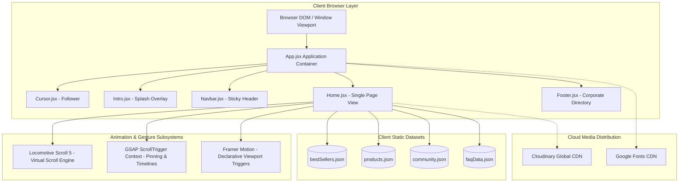
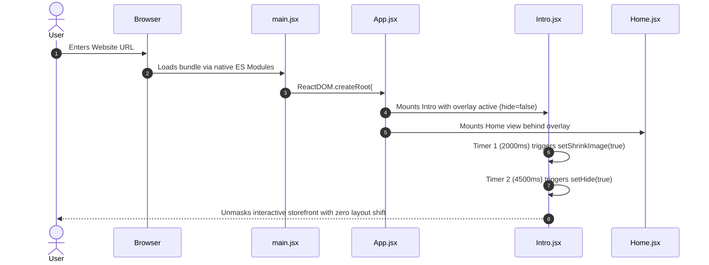
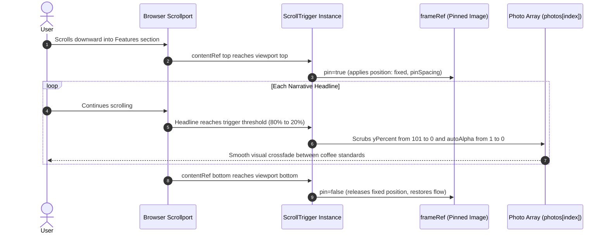
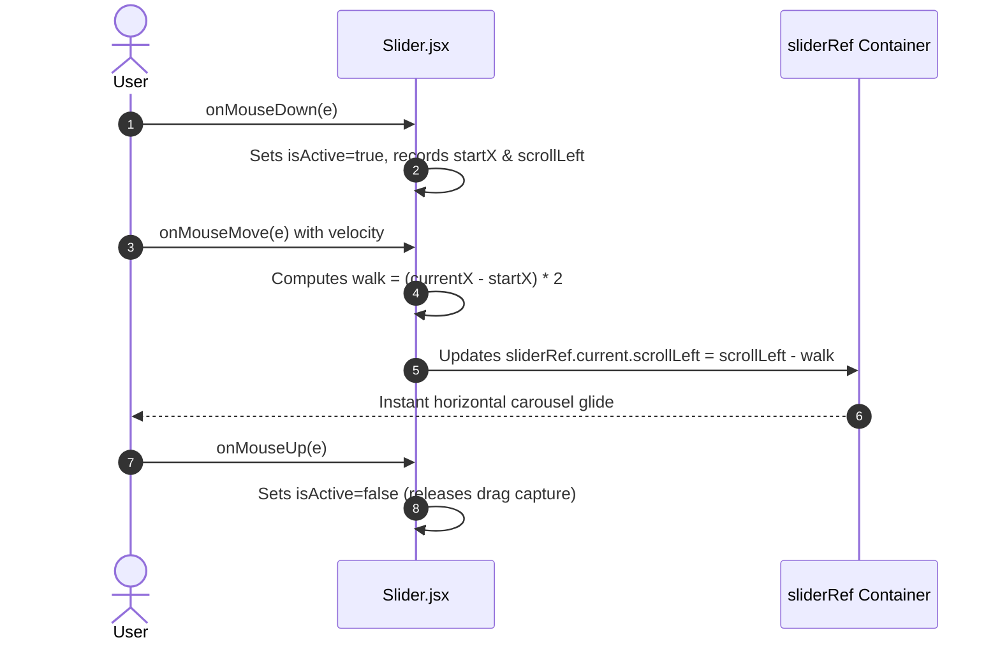
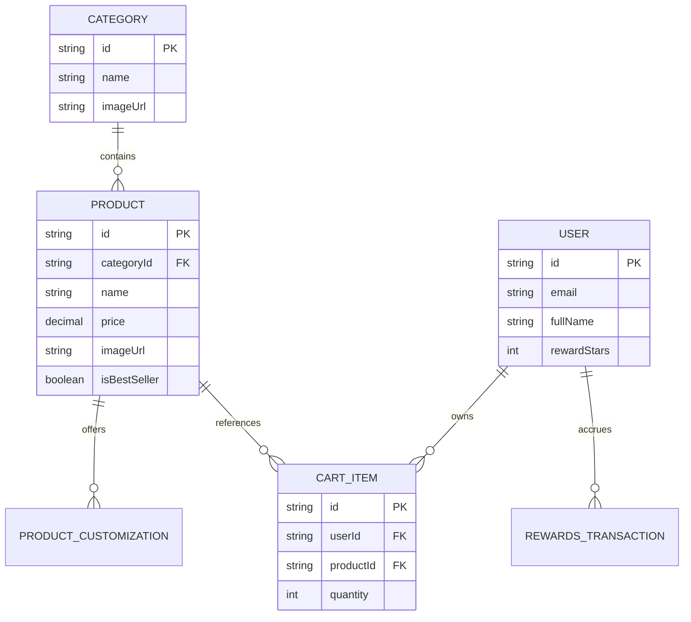

# Architecture, Data Flow & System Topology

---

## 1. High-Level Architecture Overview

The Starbucks Frontend Redesign is architected as an **Interactive Client-Side Single Page Application (SPA)** built with React 18 and Vite. It decouples the visual experience from traditional server-side rendering (SSR), offloading high-complexity animation and layout calculations directly to the client's GPU and JavaScript engine.

### Architectural Tiers:
1. **Presentation Layer**: Functional React components split into `layout/` (structural shells), `components/` (reusable UI atoms), and `pages/` (composition views).
2. **State & Gesture Engine**: React `useState` for local UI state, combined with imperative event listeners for mouse drag velocity and coordinate following.
3. **Motion & Pipeline Orchestration**:
   - **Locomotive Scroll**: Virtual scroll interceptor providing linear interpolation (`lerp: 0.1`) and multi-speed parallax.
   - **GSAP ScrollTrigger**: Viewport pin engine and sub-pixel scrub coordinator encapsulated inside `gsap.context()`.
   - **Framer Motion**: Viewport intersection observer triggering directional card and title entrances.
4. **Data Layer**: Local static JSON fixtures serving structured catalog, FAQ, and social media records.

---

## 2. Request & Rendering Lifecycles

### Lifecycle 1: Initial Page Hydration & Splash Dismissal

---

### Lifecycle 2: GSAP Sticky Pinning & Timeline Scrubbing

---

### Lifecycle 3: Mouse-Velocity Drag-to-Scroll

---

## 3. Proposed Enterprise Data Models & ER Diagram

In a full-stack deployment, the static JSON structures would migrate to an enterprise relational/document database:

---

## 4. Scaling to 100x Traffic & Bottleneck Analysis

| Bottleneck Rank | System Component | Failure Mode at 100x Load | Mitigation Strategy |
| :--- | :--- | :--- | :--- |
| **1** | **Asset Delivery (Cloudinary)** | Direct image hits exceed CDN egress bandwidth budgets, incurring high cloud costs. | Route image requests through a dedicated Cloudflare Edge Cache tier with aggressive `Cache-Control: public, max-age=31536000, immutable`. |
| **2** | **Client Animation Jank on Mobile** | Running Locomotive Scroll alongside GSAP ScrollTrigger on low-end mobile devices exhausts GPU memory and causes dropped frames. | Enforce feature detection: automatically disable Locomotive Scroll on mobile devices and fall back to native CSS smooth scrolling (`scroll-behavior: smooth`). |
| **3** | **Unbundled JSON Payloads** | Loading large static catalogs inside client bundles increases initial JavaScript parse and compile times (harming INP and LCP). | Migrate catalog fetching to lazy-loaded REST endpoints backed by Redis caches and Edge API routes. |
