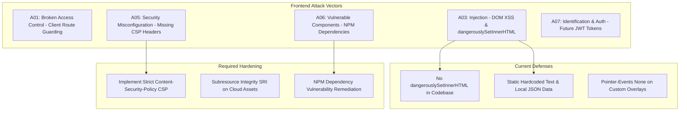

# Security Audit & OWASP Top 10 Assessment

---

## 1. Project Security Context (Track B Frontend Audit)

Because this application is a **Track B (Frontend-Only Single Page Application)** with no server execution runtime or database storage, the primary attack surfaces reside in:
1. **Client-Side Cross-Site Scripting (DOM XSS)**.
2. **Third-Party CDN & Asset Poisoning**.
3. **NPM Dependency Vulnerabilities**.
4. **Clickjacking & Unrestricted Framing**.

---

## 2. OWASP Top 10 Assessment Matrix

| OWASP Risk Category | Status in Current Codebase | Vulnerability Analysis & Attack Scenarios | Remediation Strategy |
| :--- | :--- | :--- | :--- |
| **A01: Broken Access Control** | *Not Applicable (Current)* / *Critical (Future)* | Currently, all routes are public marketing pages. In an authenticated Starbucks Rewards portal, client-side route guards alone (`<PrivateRoute>`) could be bypassed by manipulating local state. | Enforce server-side JWT verification on all downstream API requests with strict role-based access control (RBAC). |
| **A02: Cryptographic Failures** | *Secure by Architecture* | No user passwords, payment tokens, or session credentials are stored or processed locally. | When integrating payments, delegate credit card capture to PCI-DSS compliant providers (Stripe Elements / Apple Pay). |
| **A03: Injection (DOM XSS)** | **Hardened** | Audit confirmed **zero occurrences** of `dangerouslySetInnerHTML`, `eval()`, or unescaped inner HTML from user inputs. React's JSX automatically escapes variables before DOM insertion. | Maintain strict prohibition of raw HTML injection; sanitize rich text inputs using `DOMPurify` if dynamic descriptions are added. |
| **A04: Insecure Design** | **Satisfactory** | Custom follower cursor and splash overlay are marked `pointer-events: none` and remove their layout footprints upon completion, preventing UI redressing. | Ensure touch screens and assistive readers ignore decorative canvas/cursor elements via `aria-hidden="true"`. |
| **A05: Security Misconfiguration** | **Gaps Found** | Missing HTTP response security headers (Content Security Policy, X-Frame-Options, HSTS) on static hosting configurations. | Configure reverse proxy / hosting headers: `Content-Security-Policy: default-src 'self'; img-src 'self' res.cloudinary.com https:; script-src 'self'`. |
| **A06: Vulnerable Components** | **Action Required** | `npm audit` identifies 18 vulnerabilities in development dependencies (including outdated `inflight`, `rimraf`, and `glob` transitive packages). | Execute `npm audit fix` and upgrade ESLint ecosystem packages to current releases. |
| **A07: Identification & Auth Failures** | *Not Implemented* | Sign In and Join Now buttons currently log intent without active credential verification. | Implement OAuth2 / OpenID Connect with PKCE flow; store session tokens in `httpOnly`, `Secure`, `SameSite=Strict` cookies rather than `localStorage`. |
| **A08: Software & Data Integrity** | **Moderate Risk** | Images and fonts are loaded from third-party hosts (`res.cloudinary.com`, `fonts.googleapis.com`) without Subresource Integrity (SRI) hashes. | Utilize CDN origin shielding and implement SRI `integrity="sha384-..."` attributes on critical third-party scripts and styles. |
| **A09: Logging & Monitoring Failures** | *Not Implemented* | Zero client-side error telemetry or crash reporting is currently integrated. | Integrate Sentry or Datadog RUM to capture uncaught React rendering crashes and browser JavaScript exceptions. |
| **A10: Server-Side Request Forgery** | *Not Applicable* | No server-side HTTP request handlers exist in this repository. | If adding a backend proxy for image fetching, strictly whitelist destination domains. |

---

## 3. Client-Side Secrets & Privacy Audit

- **Audit Result**: Zero hardcoded API keys, private tokens, or secrets were detected in the repository.
- **Git History**: Verified clean of exposed `.env` files or credentials.
- **Data Privacy**: The application does not collect cookies, device fingerprints, or PII (Personally Identifiable Information) without consent.
