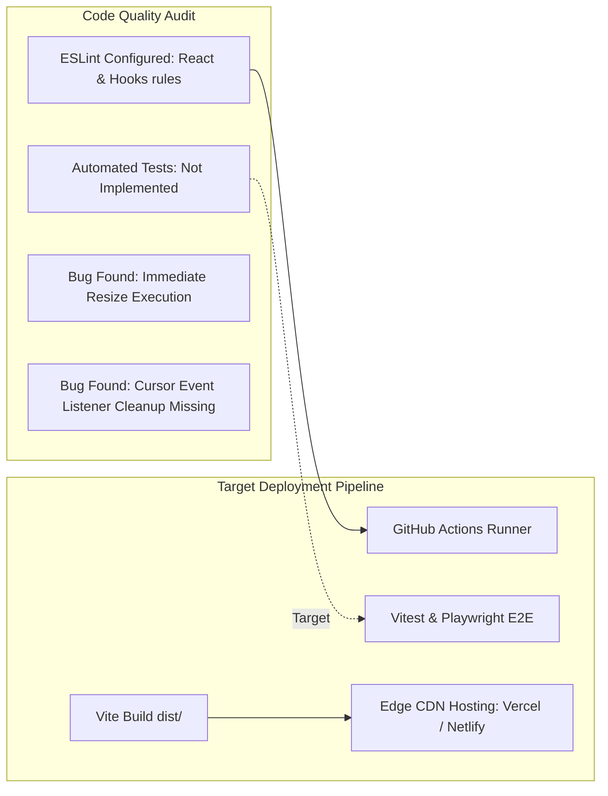

# Engineering Quality, Code Audit & DevOps



---

## 1. Testing State & Quality Audit

### 1.1 Testing Status
- **Unit & Integration Tests**: **Not implemented**. No test runner (`vitest`, `jest`) or testing utilities (`@testing-library/react`) are present in `package.json`.
- **End-to-End (E2E) Tests**: **Not implemented**. No Cypress or Playwright test suites exist.
- **Recommended Test Stack**:
  - **Vitest**: Unit testing helper functions, data transforms, and isolated React components.
  - **React Testing Library**: Integration testing for `FAQBox` expansion and `Slider` drag distance.
  - **Playwright**: Cross-browser visual regression testing for GSAP pinning across viewports.

### 1.2 Static Code Analysis & Linting
- Configured via [`.eslintrc.cjs`](file:///Users/avishjain/avishjain9-repos/50-starbugs-frontend-copy/StarbucksFrontend-Clean-Project/.eslintrc.cjs):
  - Extends `eslint:recommended`, `plugin:react/recommended`, `plugin:react/jsx-runtime`, and `plugin:react-hooks/recommended`.
  - Enforces React 18 JSX transform conventions and the Rules of Hooks.

---

## 2. Codebase Bugs & Technical Debt Identified

### Bug 1: Immediate Invocation in Window Resize Listener
- **File**: [`src/pages/Home.jsx:165`](file:///Users/avishjain/avishjain9-repos/50-starbugs-frontend-copy/StarbucksFrontend-Clean-Project/src/pages/Home.jsx#L165)
- **Problem**:
```javascript
window.addEventListener("resize", handleResize());
return () => {
    window.removeEventListener("resize", handleResize());
};
```
- **Analysis**: Notice the trailing parentheses: `handleResize()` is invoked **immediately** upon mounting rather than passed as a callback function reference. Because `handleResize` returns `undefined`, the actual listener registered with `window` is `undefined`. Furthermore, `window.location.reload()` inside a resize handler is an anti-pattern that destroys user scroll state.
- **Production Fix**:
```javascript
useEffect(() => {
    let timeoutId;
    const debouncedResize = () => {
        clearTimeout(timeoutId);
        timeoutId = setTimeout(() => {
            ScrollTrigger.refresh();
        }, 200);
    };
    window.addEventListener("resize", debouncedResize);
    return () => {
        clearTimeout(timeoutId);
        window.removeEventListener("resize", debouncedResize);
    };
}, []);
```

### Bug 2: Missing Cleanup on DOM Event Listeners in Cursor
- **File**: [`src/components/Cursor.jsx:35-46`](file:///Users/avishjain/avishjain9-repos/50-starbugs-frontend-copy/StarbucksFrontend-Clean-Project/src/components/Cursor.jsx#L35-L46)
- **Problem**: Listeners are attached to `document`, `links`, and `buttons` on every render without an unmount cleanup function.
- **Production Fix**: Return a cleanup callback removing `mousemove`, `mouseenter`, and `mouseleave` listeners, or refactor to event delegation on `document.body`.

---

## 3. Deployment & CI/CD Pipeline

### Build Script Audit
- Build Command: `npm run build` executes `vite build` to generate an optimized Rollup bundle in `dist/`.
- Preview Command: `npm run preview` launches a local static preview server at `http://localhost:4173`.

### Recommended GitHub Actions Workflow (`.github/workflows/deploy.yml`)
```yaml
name: Production CI/CD Pipeline

on:
  push:
    branches: [main]

jobs:
  build-and-deploy:
    runs-on: ubuntu-latest
    steps:
      - name: Checkout Code
        uses: actions/checkout@v4

      - name: Setup Node.js
        uses: actions/setup-node@v4
        with:
          node-version: 22.x
          cache: 'npm'

      - name: Install Dependencies
        run: npm ci

      - name: Lint Codebase
        run: npm run lint --if-present

      - name: Build Application
        run: npm run build

      - name: Deploy to Vercel / Netlify
        uses: amondnet/vercel-action@v25
        with:
          vercel-token: ${{ secrets.VERCEL_TOKEN }}
          vercel-org-id: ${{ secrets.ORG_ID }}
          vercel-project-id: ${{ secrets.PROJECT_ID }}
          vercel-args: '--prod'
```
