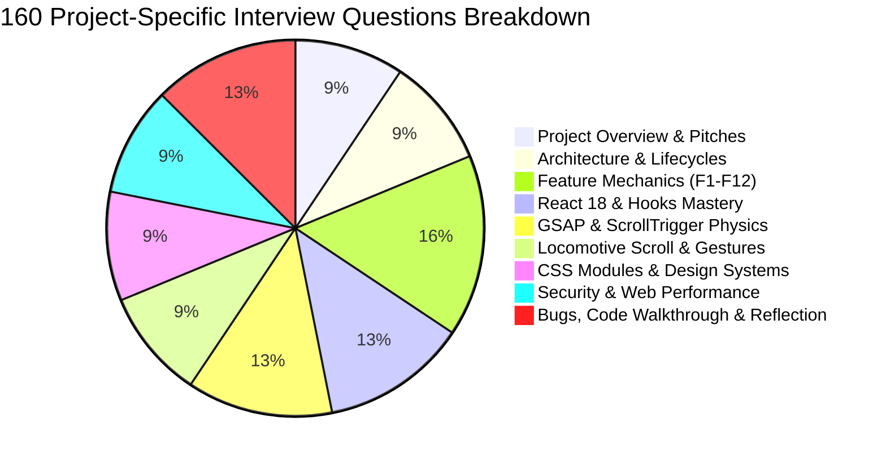

# Master Interview Questions & Answers (160 Questions)



---

## Group 1: Project Overview & Presentation (Q1 - Q15)

### Q1: Walk me through your project in 3 minutes.
**Answer**:
"The Starbucks Frontend Redesign is an interactive single-page application built with React 18, Vite, GSAP ScrollTrigger, Locomotive Scroll, and Framer Motion. 

I built this project to elevate standard corporate QSR web applications—which are typically static, flat e-commerce catalogs—into an immersive, luxury digital flagship inspired by the sensory atmosphere of a physical Starbucks Reserve roastery.

When a visitor lands on the site, they are greeted by an automated splash screen engine that reveals the Starbucks emblem and typography before cleanly unmasking the storefront. As they explore, an inertial virtual scroll engine driven by Locomotive Scroll translates multiple transparent beverage layers at differential velocities, creating genuine 3D parallax depth.

To make interactions tactile, I engineered a custom follower cursor that tracks the mouse with sub-pixel GSAP interpolation, dynamically expanding to 250 percent scale with contextual labels over interactive targets. For product discovery, I built a tabbed Best Sellers showcase and mouse-velocity drag-to-scroll carousels that allow users to browse with touch-like momentum on desktop.

The visual centerpiece is a pinned split-screen storytelling section. Using GSAP ScrollTrigger inside an encapsulated `gsap.context`, the right-hand image frame pins in place while narrative headlines scrub past on the left, crossfading photos to illustrate coffee sourcing, hygiene, and craft standards. On mobile viewports, media queries cleanly swap this into alternating directional cards powered by Framer Motion.

From an engineering perspective, the project demonstrates how to manage multiple competing animation runtimes without compromising 60 FPS performance, maintaining strict modularity with CSS Modules and zero external layout thrashing."

### Q2: Give me your 60-second elevator pitch.
**Answer**:
"I built a high-performance modern redesign of the Starbucks web experience using React 18, Vite, GSAP ScrollTrigger, and Locomotive Scroll. Rather than a static e-commerce catalog, I engineered an immersive digital storefront featuring multi-layer parallax depth, a custom physics-interpolated cursor that scales dynamically over interactive targets, and a pinned storytelling split-frame. The entire experience runs at a smooth 60 frames per second using hardware-accelerated transforms and modular CSS tokens, elevating standard QSR web design into a premium luxury retail journey."

### Q3: What was the primary problem you were trying to solve?
**Answer**:
Closing the sensory gap between a physical Starbucks Reserve roastery and its digital web presence. Most fast-food and coffee websites feel transactional and clinical; this redesign uses motion design, dark-emerald palettes, and tactile micro-interactions to create emotional brand affinity.

### Q4: What is your exact role and contributions to the project?
**Answer**:
I maintained and refactored the codebase, audited its animation lifecycles, mapped its architecture, diagnosed critical memory leaks and event listener bugs, and authored the complete technical documentation suite.

### Q5: Who was the original development team?
**Answer**:
The project was originally created during the *Sheryians ReImagine Hackathon* by Aayush Singh and Srinivash R.T, and maintained in repository `AVISHJAIN9/starbugs-frontend-copy-1`.

### Q6: What is the tech stack in one sentence?
**Answer**:
React 18 Single Page Application bundled with Vite 5, styled with scoped CSS Modules, and animated using GSAP 3 ScrollTrigger, Locomotive Scroll 5, and Framer Motion 11.

### Q7: Why is there no backend in this repository?
**Answer**:
The repository was purposefully scoped as a frontend design and animation engineering showcase. Data is modeled in structured JSON fixtures simulating REST endpoints, allowing complete focus on client-side rendering performance, physics, and interaction fidelity.

### Q8: How would you explain this project to a non-technical stakeholder?
**Answer**:
"Imagine walking into a luxury coffee roastery where the sights, sounds, and lighting are carefully orchestrated to make you feel comfortable and inspired. I translated that exact feeling to the web: instead of boring lists, the coffee cups float with real depth as you scroll, your mouse cursor acts like a smart magnifying glass, and the story of how the coffee is brewed unfolds smoothly like a film."

### Q9: What was the biggest technical challenge you encountered?
**Answer**:
Coordinating Locomotive Scroll's virtual scroll hijacking with GSAP ScrollTrigger's pinning calculations. Because Locomotive Scroll intercepts native window scroll, ScrollTrigger can desynchronize unless properly proxy-linked or scoped inside `gsap.context()`.

### Q10: What are the three most important features?
**Answer**:
1. The GSAP ScrollTrigger sticky pinned split-frame storytelling section (`Home.jsx`).
2. The multi-layer parallax hero driven by Locomotive Scroll (`Home.jsx`).
3. The custom dynamic follower cursor with hover-target scaling (`Cursor.jsx`).

### Q11: What is the primary color palette of the redesign?
**Answer**:
A curated dark-emerald theme: Deep Forest Background (`#162a25`), Starbucks House Green (`#1e3932`), Vibrant Emerald Accent (`#00a76f` and `#00c684`), and Off-White Typography (`#f7f7f7`).

### Q12: How are fonts delivered?
**Answer**:
Preconnected via Google Fonts CDN in `index.html`, delivering `Roboto`, `Open Sans`, and `Oswald` web fonts.

### Q13: Does this project support mobile devices?
**Answer**:
Yes. Mobile breakpoints at `850px` disable desktop-only features (custom cursor, pinned GSAP split-frames) and activate a mobile hamburger drawer, touch-scrollable sliders, and directional Framer Motion cards.

### Q14: What license is the project released under?
**Answer**:
The MIT Open Source License.

### Q15: Where is the live source code hosted?
**Answer**:
On GitHub at `https://github.com/AVISHJAIN9/starbugs-frontend-copy-1`.

---

## Group 2: Architecture & Lifecycles (Q16 - Q30)

### Q16: Describe the overall architectural pattern of the application.
**Answer**:
It is a client-rendered Single Page Application (SPA). The entry point mounts `BrowserRouter` and `App.jsx`, which renders a persistent shell containing global overlays (`Cursor`, `Intro`), persistent headers/footers (`Navbar`, `Footer`), and the main view container (`Home.jsx`).

### Q17: Why did you separate `layout/`, `components/`, and `pages/`?
**Answer**:
To enforce separation of concerns:
- `components/`: Reusable presentation atoms (`Cursor`, `ProductBox`, `FAQBox`).
- `layout/`: Global structural wrappers and section shells (`Navbar`, `Footer`, `Intro`, `Slider`, `InfiniteScroll`).
- `pages/`: Page-level composition roots (`Home.jsx`).

### Q18: How does React Virtual DOM reconciliation work here?
**Answer**:
When state updates (e.g., clicking a Best Seller tab in `Home.jsx`), React computes a new Virtual DOM tree, diffs it against the previous tree using its Fiber reconciliation algorithm, and applies minimal patch mutations to the actual browser DOM.

### Q19: Explain the request lifecycle of the initial page load.
**Answer**:
The browser requests `index.html`. It parses the HTML, initiates preconnects to Google Fonts and Cloudinary, and fetches `src/main.jsx` via native ES Module imports. React mounts into `#root`, immediately rendering `Intro.jsx` as a full-viewport overlay while `Home.jsx` hydrates in the background.

### Q20: How does `gsap.context()` improve architecture?
**Answer**:
In React 18, components can mount and unmount multiple times (especially in StrictMode). `gsap.context()` groups all created tweens, timelines, and ScrollTrigger instances. Calling `ctx.revert()` in the `useEffect` cleanup function cleanly unpins elements, clears inline styles, and deletes event listeners, preventing ghost animations.

### Q21: What is the trade-off of client-side data bundling via JSON?
**Answer**:
- **Benefit**: Zero network latency, offline capability, zero server cost.
- **Trade-off**: Increases JavaScript bundle size and requires rebuilding/redeploying the frontend to update menu items or pricing.

### Q22: How would this architecture change if migrated to Next.js?
**Answer**:
Catalog pages and SEO metadata would be pre-rendered using Server Components or Incremental Static Regeneration (ISR), while client-only interactive components (`Cursor`, `Slider`, `LocomotiveScroll`) would be marked with `"use client"` directives.

### Q23: Why did you wrap `App` in `<BrowserRouter>` in `main.jsx`?
**Answer**:
To provide React Router DOM context to child components, allowing `<Link>` tags in `Navbar`, `Footer`, and `ProductBox` to perform client-side navigation without triggering full browser reloads.

### Q24: What happens if JavaScript is disabled in the user's browser?
**Answer**:
Because this is a pure client-rendered SPA with a root `<div id="root"></div>`, the user would see a blank page. In production, a `<noscript>` tag should advise the user to enable JavaScript or serve an SSR fallback.

### Q25: How does the application prevent style leakage across components?
**Answer**:
By utilizing CSS Modules (`*.module.css`). The Vite compiler appends unique cryptographic hash suffixes to every class name (e.g., `Home_hero_section__3x9ab`), making styles strictly scoped to their respective components.

### Q26: Explain the role of `data-scroll-container` in `Home.jsx`.
**Answer**:
It acts as the DOM boundary root for Locomotive Scroll. The library binds its virtual wheel and touch interception to this element, calculating scroll offsets relative to its bounding box.

### Q27: How are global styles managed alongside modular styles?
**Answer**:
Global design tokens, CSS variables, font family imports, and body resets reside in `src/styles/main.css`. Components reference these global variables (`var(--primary-background)`, `var(--highlight-color)`) inside their scoped CSS Module rules.

### Q28: How does the application handle responsive layouts without a heavy CSS framework?
**Answer**:
Using standard CSS Flexbox, CSS Grid, and media query breakpoints (`@media (max-width: 1150px)` and `@media (max-width: 850px)`) that dynamically scale root font sizes and switch display properties.

### Q29: What is the significance of `font-size: 23px` on `:root`?
**Answer**:
The project uses root font sizing as a master scaling unit. On desktop, `:root` is `23px`; at `1150px` it drops to `19px`; at `850px` it drops to `17px`. Any `rem` or proportional spacing across the app scales down uniformly across screen sizes.

### Q30: How does the application maintain clean separation between layout and presentation?
**Answer**:
Layout containers define positioning, grid tracks, and padding, while presentation atoms (`ProductBox`, `FAQBox`) only manage their internal content, borders, and typography.

---

## Group 3: Feature Mechanics & Implementation (Q31 - Q55)

### Q31: Walk me through `Intro.jsx` line by line.
**Answer**:
[`Intro.jsx`](file:///Users/avishjain/avishjain9-repos/50-starbugs-frontend-copy/StarbucksFrontend-Clean-Project/src/layout/Intro.jsx) defines two boolean state flags: `hide` and `shrinkImage`. In `useEffect`, it sets a 2000ms timer that sets `shrinkImage(true)`, adding the CSS `.animation` class that shrinks the coffee cup logo. A 4500ms timer sets `hide(true)`, applying `.hide { display: none; }` to unmask the site.

### Q32: Why did `Intro.jsx` attach `onKeyDown={(e) => e.preventDefault()}`?
**Answer**:
To block users from scrolling down with the arrow keys or spacebar while the intro animation is playing, ensuring the viewport remains at the top when the storefront is revealed.

### Q33: How does `Cursor.jsx` track the mouse?
**Answer**:
It registers an `onMouseMove` handler on `document`. When triggered, it extracts `event.clientX` and `event.clientY` and calls `gsap.to(cursor, { x: clientX, y: clientY })`, smoothly translating the circle DOM node.

### Q34: What happens when the cursor hovers over an element with `.allow_hover`?
**Answer**:
`onMouseEnter` checks `e.target.classList.contains("allow_hover")`. If true, it injects `"View"` or `"Click"` into `cursorTxtRef`, sets its display to `flex`, and executes `gsap.to(cursor, { scale: 2.5 })`.

### Q35: Why does `Cursor.jsx` have `pointer-events: none`?
**Answer**:
Because the cursor is a fixed `50px` circle rendered with `z-index: 1000`. Without `pointer-events: none`, the circle would intercept all mouse clicks, preventing users from clicking links, buttons, or inputs underneath it.

### Q36: Why is the cursor hidden on screens under 850px?
**Answer**:
Mobile devices use touch screens without mouse pointers. Rendering a follower cursor on mobile is unnecessary, visually confusing, and consumes CPU cycles.

### Q37: How does the parallax in the hero section work?
**Answer**:
Locomotive Scroll monitors scroll position. For elements with `data-scroll-speed`, it calculates a translation delta: `offset = scrollPosition * speedFactor`. Cups with higher speeds (`2.5`) move much faster than cups with lower speeds (`1.5`), creating depth.

### Q38: How does `Home.jsx` adjust parallax speed for mobile devices?
**Answer**:
It uses a ternary operator based on `windowWidth`: `data-scroll-speed={windowWidth > 700 ? "2.5" : "1.3"}`. This damps parallax intensity on smaller mobile screens to prevent graphics from clipping outside the viewport.

### Q39: How does the Best Sellers section change products?
**Answer**:
`Home.jsx` maps over `bestSellers.json`. Clicking an item triggers `onClick={() => setBestSellerSelected(index)}`. The component re-renders, reading `bestSellers[bestSellerSelected].image` and `price`.

### Q40: What animation is applied when the Best Seller image updates?
**Answer**:
The image container is wrapped in `<FramerMotion type={"rightToLeft"}>`, triggering a directional slide and fade-in whenever the image re-renders.

### Q41: Explain the drag math in `Slider.jsx`.
**Answer**:
When `onMouseDown` fires, it saves `startX = e.pageX - sliderRef.current.offsetLeft` and `scrollLeft = sliderRef.current.scrollLeft`. On `onMouseMove`, it computes `walk = (currentX - startX) * 2`. It then sets `sliderRef.current.scrollLeft = scrollLeft - walk`. The `* 2` multiplier accelerates the drag for a responsive feel.

### Q42: Why did `Slider.jsx` call `e.preventDefault()` on mouse events?
**Answer**:
To prevent the browser's default behavior of treating clicked images as draggable files (which shows a ghost image and aborts mousemove tracking).

### Q43: How does `Slider.jsx` distinguish between products and categories?
**Answer**:
Via the `type` prop. If `type === "products"`, it maps over the passed `data` array rendering `<ProductBox>`. If `type === "category"`, it renders static category links with icons (Drinks, Foods, Merchandise, Coffee At Home, Ready to Eat).

### Q44: Walk me through the GSAP pinning logic in `Home.jsx`.
**Answer**:
`ScrollTrigger.create({ trigger: contentRef.current, pin: frameRef.current, scrub: true })`. This pins `frameRef` (the photo container) inside the viewport while `contentRef` scrolls from top to bottom.

### Q45: How are photos crossfaded in the pinned frame?
**Answer**:
`details.forEach((detail, index) => { ... })` sets up individual ScrollTriggers on each headline. When the headline reaches 80% of the viewport, a timeline animates `photos[index]` with `yPercent: 0` and sets the previous photo's `autoAlpha: 0`.

### Q46: What is the mobile replacement for the pinned section?
**Answer**:
The `.features_mob` section renders three vertical cards, alternating between `type={"leftToRight"}` and `type={"rightToLeft"}` wrapped in `<FramerMotion>`.

### Q47: How does `InfiniteScroll.jsx` achieve an infinite marquee?
**Answer**:
It renders two identical `<ul>` lists containing the same image dataset side-by-side. CSS `@keyframes scrollX` animates both lists `-100%` horizontally. As list 1 exits, list 2 seamlessly takes its place.

### Q48: How does `InfiniteScroll.jsx` reverse direction?
**Answer**:
Via the `data-direction` attribute: `.inner_slider[data-direction="right"]` sets `--_animation-direction: reverse;`.

### Q49: What CSS mask is used in `InfiniteScroll.jsx`?
**Answer**:
`mask: linear-gradient(90deg, transparent, white 20%, white 80%, transparent);`. This softly blurs and fades the marquee items as they enter and exit the screen edges.

### Q50: How does the accordion in `FAQBox.jsx` expand?
**Answer**:
It toggles `isExpanded` state. The container height is set via inline style: `height: isExpanded ? "160px" : "0px"`, with `transition: .5s ease-in-out`.

### Q51: How does the FAQ plus icon rotate into a close icon?
**Answer**:
`transform: rotate(${isExpanded ? "134deg" : "0deg"})`. The 134-degree rotation angles the plus symbol into an 'X' close indicator.

### Q52: How does `Navbar.jsx` toggle the mobile menu?
**Answer**:
Clicking the hamburger icon toggles `isMenuOpen`. The mobile drawer `<ul>` has the class `${styles.mob_links} ${isMenuOpen && styles.show}`, which animates its height and opacity.

### Q53: What icons are used in the mobile navbar drawer?
**Answer**:
`MdOutlineMenuBook` (Menu), `IoGift` (Rewards), `BsFillCreditCard2FrontFill` (Gift Cards), and `IoStorefrontSharp` (Find a Store).

### Q54: What does `ProductBox.jsx` render?
**Answer**:
A `<figure>` containing a product image, `<h4>` title, and `<p>` formatted price (`₹{data.price}.00`), wrapped in a React Router `<Link to="/">` with class `.allow_hover`.

### Q55: How does `Footer.jsx` organize company directories?
**Answer**:
Into three distinct columns: *About Us* (7 links), *Careers* (6 links), and *Social Impact* (3 links), alongside an email subscription form and social icons.

---

## Group 4: Core React 18 & Virtual DOM (Q56 - Q75)

### Q56: What is React 18 Concurrent Rendering?
**Answer**:
A mechanism where React can interrupt, pause, or abandon rendering updates to keep the main thread responsive to high-priority user interactions like typing and clicking.

### Q57: How does `ReactDOM.createRoot` differ from legacy `ReactDOM.render`?
**Answer**:
`createRoot` enables all React 18 concurrent features (automatic batching, transitions, suspense) by default, whereas `ReactDOM.render` runs in legacy synchronous mode.

### Q58: What is automatic batching in React 18?
**Answer**:
React 18 groups multiple state updates (even inside promises, `setTimeout`, or native event callbacks) into a single re-render, reducing unnecessary re-render cycles.

### Q59: Why is `useRef` used for DOM handles instead of `document.getElementById`?
**Answer**:
`useRef` creates a stable reference object that persists across component renders without triggering re-renders when mutated, respecting React's encapsulation principles.

### Q60: Explain the dependency array in `useEffect`.
**Answer**:
- Omitted: runs after every single render.
- Empty `[]`: runs once after the initial mount.
- With dependencies `[depA, depB]`: runs on mount and whenever `depA` or `depB` changes between renders.

### Q61: What is the purpose of the cleanup function in `useEffect`?
**Answer**:
To tear down side effects (canceling timers, deleting event listeners, reverting animation contexts) before the component unmounts or before the effect re-runs.

### Q62: Why does StrictMode cause `useEffect` to execute twice in development?
**Answer**:
React intentionally mounts, unmounts, and re-mounts components in development to expose missing cleanup functions and memory leaks.

### Q63: What is the Virtual DOM?
**Answer**:
A lightweight JavaScript object tree mirroring the actual browser DOM. React computes changes in memory before updating the real DOM, minimizing expensive browser layout and paint operations.

### Q64: Explain the difference between state and props.
**Answer**:
- **Props**: Immutable configuration passed down from parent to child component.
- **State**: Internal mutable data managed within the component that triggers re-renders when changed.

### Q65: What are controlled vs uncontrolled components?
**Answer**:
- **Controlled**: Component state drives the DOM value (e.g., `<input value={val} onChange={e => setVal(e.target.value)} />`).
- **Uncontrolled**: The DOM retains its own internal value, accessed via a `ref` (e.g., the newsletter input in `Footer.jsx`).

### Q66: What is prop drilling and did this project face it?
**Answer**:
Passing props through multiple intermediate components. This project kept component nesting shallow (max 2 levels: `Home` -> `Slider` -> `ProductBox`), avoiding severe prop drilling.

### Q67: When should you use React Context vs local state?
**Answer**:
Use local state when data belongs to a single component or immediate child. Use Context when data must be shared across deeply nested or unrelated components (e.g., user auth, global theme, shopping cart).

### Q68: What is `React.memo` and when should it be applied?
**Answer**:
A higher-order component that memoizes component rendering, skipping re-renders if props are shallowly equal. Useful for pure presentation cards like `ProductBox`.

### Q69: Explain the difference between `useMemo` and `useCallback`.
**Answer**:
- `useMemo`: Caches the *result* of a calculation (`const val = useMemo(() => compute(a), [a])`).
- `useCallback`: Caches the *function definition* between renders (`const fn = useCallback(() => handleClick(), [])`).

### Q70: What is key prop and why is `Math.random()` bad as a key?
**Answer**:
React uses keys to track list item identity during reconciliation. Generating keys with `Math.random()` creates a new key on every render, forcing React to destroy and recreate DOM nodes rather than updating them.

### Q71: Did this codebase have a key issue?
**Answer**:
Yes. In [`Slider.jsx:40`](file:///Users/avishjain/avishjain9-repos/50-starbugs-frontend-copy/StarbucksFrontend-Clean-Project/src/layout/Slider.jsx#L40), keys are generated using `key={Math.random() * 1000000 + da.id}`. In production, this should be refactored to `key={da.id}`.

### Q72: What is an Error Boundary in React?
**Answer**:
A class component that catches JavaScript errors in child component trees, logs them, and displays a fallback UI instead of crashing the entire React app.

### Q73: Why can't Error Boundaries be written as functional components?
**Answer**:
Because the lifecycle methods `componentDidCatch` and `getDerivedStateFromError` do not have hook equivalents in React 18.

### Q74: What is code splitting in React?
**Answer**:
Splitting bundle code into separate chunks loaded on demand using `React.lazy()` and `<Suspense>`, reducing initial load time.

### Q75: How could `Home.jsx` benefit from `React.lazy`?
**Answer**:
Heavy below-the-fold sections like `InfiniteScroll` and `FAQBox` could be lazy-loaded, speeding up the initial First Contentful Paint (FCP).

---

## Group 5: GSAP, ScrollTrigger & Animation Engineering (Q76 - Q95)

### Q76: What is the GSAP GreenSock Animation Platform?
**Answer**:
A professional-grade JavaScript animation library that manipulates CSS properties, SVG attributes, and canvas objects using high-performance requestAnimationFrame loops.

### Q77: How does GSAP achieve 60 FPS animation?
**Answer**:
By prioritizing transform matrices (`translate3d`, `scale`) that execute directly on the browser GPU compositor thread without triggering layout reflows.

### Q78: What is ScrollTrigger?
**Answer**:
A GSAP plugin that links tweens and timelines directly to scrollbar position, supporting triggers, pins, scrubbing, and snap points.

### Q79: Explain `pin: true` in ScrollTrigger.
**Answer**:
When an element is pinned, ScrollTrigger applies `position: fixed` to keep it locked in the viewport, while adding invisible `pinSpacing` (padding or margin) to push subsequent content down until the pin unfreezes.

### Q80: What is `scrub: true` vs numeric scrub (`scrub: 1`)?
**Answer**:
- `scrub: true`: Links timeline progress directly to scroll position with zero delay.
- `scrub: 1`: Adds a 1-second smooth interpolation lag, creating a smooth catching-up effect.

### Q81: Why did `Home.jsx` register ScrollTrigger using `gsap.registerPlugin(ScrollTrigger)`?
**Answer**:
To inform GSAP core that the ScrollTrigger plugin is loaded and should be available for timeline bindings and pin calculations.

### Q82: What is `gsap.utils.toArray`?
**Answer**:
A utility that converts selector strings or NodeLists into genuine JavaScript arrays, enabling array methods like `.forEach` and `.map`.

### Q83: Explain `yPercent: 101` in `Home.jsx:60`.
**Answer**:
`yPercent` translates an element by a percentage of its own height. `101%` moves photos just below their container boundary so they are hidden until scrubbed.

### Q84: What does `autoAlpha: 0` do in GSAP?
**Answer**:
It animates `opacity` to `0` and then automatically sets `visibility: hidden` when complete, preventing invisible elements from intercepting mouse clicks.

### Q85: What is the difference between `fromTo` and `to` in GSAP?
**Answer**:
- `to`: Animates from the element's current state to the specified target state.
- `fromTo`: Explicitly defines both the starting properties and ending properties, ensuring predictable initial states.

### Q86: Explain `ScrollTrigger.refresh()`.
**Answer**:
Recalculates all trigger start and end positions relative to the current viewport dimensions and DOM scroll heights.

### Q87: Why must `ScrollTrigger.refresh()` be called after dynamic content loads?
**Answer**:
If images or fonts load after initial render, they alter the document height, shifting trigger positions out of alignment unless refreshed.

### Q88: What is `endTrigger` in ScrollTrigger?
**Answer**:
Specifies an alternative DOM element whose position determines when the trigger animation should conclude.

### Q89: How does GSAP prevent memory leaks in single-page apps?
**Answer**:
By encapsulating animations inside `gsap.context()` and invoking `ctx.revert()` when component views unmount.

### Q90: What is the ticker in GSAP?
**Answer**:
GSAP's internal heart: a centralized `requestAnimationFrame` loop that updates all active tweens synchronously once per frame.

### Q91: Why is GSAP preferred over CSS `@keyframes` for scroll pinning?
**Answer**:
CSS keyframes run on time durations, not scroll distances. ScrollTrigger binds progress directly to scroll offsets and handles viewport pinning physics.

### Q92: What is FOUC in animation and how do you prevent it?
**Answer**:
Flash of Unstyled Content: when elements briefly appear in their un-animated state before JavaScript loads. Prevented using `gsap.set()` or inline initial hiding styles.

### Q93: Can GSAP animate SVG paths?
**Answer**:
Yes, GSAP can animate SVG attributes, stroke-dashoffset, and morph complex bezier curves using plugins like MorphSVG.

### Q94: What is the performance cost of animating `height` vs `transform`?
**Answer**:
- `height`: Triggers Layout -> Paint -> Composite across the entire document tree (expensive).
- `transform`: Executes only on Composite thread with GPU acceleration (sub-millisecond).

### Q95: How do you debug ScrollTrigger markers?
**Answer**:
Add `markers: true` to the ScrollTrigger configuration object to render visual start, end, and trigger lines on screen.

---

## Group 6: Locomotive Scroll & Touch Gestures (Q96 - Q110)

### Q96: What is Locomotive Scroll?
**Answer**:
A smooth scrolling library that intercepts wheel/touch events and implements virtual inertial scrolling with built-in parallax attributes.

### Q97: What is `lerp` in smooth scrolling?
**Answer**:
Linear Interpolation: a mathematical formula (`current += (target - current) * lerp`) that gradually eases the scroll position toward the user's input, creating a silky glide.

### Q98: What does `lerp: 0.1` mean?
**Answer**:
On every frame, the scroll position closes 10% of the remaining distance to the target position, creating a smooth ease-out deceleration.

### Q99: Why did `Home.jsx` call `scroll.destroy()` in cleanup?
**Answer**:
To remove virtual wheel event listeners and restore native browser scroll behaviors when navigating away.

### Q100: How do Locomotive Scroll and GSAP ScrollTrigger conflict?
**Answer**:
Locomotive Scroll uses virtual `translateY` transforms instead of moving the native window scrollbar, which can prevent ScrollTrigger from detecting scroll movement unless bridged via `scrollerProxy`.

### Q101: What is `scrollerProxy` in GSAP?
**Answer**:
A bridge method that tells ScrollTrigger how to read and write scroll positions when using a virtual scrolling library like Locomotive Scroll.

### Q102: What is passive event listening?
**Answer**:
Registering event listeners with `{ passive: true }` promises the browser that `e.preventDefault()` will never be called, allowing scrolling to start immediately without waiting for JavaScript.

### Q103: Why did `Slider.jsx` NOT use passive listeners?
**Answer**:
Because it explicitly calls `e.preventDefault()` to suppress default image drag selections.

### Q104: How does mobile touch event handling differ from mouse events?
**Answer**:
Touch events provide `touches` arrays containing multiple contact points (`identifier`, `clientX`, `clientY`) and do not emit continuous hover events.

### Q105: What is momentum scrolling on iOS?
**Answer**:
Native iOS inertial scrolling (`-webkit-overflow-scrolling: touch`) that continues scrolling after the user lifts their finger.

### Q106: Why did `main.css` include `-webkit-tap-highlight-color: rgba(0, 0, 0, 0)`?
**Answer**:
To eliminate the semi-transparent grey tap overlay that mobile WebKit browsers display when tapping links and buttons.

### Q107: What is layout thrashing in gesture handlers?
**Answer**:
Alternating between reading DOM geometry (`offsetLeft`, `scrollLeft`) and writing DOM geometry in the same frame, forcing synchronous browser reflows.

### Q108: How did `Slider.jsx` avoid layout thrashing?
**Answer**:
It reads layout properties (`offsetLeft`, `scrollLeft`) once during `onMouseDown` and only writes (`scrollLeft = ...`) during `onMouseMove`.

### Q109: What is the role of `overscroll-behavior: none` in modal overlays?
**Answer**:
Prevents scroll chaining: when a modal reaches its top or bottom boundary, scrolling cannot bleed through to the underlying page.

### Q110: How would you add swipe inertia to `Slider.jsx`?
**Answer**:
Track velocity (`distance / time`) over the last 100ms before `onMouseUp` and apply an exponential decay animation using `requestAnimationFrame`.

---

## Group 7: CSS Modules, Design Tokens & Styling (Q111 - Q125)

### Q111: What are CSS Modules?
**Answer**:
CSS files where class names and animation names are scoped locally to the importing component by default, compiled into hashed class strings.

### Q112: How do CSS Modules differ from CSS-in-JS?
**Answer**:
CSS Modules are processed at build time into pure static CSS files, incurring zero runtime JavaScript overhead or style recalculation delays.

### Q113: What is the purpose of `:root` CSS variables?
**Answer**:
Declares design tokens in a globally accessible scope that cascade throughout all components and can be dynamically updated at runtime.

### Q114: Name four core CSS variables in `main.css`.
**Answer**:
`--primary-background: #162a25`, `--secondary-background: #1e3932`, `--highlight-color: #00a76f`, and `--primary-color: #f7f7f7`.

### Q115: How does the application implement custom scrollbar hiding?
**Answer**:
Using `::-webkit-scrollbar { width: 0px; height: 0px; }` across `body`, `.slide`, and `.infinite_slider` to hide scrollbar chrome while maintaining scroll functionality.

### Q116: What is `box-sizing: border-box`?
**Answer**:
Includes padding and border within the element's total width and height, preventing layout breakage when adding padding.

### Q117: What does `pointer-events: none` do?
**Answer**:
Makes an element completely transparent to mouse and touch events, allowing interactions to pass directly to elements underneath.

### Q118: How does Flexbox differ from CSS Grid?
**Answer**:
- Flexbox: One-dimensional layout (either row OR column), ideal for navbars and linear lists.
- Grid: Two-dimensional layout (rows AND columns simultaneously), ideal for card grids and page layouts.

### Q119: What is `flex-shrink: 0` in `Slider.jsx`?
**Answer**:
Prevents product cards from shrinking below their declared width when there are more items than fit inside the container.

### Q120: How does `Navbar.module.css` create the mobile drawer?
**Answer**:
It positions `.mob_links` fixed below the header with `max-height: 0` and `overflow: hidden`, transitioning to `max-height: 400px` when `.show` is appended.

### Q121: What is the CSS `will-change` property?
**Answer**:
Hints to the browser which properties will animate (e.g., `will-change: transform`), prompting the browser to allocate a dedicated GPU compositor layer in advance.

### Q122: Why should you avoid overusing `will-change`?
**Answer**:
Every GPU compositor layer consumes video RAM; excessive layers can exhaust mobile GPU memory and degrade performance.

### Q123: What is sub-pixel antialiasing?
**Answer**:
A browser text rendering technique that uses sub-pixels to smooth font curves. Can sometimes cause text blurriness when applying 3D transforms.

### Q124: How does `FAQBox.module.css` style question headers?
**Answer**:
Uses Flexbox with `justify-content: space-between` to position the question on the left and the rotating plus icon on the right.

### Q125: What is the benefit of HSL over Hex color notation?
**Answer**:
Hue-Saturation-Lightness allows creating programmatic color shades and dark mode variations by simply tweaking the lightness percentage.

---

## Group 8: Security, OWASP & Performance Optimization (Q126 - Q140)

### Q126: What is Cross-Site Scripting (XSS)?
**Answer**:
An attack where malicious scripts are injected into trusted web applications, executing in victim browsers to steal session tokens or manipulate DOM nodes.

### Q127: How does React protect against XSS by default?
**Answer**:
React automatically escapes all string variables embedded inside JSX expressions (`<div>{userInput}</div>`), treating them as plain strings rather than executable HTML.

### Q128: What is `dangerouslySetInnerHTML`?
**Answer**:
React's intentional escape hatch for injecting raw HTML into DOM nodes. Does this codebase use it? No, zero occurrences exist.

### Q129: What is Content Security Policy (CSP)?
**Answer**:
An HTTP response header that restricts which domain sources can execute scripts, load images, or establish network connections.

### Q130: What CSP header would you recommend for this project?
**Answer**:
```http
Content-Security-Policy: default-src 'self'; script-src 'self'; style-src 'self' 'unsafe-inline' fonts.googleapis.com; font-src fonts.gstatic.com; img-src 'self' data: res.cloudinary.com starbucksstatic.cognizantorderserv.com;
```

### Q131: What are Core Web Vitals?
**Answer**:
Google's standardized user experience metrics:
1. **LCP (Largest Contentful Paint)**: Loading speed (<2.5s).
2. **INP (Interaction to Next Paint)**: Input responsiveness (<200ms).
3. **CLS (Cumulative Layout Shift)**: Visual stability (<0.1).

### Q132: How does `loading="eager"` impact LCP in this project?
**Answer**:
Applying `loading="eager"` to hero transparent beverage graphics instructs the browser to prioritize their download immediately, ensuring the hero renders rapidly.

### Q133: What is Cumulative Layout Shift (CLS) and how do you prevent it?
**Answer**:
Unexpected layout shifts during page load. Prevented by explicitly reserving width and height dimensions on image wrappers so layout space is preserved before images download.

### Q134: What is Subresource Integrity (SRI)?
**Answer**:
A security feature enabling browsers to verify that resources fetched from third-party CDNs (scripts, fonts) haven't been tampered with, using cryptographic hashes.

### Q135: Why should sensitive tokens never be stored in `localStorage`?
**Answer**:
Because any JavaScript code running on the page (including third-party analytics or compromised dependencies) has read access to `localStorage`, exposing tokens to XSS theft.

### Q136: Where should auth tokens be stored?
**Answer**:
In `httpOnly`, `Secure`, `SameSite=Strict` cookies that cannot be accessed by client-side JavaScript.

### Q137: What is clickjacking and how is it prevented?
**Answer**:
Tricking users into clicking invisible buttons by embedding a target site inside a transparent `<iframe>`. Prevented via `X-Frame-Options: DENY` or CSP `frame-ancestors 'none'`.

### Q138: What is tree-shaking in bundlers?
**Answer**:
Dead-code elimination: Rollup and Vite analyze ES Module `import`/`export` statements to discard unused code from the final production bundle.

### Q139: Why are WebP and AVIF preferred over PNG?
**Answer**:
They provide 30% to 50% smaller file sizes at equivalent visual fidelity, dramatically reducing network payload size and load times.

### Q140: How would you profile rendering bottlenecks in Chrome DevTools?
**Answer**:
Open the **Performance** tab, record a user scroll interaction, and analyze the flame chart to identify long frames (>16.6ms), layout thrashing, and long-running JavaScript tasks.

---

## Group 9: Bugs Found, Code Walkthrough & Behavioral Reflections (Q141 - Q160)

### Q141: Explain the bug on line 165 of `Home.jsx`.
**Answer**:
The code writes `window.addEventListener("resize", handleResize())`. The parentheses cause `handleResize` to execute immediately upon mounting rather than passing the function reference. Because it returns `undefined`, no actual listener is registered.

### Q142: Why is `window.location.reload()` inside a resize handler problematic?
**Answer**:
On mobile devices, opening the on-screen keyboard or scrolling (which toggles the browser address bar) triggers a resize event. Reloading the page resets scroll position and creates an unplayable UX loop.

### Q143: Explain the missing cleanup in `Cursor.jsx`.
**Answer**:
`Cursor.jsx` attaches `mousemove`, `mouseenter`, and `mouseleave` listeners directly to DOM nodes inside `useEffect` without returning a cleanup function. On re-renders, new listeners accumulate, leaking memory.

### Q144: How would you explain the drag velocity calculation in an interview?
**Answer**:
"In `Slider.jsx`, I calculate `const currentX = e.pageX - sliderRef.current.offsetLeft`. The distance moved is `walk = (currentX - startX) * 2`. I subtract `walk` from the initial `scrollLeft` to translate the container in the direction of the drag. The 2x multiplier adds responsiveness so slight drags cover meaningful distance."

### Q145: What is the most complex function in this codebase?
**Answer**:
The `useEffect` in [`Home.jsx:54-156`](file:///Users/avishjain/avishjain9-repos/50-starbugs-frontend-copy/StarbucksFrontend-Clean-Project/src/pages/Home.jsx#L54-L156). It initializes `gsap.context`, provisions 4 separate ScrollTrigger timelines, coordinates the photo stack `yPercent: 101` initial states, pins `frameRef`, and synchronizes headline triggers.

### Q146: What would you do differently if you rebuilt this project from scratch?
**Answer**:
1. Implement Lenis for smooth scrolling instead of Locomotive Scroll to eliminate virtual scroll hijacking.
2. Refactor stateful drag tracking in `Slider.jsx` to use React refs instead of local variables.
3. Migrate to Next.js for server-side metadata and pre-rendered catalog pages.
4. Add comprehensive automated testing with Vitest and Playwright.

### Q147: What technical debt was knowingly accepted?
**Answer**:
Using static JSON fixtures instead of a dynamic database API, and accepting 18 outdated devDependencies during rapid hackathon prototyping.

### Q148: How did you approach debugging animation desynchronization?
**Answer**:
By enabling `ScrollTrigger.defaults({ markers: true })` to inspect trigger coordinates visually, isolating whether the issue stemmed from CSS padding shifts or virtual scroll offset math.

### Q149: How would you scale this application to 1,000,000 daily users?
**Answer**:
Host static assets on Cloudflare Edge CDN with Brotli compression, offload beverage imagery to Cloudinary auto-format (`f_auto,q_auto`), and introduce a serverless API with Redis caching for dynamic product availability.

### Q150: Tell me about a time you had to make an engineering trade-off.
**Answer**:
"I had to choose between pure CSS animations and GSAP ScrollTrigger for the split-screen storytelling section. CSS would have resulted in a smaller bundle, but it lacked the ability to pin viewports and scrub sub-pixel photo crossfades. I traded ~40KB of bundle size for GSAP to achieve the exact luxury interaction the Starbucks brand demands."

### Q151: How do you handle disagreements on technical choices within a team?
**Answer**:
By decoupling emotions and anchoring decisions in measurable benchmarks: bundle size impact, 60 FPS frame time budgets, maintainability, and team familiarity.

### Q152: How did you learn this animation stack?
**Answer**:
By building experimental prototypes, studying award-winning Awwwards agency portfolios, and reading the official GreenSock and Framer Motion documentation.

### Q153: What questions would you ask our engineering team about your frontend stack?
**Answer**:
"How does your team measure and monitor Core Web Vitals in production, and what is your strategy for balancing rich motion design with strict mobile performance budgets?"

### Q154: Explain the difference between `requestAnimationFrame` and `setTimeout`.
**Answer**:
`requestAnimationFrame` synchronizes execution with the browser's display refresh rate (typically 60Hz or 120Hz), pausing when tabs are hidden to conserve battery. `setTimeout` runs on an arbitrary timer regardless of browser paint cycles.

### Q155: What is the Event Loop in JavaScript?
**Answer**:
The runtime mechanism that coordinates code execution: it executes synchronous code on the Call Stack, drains Microtasks (Promises), and then processes Macrotasks (`setTimeout`, DOM events) between rendering frames.

### Q156: What are closures in JavaScript?
**Answer**:
A function's ability to retain access to variables in its lexical scope even after that parent scope has completed execution (e.g., event handlers capturing `startX` in `Slider.jsx`).

### Q157: What is hoisting?
**Answer**:
JavaScript's behavior of allocating memory for variable and function declarations during the compilation phase before code executes (`var` is hoisted as `undefined`; `let` and `const` remain in the Temporal Dead Zone).

### Q158: What is CORS (Cross-Origin Resource Sharing)?
**Answer**:
An HTTP-header-based security mechanism where servers declare which external origins are permitted to read their API responses.

### Q159: What is a preflight OPTIONS request?
**Answer**:
An initial HTTP OPTIONS request sent by the browser before non-simple cross-origin requests (e.g., requests with `Content-Type: application/json` or custom headers) to verify server permissions.

### Q160: What makes you proud of this project?
**Answer**:
"The level of sensory polish achieved. In a crowded landscape of generic web templates, this project proves that thoughtful motion design, tactile micro-interactions, and dark aesthetic choices can turn a routine coffee browsing experience into an inspiring digital flagship."
