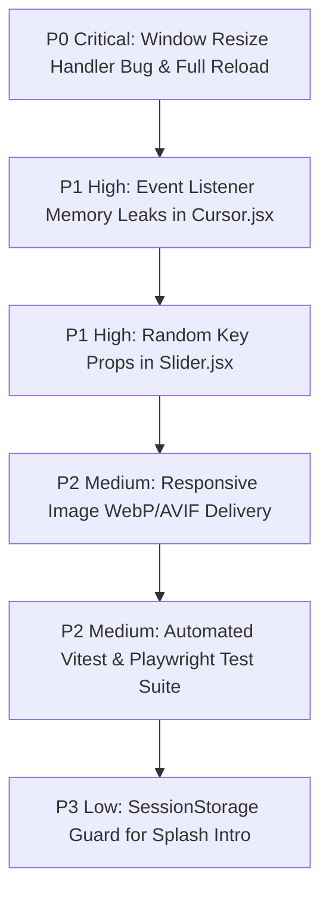

# Gaps, Code Audits & Prioritized Improvements



---

## 1. Prioritized Improvement Roadmap

| Priority | Issue Description | Affected File | Impact |
| :--- | :--- | :--- | :--- |
| **P0 (Critical)** | **Window Resize Immediate Execution & Reload Bug** | [`src/pages/Home.jsx:160-169`](file:///Users/avishjain/avishjain9-repos/50-starbugs-frontend-copy/StarbucksFrontend-Clean-Project/src/pages/Home.jsx#L160-L169) | Immediate execution on mount, invalid listener registration, destructive page reload on mobile screen resize. |
| **P1 (High)** | **Memory Leak in Cursor Event Listeners** | [`src/components/Cursor.jsx:35-49`](file:///Users/avishjain/avishjain9-repos/50-starbugs-frontend-copy/StarbucksFrontend-Clean-Project/src/components/Cursor.jsx#L35-L49) | Multiple event listeners accumulate on `document`, `links`, and `buttons` without cleanup callback. |
| **P1 (High)** | **Unstable `Math.random()` React Keys** | [`src/layout/Slider.jsx:40`](file:///Users/avishjain/avishjain9-repos/50-starbugs-frontend-copy/StarbucksFrontend-Clean-Project/src/layout/Slider.jsx#L40) | Forces React Fiber reconciliation to destroy and recreate product card DOM nodes on every render. |
| **P2 (Medium)** | **Missing Automated Unit & E2E Tests** | Project Root / Tooling | Zero regression safety when updating dependencies or modifying GSAP timings. |
| **P2 (Medium)** | **Non-Responsive PNG Asset Payloads** | [`src/pages/Home.jsx:183-196`](file:///Users/avishjain/avishjain9-repos/50-starbugs-frontend-copy/StarbucksFrontend-Clean-Project/src/pages/Home.jsx#L183-L196) | Large PNGs loaded on mobile devices without `srcset` or Cloudinary auto-format flags (`f_auto,q_auto`). |
| **P3 (Low)** | **Persistent Splash Intro on Refresh** | [`src/layout/Intro.jsx:9-17`](file:///Users/avishjain/avishjain9-repos/50-starbugs-frontend-copy/StarbucksFrontend-Clean-Project/src/layout/Intro.jsx#L9-L17) | Intro replays for 4.5 seconds on every page reload, causing friction for returning visitors. |

---

## 2. In-Depth Technical Remediation & Code Diffs

### Fix 1: Window Resize Debounce & ScrollTrigger Refresh (P0)

#### Before (Problematic Code):
```javascript
// src/pages/Home.jsx line 160
useEffect(() => {
    function handleResize() {
        if (window.innerWidth !== windowWidth) {
            window.location.reload()
        }
    }
    window.addEventListener("resize", handleResize());
    return () => {
        window.removeEventListener("resize", handleResize());
    };
}, []);
```

#### After (Production Fix):
```javascript
useEffect(() => {
    let resizeTimer;
    const handleResize = () => {
        clearTimeout(resizeTimer);
        resizeTimer = setTimeout(() => {
            setWindowWidth(window.innerWidth);
            ScrollTrigger.refresh();
        }, 200);
    };

    window.addEventListener("resize", handleResize);
    return () => {
        clearTimeout(resizeTimer);
        window.removeEventListener("resize", handleResize);
    };
}, []);
```
- **Rationale**: Removes the destructive `window.location.reload()`, passes the clean function reference, debounces the event by 200ms, and updates ScrollTrigger coordinates smoothly without reloading the page.

---

### Fix 2: Clean Event Delegation in Follower Cursor (P1)

#### Before (Problematic Code):
```javascript
// src/components/Cursor.jsx line 35
document.addEventListener("mousemove", onMouseMove)

links.forEach((link) => {
    link.addEventListener("mouseenter", (e) => onMouseEnter(e, "View"))
    link.addEventListener("mouseleave", onMouseLeave)
})
```

#### After (Production Fix):
```javascript
useEffect(() => {
    const cursor = cursorRef.current;
    const cursorTxt = cursorTxtRef.current;

    const onMouseMove = (event) => {
        gsap.to(cursor, { x: event.clientX, y: event.clientY, duration: 0.1 });
    };

    const handleMouseOver = (e) => {
        const target = e.target.closest(".allow_hover");
        if (target) {
            const isButton = target.tagName === "BUTTON";
            cursorTxt.innerText = isButton ? "Click" : "View";
            cursorTxt.style.display = "flex";
            gsap.to(cursor, { scale: 2.5, duration: 0.2 });
        }
    };

    const handleMouseOut = (e) => {
        const target = e.target.closest(".allow_hover");
        if (target) {
            cursorTxt.style.display = "none";
            gsap.to(cursor, { scale: 1, duration: 0.2 });
        }
    };

    window.addEventListener("mousemove", onMouseMove);
    document.addEventListener("mouseover", handleMouseOver);
    document.addEventListener("mouseout", handleMouseOut);

    return () => {
        window.removeEventListener("mousemove", onMouseMove);
        document.removeEventListener("mouseover", handleMouseOver);
        document.removeEventListener("mouseout", handleMouseOut);
    };
}, []);
```
- **Rationale**: Uses event delegation on `document` rather than iterating over individual DOM elements, ensuring dynamic elements are automatically supported while guaranteeing clean listener teardown.
