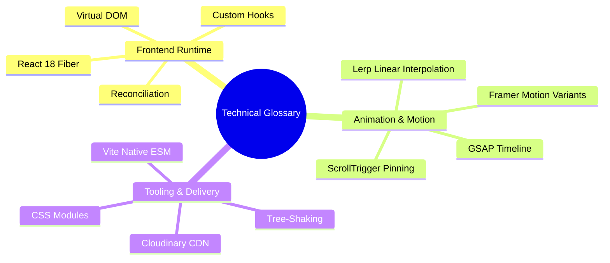

# Technical Glossary & Core Definitions

---

## Glossary of Terms

| Term | Category | Plain-English Definition | Relevance to This Codebase |
| :--- | :--- | :--- | :--- |
| **Automatic Batching** | React 18 | The ability of React 18 to group multiple state updates (even across async timers) into a single re-render cycle. | Optimizes UI updates during splash intro and slider interactions. |
| **CSS Modules** | Styling | A CSS file preprocessor where class names are scoped locally to a single component via unique cryptographic hashes. | Prevents styles in `Home.module.css` from leaking into `Navbar.module.css`. |
| **Concurrent Mode** | React 18 | A set of runtime features allowing React to interrupt, pause, or discard rendering tasks to prioritize user inputs. | Enables smooth UI response during rapid mouse gestures. |
| **CORS** | Security | Cross-Origin Resource Sharing: HTTP headers allowing or restricting resource loading from external domains. | Governs font loading from Google Fonts and image delivery from Cloudinary. |
| **Event Delegation** | DOM Performance | Attaching a single event listener to a parent container to manage events from all current and future child elements. | Recommended fix for mouse listeners in `Cursor.jsx`. |
| **Fiber Architecture** | React Core | React's complete rewrite of its reconciliation engine, breaking rendering work into incremental chunks. | Underlying engine powering all component renders. |
| **GSAP (GreenSock)** | Animation | A high-performance JavaScript animation library that executes sub-pixel transform manipulations on the browser compositor. | Powers `Cursor.jsx` mouse tracking and `Home.jsx` pinning timelines. |
| **Hardware Acceleration** | Performance | Offloading graphical rendering tasks (like 3D translations and opacity) from the CPU directly to the device GPU. | Enforced across all CSS animations (`transform: translate3d`) for 60 FPS motion. |
| **HMR (Hot Module Replacement)** | Tooling | Swapping updated JavaScript or CSS modules in the browser during development without refreshing the entire page. | Enabled by Vite and `@vitejs/plugin-react` for sub-50ms code updates. |
| **Intersection Observer** | Browser API | A native browser interface that asynchronously observes when target DOM elements intersect with the viewport. | Wrapped inside `FramerMotion.jsx` to trigger scroll-in animations. |
| **Layout Thrashing** | Performance | The performance degradation caused by alternating between reading and writing DOM geometry in the same frame. | Avoided in `Slider.jsx` by reading layout offsets once during mousedown. |
| **Lerp (Linear Interpolation)** | Physics | A mathematical smoothing formula (`current += (target - current) * factor`) that creates gradual deceleration. | Configured as `lerp: 0.1` in Locomotive Scroll for smooth scrolling. |
| **Locomotive Scroll** | Smooth Scroll | A virtual scrolling library that intercepts wheel/touch events to provide inertial scrolling and data-attribute parallax. | Intercepts scrolling and powers hero cup floating depth. |
| **Parallax Scrolling** | Visual Design | A visual technique where background and foreground layers move at different speeds, creating a 3D depth illusion. | Configured via `data-scroll-speed` tags (`0.8` to `2.5`) across hero coffee cups. |
| **Pinning (ScrollTrigger)** | GSAP | Locking a DOM element to the viewport (`position: fixed`) while other page content scrolls past it. | Implemented in `Home.jsx` to pin the brand storytelling image frame. |
| **Pointer-Events** | CSS | A CSS property controlling how HTML elements react to mouse and touch interactions. | Set to `none` on `Cursor.jsx` so the follower circle never blocks clicks. |
| **Rollup** | Bundler | A next-generation JavaScript module bundler that produces highly optimized static production bundles. | Integrated inside Vite for `npm run build` compilation. |
| **Scroll Scrubbing** | Animation | Linking the playback progress of an animation timeline directly to the user's scroll position. | Used in `Home.jsx` to crossfade coffee images as headlines scroll. |
| **SPA (Single Page Application)** | Architecture | A web application that loads a single HTML shell and dynamically updates content as the user navigates without reloads. | The architectural foundation of this entire repository. |
| **Tree-Shaking** | Optimization | The process of removing unused dead code exports from the final compiled bundle. | Automatically executed by Rollup during production compilation. |
| **Virtual DOM** | React Core | An in-memory JavaScript representation of the real DOM tree used by React to compute efficient DOM updates. | Diffs changes before patching the browser DOM. |
| **Vite** | Tooling | A modern build tool serving source code over native ES Modules during development and bundling with Rollup. | The primary dev server and production bundler for this project. |
