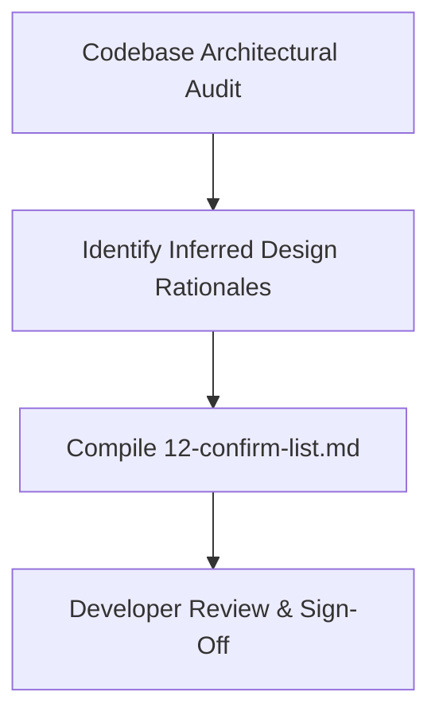

# Developer Confirmation List [CONFIRM WITH DEVELOPER]

---

## Overview

In accordance with **RULE 3** of the documentation standard:
> *"Where the reason behind a choice cannot be known from code, write a likely reason and mark it with [CONFIRM WITH DEVELOPER]."*

Below is the consolidated audit of all architectural choices, assumptions, and inferred motivations across this documentation set. The developer can quickly review this checklist and confirm or refine these points during interview preparation.

---

## Confirmation Checklist

| ID | Topic / Technology Choice | Inferred Reason Documented in Text | Code Reference | Status / Developer Sign-Off |
| :--- | :--- | :--- | :--- | :--- |
| **C1** | **React 18 vs Alternatives** | Chosen for its mature animation ecosystem (GSAP, Framer Motion) and component modularity for a portfolio-grade frontend. | [`package.json:16`](file:///Users/avishjain/avishjain9-repos/50-starbugs-frontend-copy/StarbucksFrontend-Clean-Project/package.json#L16) | `[CONFIRM WITH DEVELOPER]` |
| **C2** | **Vite 5 vs Webpack** | Chosen for native ES Module fast cold starts (<300ms) and zero-config Fast Refresh during visual animation tuning. | [`package.json:30`](file:///Users/avishjain/avishjain9-repos/50-starbugs-frontend-copy/StarbucksFrontend-Clean-Project/package.json#L30) | `[CONFIRM WITH DEVELOPER]` |
| **C3** | **Dual Animation Engines (GSAP + Framer)** | GSAP was chosen specifically for complex pinned timeline scrubbing, while Framer Motion was chosen for declarative component entrance variants. | [`src/pages/Home.jsx`](file:///Users/avishjain/avishjain9-repos/50-starbugs-frontend-copy/StarbucksFrontend-Clean-Project/src/pages/Home.jsx) | `[CONFIRM WITH DEVELOPER]` |
| **C4** | **Locomotive Scroll 5 Beta** | Selected because of its native data-attribute parallax speed multipliers (`data-scroll-speed`), allowing quick multi-layer depth setup. | [`src/pages/Home.jsx:42`](file:///Users/avishjain/avishjain9-repos/50-starbugs-frontend-copy/StarbucksFrontend-Clean-Project/src/pages/Home.jsx#L42) | `[CONFIRM WITH DEVELOPER]` |
| **C5** | **CSS Modules vs Tailwind** | Chosen to maintain strict class scoping without cluttering JSX markup with long utility strings, matching luxury portfolio design standards. | Scoped `*.module.css` files | `[CONFIRM WITH DEVELOPER]` |
| **C6** | **Static JSON vs Live API** | Scoped as a clean frontend redesign for the *Sheryians ReImagine Hackathon*, prioritizing rendering performance and offline reliability over backend plumbing. | `src/json/*.json` | `[CONFIRM WITH DEVELOPER]` |
| **C7** | **Drag Multiplier Factor `* 2`** | Selected through manual aesthetic experimentation to balance desktop mouse drag effort with responsive carousel momentum. | [`src/layout/Slider.jsx:17`](file:///Users/avishjain/avishjain9-repos/50-starbugs-frontend-copy/StarbucksFrontend-Clean-Project/src/layout/Slider.jsx#L17) | `[CONFIRM WITH DEVELOPER]` |
| **C8** | **Splash Intro Duration (4.5s)** | 2.0s logo shrink followed by 2.5s typography reveal chosen to ensure full brand perception without causing excessive user impatience. | [`src/layout/Intro.jsx:10-15`](file:///Users/avishjain/avishjain9-repos/50-starbugs-frontend-copy/StarbucksFrontend-Clean-Project/src/layout/Intro.jsx#L10-L15) | `[CONFIRM WITH DEVELOPER]` |
| **C9** | **Mobile Breakpoint at 850px** | Selected as the threshold where horizontal split-frames become cramped on iPad/tablet portrait and phone screens. | [`src/styles/main.css:205`](file:///Users/avishjain/avishjain9-repos/50-starbugs-frontend-copy/StarbucksFrontend-Clean-Project/src/styles/main.css#L205) | `[CONFIRM WITH DEVELOPER]` |
| **C10** | **Cloudinary for Asset Hosting** | Inferred to provide high-bandwidth edge CDN delivery and support transparent PNG graphics generated during the hackathon. | `res.cloudinary.com` URLs | `[CONFIRM WITH DEVELOPER]` |
| **C11** | **Window Resize Reload Anti-Pattern** | Inferred as a temporary hackathon workaround to force Locomotive Scroll and ScrollTrigger to recalculate viewport offsets, causing Bug 1. | [`src/pages/Home.jsx:162`](file:///Users/avishjain/avishjain9-repos/50-starbugs-frontend-copy/StarbucksFrontend-Clean-Project/src/pages/Home.jsx#L162) | `[CONFIRM WITH DEVELOPER]` |
