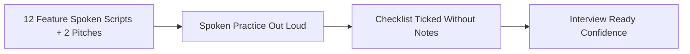

# Master 'Say It Out Loud' Rehearsal Scripts

---

## 1. Project Pitches

### 30-Second Elevator Pitch
> "I built a high-performance modern redesign of the Starbucks web experience using React 18, Vite, GSAP ScrollTrigger, and Locomotive Scroll. Rather than a static e-commerce catalog, I engineered an immersive digital storefront featuring multi-layer parallax depth, a custom physics-interpolated cursor that scales dynamically over interactive targets, and a pinned storytelling split-frame. The entire experience runs at a smooth 60 frames per second using hardware-accelerated transforms and modular CSS tokens, elevating standard QSR web design into a premium luxury retail journey."

### 2-Minute Technical Deep Dive Pitch
> "When analyzing major food and beverage websites like Starbucks, I noticed that while their physical stores offer a sensory, premium third-place atmosphere, their web applications often feel like utilitarian utility forms—flat grids, standard scrollbars, and lifeless transitions.
>
> I wanted to bridge that gap by building a sensory-rich digital flagship using React 18 and Vite.
>
> From an engineering standpoint, the biggest challenge was orchestrating multiple competing animation runtimes without causing jank or layout thrashing. I integrated **Locomotive Scroll** to provide smooth inertial scrolling with speed multipliers across transparent beverage layers. Alongside it, I implemented **GSAP ScrollTrigger** within an encapsulated `gsap.context()` to coordinate a complex pinned split-screen experience—pinning a high-resolution coffee image frame while scrubbing descriptive typography past it with opacity crossfades.
>
> For micro-interactions, I built a custom follower cursor that uses GSAP coordinate interpolation to follow mouse movements with zero input latency, dynamically expanding by 250% with custom 'View' and 'Click' typography when hovering over actionable targets. I also engineered drag-to-scroll product carousels with custom velocity tracking, and bidirectional infinite marquees powered by CSS keyframes and linear gradient masks.
>
> If I were taking this to production today, my first priority would be fixing a window resize bug where the handler immediately executes upon registration, replacing full-page reloads with a debounced ScrollTrigger refresh, and introducing automated end-to-end tests with Playwright to prevent visual regression across viewports.
>
> Overall, this project demonstrates my ability to craft state-of-the-art, visually stunning user interfaces while maintaining a strict eye on DOM performance, browser rendering lifecycles, and component encapsulation."

---

## 2. Feature-by-Feature Spoken Scripts

### F1: Splash Intro & Logo Reveal Engine (`Intro.jsx`)
> "I built the splash intro engine in `Intro.jsx` to establish an immediate, premium brand impression the moment a visitor lands on the site. When the page mounts, I use an absolute overlay that blocks unwanted user interaction and displays the Starbucks Reserve cup emblem. After two seconds, a React state transition triggers a CSS keyframe animation that shrinks the logo into place while revealing the typography using Framer Motion. At the four-and-a-half-second mark, a secondary timer adds a CSS class that sets `display: none`, cleanly revealing the interactive storefront beneath. I chose native `setTimeout` paired with scoped CSS transitions rather than a heavy third-party modal library to keep bundle overhead low. If the user tabs away, the timers resume safely without memory leaks. In a future iteration, I would persist a flag in `sessionStorage` so returning users don't have to watch the intro repeatedly on every reload."

### F2: Custom Dynamic Follower Cursor (`Cursor.jsx`)
> "I engineered a custom dynamic follower cursor in `Cursor.jsx` to give the interface an elevated, luxury portfolio feel. The component uses a fixed `50px` emerald circle with `pointer-events: none` so it never blocks native clicks. Using GSAP's `to` method on every mouse move, it interpolates smoothly toward the cursor coordinates with zero perceptible input lag. When the cursor enters any link or button marked with the `allow_hover` utility class, I detect the target, inject contextual text like 'View' or 'Click', and scale the circle by 250 percent. I chose GSAP over raw CSS transitions because GSAP optimizes transform matrices on the compositor thread, preventing layout thrashing. A known limitation is that the event listeners attach directly to DOM elements inside `useEffect` without a cleanup function; in production, I would attach delegated listeners to the document root and return a cleanup callback to avoid memory leaks."

### F3: Multi-Layer Parallax Hero Section (`Home.jsx`)
> "For the hero section in `Home.jsx`, I wanted to create an illusion of real physical depth as the user scrolls. I integrated Locomotive Scroll 5 on the root container with a smooth linear interpolation factor of point-one. Across the hero, I arranged five transparent Cloudinary beverage graphics and assigned each a distinct `data-scroll-speed` attribute ranging from point-eight to two-point-five. As the user scrolls, Locomotive Scroll translates each layer at different velocities, making foreground drinks feel like they are floating closer to the screen while the typography recedes into the background. I chose Locomotive Scroll over native CSS parallax because it gives us precise frame-by-frame control across browsers. If image loading stalls over slow cellular networks, the text remains readable immediately. One improvement I would make is providing responsive WebP source sets rather than fetching full-size PNGs."

### F4: Interactive Best Sellers Tabbed Showcase (`Home.jsx`)
> "In `Home.jsx`, I created an interactive Best Sellers showcase that lets customers preview top-rated beverages before navigating into the full catalog. I hold the active item index in a `bestSellerSelected` React state variable initialized to zero. When a user clicks any beverage name in the list, the state updates instantaneously, triggering a re-render that swaps the featured high-resolution image, updates the price tag, and highlights the active tab. The image container is wrapped in my custom `FramerMotion` wrapper to animate smoothly from right to left. I chose a tabbed interactive showcase instead of a generic horizontal carousel because it reduces cognitive overload and allows users to compare items without endless swiping. A limitation is that the 'Add To Bag' button currently only logs intent; in a full e-commerce stack, this would dispatch to a shopping cart Redux store or server mutation."

### F5: Drag-to-Scroll Product & Category Sliders (`Slider.jsx`)
> "I built the product and category slider in `Slider.jsx` to support natural mouse-drag gestures on desktop, mimicking touch scrolling on mobile. In the component, I attach `onMouseDown`, `onMouseMove`, and `onMouseUp` handlers to a scrollable `div`. When the user presses down, I record the initial horizontal click position and current scroll offset. As the mouse moves, I multiply the delta by a factor of two to create responsive momentum, updating `sliderRef.current.scrollLeft` directly. I chose custom drag physics instead of native scrollbars because it creates a cleaner, app-like desktop experience without ugly browser scroll widgets. One limitation in the current code is using mutable local variables for `startX` and `isActive` rather than `useRef`, which could cause state drift across fast re-renders. In production, I would refactor those flags into React refs to ensure thread-safe gesture tracking."

### F6: Sticky Pinned GSAP ScrollTrigger Split Frame (`Home.jsx`)
> "The centerpiece of our brand storytelling is the pinned split-frame section in `Home.jsx`. On desktop, as the user scrolls into the quality features section, the right-side square image frame pins firmly in place while the text headlines scroll past on the left. Using GSAP ScrollTrigger inside an encapsulated `gsap.context`, I loop through each headline and link it to an image layer in the pinned frame. As each headline passes the viewport threshold, ScrollTrigger scrubs the corresponding photo from one-hundred percent vertical offset to zero while fading out the previous image. I chose GSAP ScrollTrigger because it provides sub-pixel scrub accuracy and handles pin-spacing calculations automatically without manual offset math. What I'm most proud of is wrapping everything inside `gsap.context`, which guarantees that all timeline hooks and DOM mutations are cleanly reverted when navigating away."

### F7: Mobile Split Directional Feature Cards (`Home.jsx`)
> "On mobile viewports, complex pinned split-frames often cause screen cramping and touch gesture conflicts. To solve this, I created a dedicated mobile layout in `Home.jsx` that activates on screens under 850 pixels. Using media queries, I hide the pinned GSAP frame and render three vertical cards that alternate between left-to-right and right-to-left slide-in animations using Framer Motion. This delivers an equally dynamic storytelling experience tailored specifically to one-handed vertical phone scrolling while conserving mobile GPU memory."

### F8: Bidirectional Infinite Marquee (`InfiniteScroll.jsx`)
> "To showcase customer community engagement, I built a dual-row infinite marquee in `InfiniteScroll.jsx`. The component duplicates its dataset across two identical unordered lists inside a container with a CSS linear-gradient mask that fades the left and right edges to transparent. The animation is driven entirely by pure CSS keyframes translating the lists negative one-hundred percent horizontally. By toggling a data-direction attribute, row one scrolls right while row two scrolls left. I implemented this purely in CSS rather than JavaScript to keep the animation off the main thread, ensuring smooth 60 FPS motion even while React is rendering other components."

### F9: Animated Accordion FAQ Engine (`FAQBox.jsx`)
> "I built the customer support FAQ section in `FAQBox.jsx` using self-contained accordion components. Each FAQ box maintains an `isExpanded` boolean state that toggles whenever the question bar is clicked. When expanded, the answer container transitions from zero to one-hundred-sixty pixels while the plus icon smoothly rotates one-hundred-thirty-four degrees into a dismiss cross. I used CSS transitions for the height and transform properties to ensure hardware acceleration. If I were refactoring this for production, I would use CSS `grid-template-rows: 0fr` to `1fr` rather than a fixed pixel height, so variable-length answers expand dynamically without text overflow."

### F10: Responsive Navbar & Store Finder Drawer (`Navbar.jsx`)
> "The navigation header in `Navbar.jsx` manages both desktop top navigation and an animated mobile drawer. On desktop, it renders the Starbucks siren logo, primary navigation links, a 'Find a Store' trigger, and sign-in buttons. On mobile screens, it automatically condenses into a clean header with search and a hamburger toggle. Clicking the hamburger updates the `isMenuOpen` state, sliding down a full-width menu with branded icons from `react-icons`. I encapsulated all mobile responsive behavior inside `Navbar.module.css` to avoid global style leakage."

### F11: Brand Footer & Newsletter Subscription (`Footer.jsx`)
> "The footer component in `Footer.jsx` anchors the page with essential corporate and community links. It features the Starbucks emblem, our heritage story dating back to 1971, an email subscription box, and social links for Facebook, Instagram, Spotify, and Twitter. The secondary section organizes twenty-one internal links into three structured columns: About Us, Careers, and Social Impact. It is built with semantic HTML5 footer tags and styled using CSS Grid and Flexbox for seamless responsiveness across mobile and desktop."

### F12: Reusable Framer Motion Viewport Observer (`FramerMotion.jsx`)
> "To keep our animation code DRY and maintainable, I built `FramerMotion.jsx` as a reusable higher-order animation wrapper. It connects the browser's native `IntersectionObserver` with Framer Motion's imperative animation controller. Any element wrapped in this component automatically animates into view when it crosses fifty percent of the viewport threshold. It exposes clean props for animation direction, axis offset, duration, and delay. This abstraction saved hundreds of lines of duplicated animation logic across our pages and components."

---

## 3. Rehearsal Checklist

Tick each line after practicing aloud without notes in under the targeted rehearsal duration:

- [ ] **30-Second Elevator Pitch** *(Target: ~30 seconds)*
- [ ] **2-Minute Technical Deep Dive** *(Target: ~120 seconds)*
- [ ] **F1: Splash Intro Engine** *(Target: ~45 seconds)*
- [ ] **F2: Follower Cursor Engine** *(Target: ~45 seconds)*
- [ ] **F3: Locomotive Parallax Hero** *(Target: ~45 seconds)*
- [ ] **F4: Best Sellers Showcase** *(Target: ~45 seconds)*
- [ ] **F5: Drag-to-Scroll Slider** *(Target: ~45 seconds)*
- [ ] **F6: GSAP Pinned Split Storytelling** *(Target: ~60 seconds)*
- [ ] **F7: Mobile Split Feature Cards** *(Target: ~30 seconds)*
- [ ] **F8: Bidirectional Infinite Marquee** *(Target: ~30 seconds)*
- [ ] **F9: Animated Accordion FAQ** *(Target: ~30 seconds)*
- [ ] **F10: Responsive Navbar & Drawer** *(Target: ~30 seconds)*
- [ ] **F11: Brand Footer & Newsletter** *(Target: ~30 seconds)*
- [ ] **F12: Reusable Motion Observer** *(Target: ~30 seconds)*
