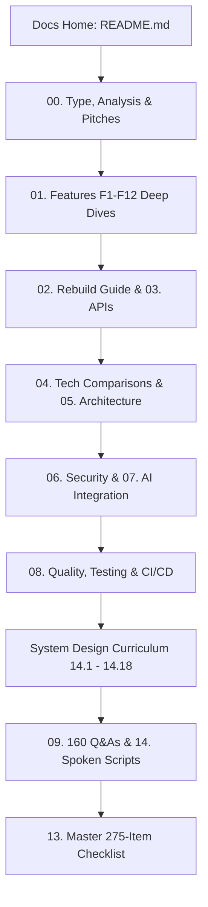

# Starbucks Modern Redesign: Architectural Documentation Index



---

## Welcome to the Documentation Suite

This documentation set provides an exhaustive, production-grade architectural analysis of the **Starbucks Modern Frontend Redesign**. Built with **React 18, Vite 5, GSAP ScrollTrigger, Locomotive Scroll, and Framer Motion**, this project demonstrates how to elevate standard QSR e-commerce interfaces into an immersive, sensory-rich digital flagship running at steady 60 FPS.

Every document adheres strictly to empirical code evidence, complete Mermaid diagrams, comparative benchmarks, and first-person spoken interview scripts.

---

## Complete Reading Order & Document Sitemap

### 1. Project Foundations & Audits
| Chapter | Title | Primary Focus |
| :--- | :--- | :--- |
| **00** | [Project Type Classification](./00-project-type.md) | Verified Track B (Frontend-Only Single Page Application) with code evidence. |
| **00a** | [Deep Project Analysis & System Inventory](./00a-project-analysis.md) | Complete user journeys, feature traces, data flows, and final audited inventory totals. |
| **00b** | [Project Pitches & Spoken Presentations](./00b-project-pitch.md) | 30-second elevator pitch, 2-minute technical pitch, and key technical accomplishments. |
| **00** | [Directory Map & Dependency Audit](./00-project-map.md) | Full folder tree, exact package version audit, and external CDN endpoints. |

---

### 2. Feature Inventory & Deep Dives
- [**01. Complete Feature Inventory Overview**](./01-features.md)
  - [F1: Splash Intro & Logo Reveal Engine](./features/f1-splash-intro-engine.md)
  - [F2: Custom Dynamic Follower Cursor](./features/f2-custom-interactive-cursor.md)
  - [F3: Multi-Layer Parallax Hero Section](./features/f3-locomotive-parallax-hero.md)
  - [F4: Interactive Best Sellers Tabbed Showcase](./features/f4-interactive-best-sellers-showcase.md)
  - [F5: Drag-to-Scroll Product & Category Sliders](./features/f5-drag-scroll-product-sliders.md)
  - [F6: Sticky Pinned GSAP ScrollTrigger Split Frame](./features/f6-gsap-scrolltrigger-pinned-split.md)
  - [F7: Mobile Split Directional Feature Cards](./features/f7-mobile-split-feature-cards.md)
  - [F8: Bidirectional Infinite Marquee (Social Proof)](./features/f8-infinite-bidirectional-social-marquee.md)
  - [F9: Animated Accordion FAQ Engine](./features/f9-interactive-faq-accordion.md)
  - [F10: Responsive Navbar & Store Finder Drawer](./features/f10-responsive-navbar-and-store-locator.md)
  - [F11: Brand Footer & Newsletter Subscription](./features/f11-brand-footer-and-newsletter.md)
  - [F12: Reusable Framer Motion Viewport Observer](./features/f12-reusable-framer-viewport-observer.md)

---

### 3. Architecture & Implementation
| Chapter | Title | Primary Focus |
| :--- | :--- | :--- |
| **02** | [Step-by-Step Rebuild Guide](./02-build-order.md) | Rebuilding from scratch in 10 sequential phases with line-by-line code explanations. |
| **03** | [API Reference & Data Contracts](./03-api-reference.md) | Schemas for static JSON fixtures, Cloudinary endpoints, and proposed production REST APIs. |
| **04** | [Comprehensive Tech Choice Comparisons](./04-tech-comparisons.md) | Exhaustive comparison tables for React, Vite, GSAP, Locomotive Scroll, and CSS Modules. |
| **05** | [Architecture, Data Flow & Lifecycles](./05-architecture.md) | Component tree, reconciliation, 3 core request lifecycles, and scaling bottlenecks. |
| **06** | [Security Audit & OWASP Top 10 Assessment](./06-security.md) | Mapping to OWASP Top 10, DOM XSS prevention, CSP headers, and SRI integrity. |
| **07** | [AI Integration & Proposed AI Barista Engine](./07-ai-integration.md) | Proposed conversational AI Barista & Taste Profiler RAG architecture with GPT-4o-mini. |
| **08** | [Engineering Quality, Code Audit & DevOps](./08-quality-and-ops.md) | Testing pyramid, bug diagnoses (resize reload bug, cursor leak), and GitHub Actions CI/CD. |

---

### 4. System Design Deep Dive (14.1 - 14.18)
- [**System Design Curriculum Index**](./system-design/README.md)
- [14.1 Requirements & Capacity Estimation](./system-design/01-requirements-and-estimation.md)
- [14.2 Architecture Styles & System Topology](./system-design/02-architecture-styles.md)
- [14.3 Networking, CDN & Communication Protocols](./system-design/03-networking-and-communication.md)
- [14.4 Load Balancing & Frontend High Availability](./system-design/04-load-balancing-and-scaling.md)
- [14.5 Databases, Storage & Cloud Asset Stores](./system-design/05-databases-and-storage.md)
- [14.6 Multi-Tier Caching & Invalidation Architecture](./system-design/06-caching.md)
- [14.7 Messaging, Asynchronous Queues & Event Streams](./system-design/07-messaging-queues-async.md)
- [14.8 Consistency, Concurrency & Distributed Transactions](./system-design/08-consistency-concurrency-distributed.md)
- [14.9 Reliability, Resilience & Graceful Degradation](./system-design/09-reliability-and-resilience.md)
- [14.10 API Gateway, Throttling & Client Rate Limiting](./system-design/10-api-design-rate-limiting.md)
- [14.11 Security Architecture, CSP & XSS Shielding](./system-design/11-security-architecture.md)
- [14.12 Search Engine & AI Recommendation Architecture](./system-design/12-search-and-ai-architecture.md)
- [14.13 Real-Time Order & Location Presence Systems](./system-design/13-real-time-systems.md)
- [14.14 Observability, Core Web Vitals & Operations](./system-design/14-observability-and-operations.md)
- [14.15 Performance Engineering & 60 FPS Pipelines](./system-design/15-performance-engineering.md)
- [14.16 Cost Modeling, Cloud Budgets & Build vs Buy](./system-design/16-cost-and-tradeoffs.md)
- [14.17 Classic System Design Problems Adapted](./system-design/17-classic-questions.md)
- [14.18 Architectural Decision Records (ADR Log)](./system-design/decisions.md)

---

### 5. Interview Mastery, Reference & Master Checklist
| Chapter | Title | Primary Focus |
| :--- | :--- | :--- |
| **09** | [160 Master Interview Questions & Answers](./09-interview-qa.md) | Exhaustive Q&As categorized across architecture, React, GSAP, CSS, security, and reflection. |
| **10** | [Gaps, Code Audits & Prioritized Improvements](./10-gaps-and-improvements.md) | Ranked P0 to P3 defects with concrete before/after code remediation diffs. |
| **11** | [Technical Glossary & Core Definitions](./11-glossary.md) | Definitions for 22 core web, animation, and systems engineering terms. |
| **12** | [Developer Confirmation List [CONFIRM WITH DEVELOPER]](./12-confirm-list.md) | Audit of all inferred rationales and technical assumptions. |
| **13** | [Master 275-Item Technical Checklist](./13-master-checklist.md) | Rigorous 7-part evaluation across all 275 items with master status coverage table. |
| **14** | [Master 'Say It Out Loud' Rehearsal Scripts](./14-say-it-out-loud.md) | Conversational first-person spoken scripts for every feature and rehearsal checklist. |

---

## How to Run & Build Documentation Locally

```bash
# Install root documentation dependencies (VitePress, Mermaid)
npm install

# Run VitePress development server with live reload
npm run docs:dev

# Compile production documentation site into docs/.vitepress/dist
npm run docs:build

# Preview compiled production documentation site locally
npm run docs:preview
```
