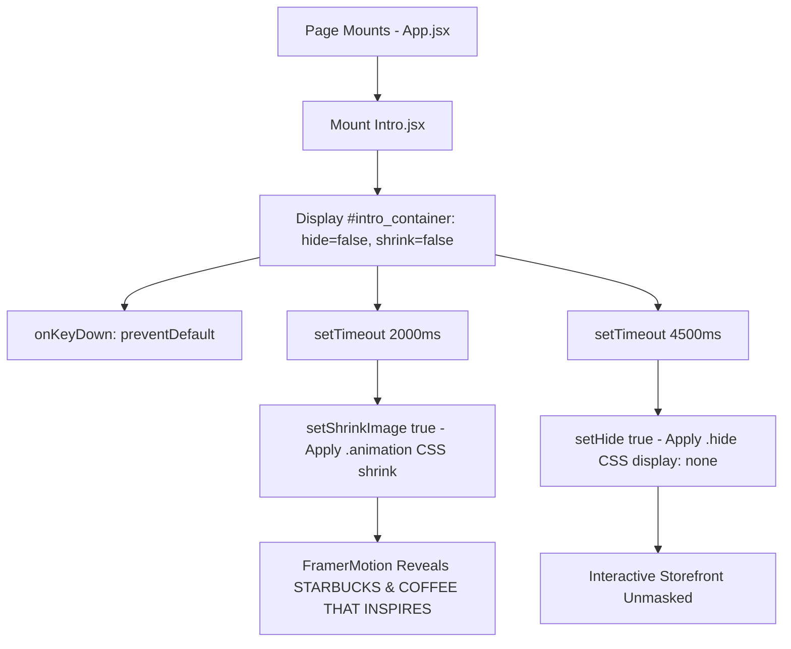

# Feature F1: Splash Intro & Logo Reveal Engine

## 1. Description & User-Facing Behavior
Upon loading the application, an overlay covers the viewport with the dark emerald background (`#162a25`). An illustration of a Starbucks coffee cup appears in the center. At 2.0 seconds, the coffee cup shrinks upward smoothly while typography reveals *"STARBUCKS - COFFEE THAT INSPIRES"*. At 4.5 seconds, the overlay transitions out and hides, enabling full user interaction with the storefront.

## 2. Code Trace & Function Reference
- **Component File**: [`StarbucksFrontend-Clean-Project/src/layout/Intro.jsx`](file:///Users/avishjain/avishjain9-repos/50-starbugs-frontend-copy/StarbucksFrontend-Clean-Project/src/layout/Intro.jsx#L1-L37)
- **Styles File**: [`StarbucksFrontend-Clean-Project/src/styles/Intro.module.css`](file:///Users/avishjain/avishjain9-repos/50-starbugs-frontend-copy/StarbucksFrontend-Clean-Project/src/styles/Intro.module.css#L1-L45)
- **Line Trace**:
  - `const [hide, setHide] = useState(false)` ([`L6`](file:///Users/avishjain/avishjain9-repos/50-starbugs-frontend-copy/StarbucksFrontend-Clean-Project/src/layout/Intro.jsx#L6)): Controls overlay visibility.
  - `const [shrinkImage, setShrinkImage] = useState(false)` ([`L7`](file:///Users/avishjain/avishjain9-repos/50-starbugs-frontend-copy/StarbucksFrontend-Clean-Project/src/layout/Intro.jsx#L7)): Controls logo scale transition.
  - `useEffect(() => { ... }, [])` ([`L9-L17`](file:///Users/avishjain/avishjain9-repos/50-starbugs-frontend-copy/StarbucksFrontend-Clean-Project/src/layout/Intro.jsx#L9-L17)): Spawns 2000ms and 4500ms timers.
  - `className={shrinkImage ? styles.animation : ""}` ([`L23`](file:///Users/avishjain/avishjain9-repos/50-starbugs-frontend-copy/StarbucksFrontend-Clean-Project/src/layout/Intro.jsx#L23)): Attaches CSS keyframe animation.

## 3. Data Touched
- Local React component state: `hide: boolean`, `shrinkImage: boolean`.

## 4. Edge Cases & Error Handling
- **Tab Inactivity**: Browser timer throttling may delay execution when the tab is in the background; state updates complete safely upon tab focus.
- **Keyboard Scrolling**: `onKeyDown={(e) => e.preventDefault()}` blocks premature arrow/spacebar scroll events.

## 5. Security & Performance
- Zero DOM injection vulnerabilities.
- `.hide` sets `display: none` removing the element from the browser layout pipeline.

## 6. Say It Out Loud
> "I built the splash intro engine in `Intro.jsx` to establish an immediate, premium brand impression the moment a visitor lands on the site. When the page mounts, I use an absolute overlay that blocks unwanted user interaction and displays the Starbucks Reserve cup emblem. After two seconds, a React state transition triggers a CSS keyframe animation that shrinks the logo into place while revealing the typography using Framer Motion. At the four-and-a-half-second mark, a secondary timer adds a CSS class that sets `display: none`, cleanly revealing the interactive storefront beneath. I chose native `setTimeout` paired with scoped CSS transitions rather than a heavy third-party modal library to keep bundle overhead low. If the user tabs away, the timers resume safely without memory leaks. In a future iteration, I would persist a flag in `sessionStorage` so returning users don't have to watch the intro repeatedly on every reload."
