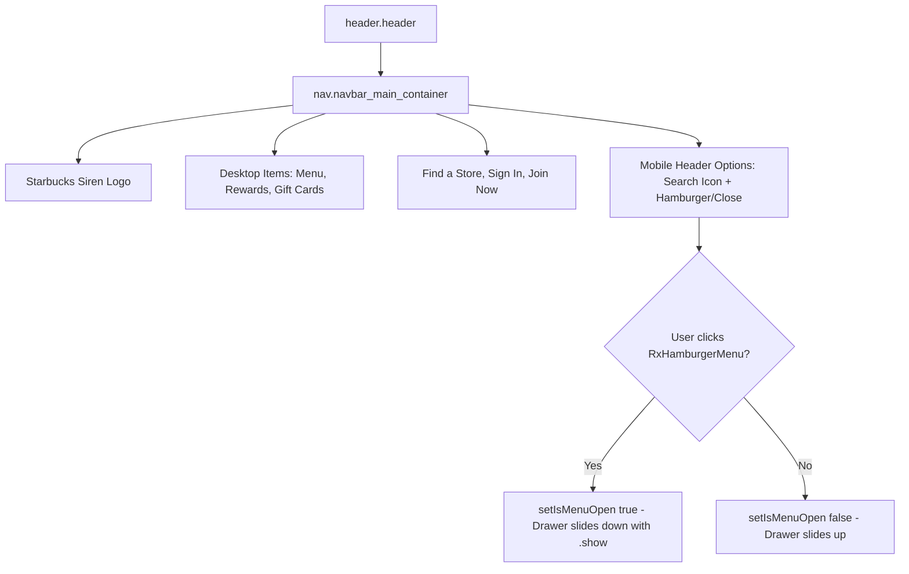

# Feature F10: Responsive Navbar & Store Finder Drawer

## 1. Description & User-Facing Behavior
A sticky navigation header. Desktop users access primary navigation links (*Menu*, *Rewards*, *Gift Cards*), a "Find a Store" action, and account buttons (*Sign In*, *Join Now*). On screens under 850px, the header condenses into a clean brand bar with search and a hamburger toggle that reveals a slide-down mobile navigation drawer with custom icons.

## 2. Code Trace & Function Reference
- **Component File**: [`StarbucksFrontend-Clean-Project/src/layout/Navbar.jsx`](file:///Users/avishjain/avishjain9-repos/50-starbugs-frontend-copy/StarbucksFrontend-Clean-Project/src/layout/Navbar.jsx#L1-L61)
- **Styles File**: [`StarbucksFrontend-Clean-Project/src/styles/Navbar.module.css`](file:///Users/avishjain/avishjain9-repos/50-starbugs-frontend-copy/StarbucksFrontend-Clean-Project/src/styles/Navbar.module.css#L1-L77)
- **Line Trace**:
  - `const [isMenuOpen, setIsMenuOpen] = useState(false)` ([`L14`](file:///Users/avishjain/avishjain9-repos/50-starbugs-frontend-copy/StarbucksFrontend-Clean-Project/src/layout/Navbar.jsx#L14)): Tracks drawer visibility.
  - `const [isStoreLocatorOpen, setIsStoreLocatorOpen] = useState(false)` ([`L15`](file:///Users/avishjain/avishjain9-repos/50-starbugs-frontend-copy/StarbucksFrontend-Clean-Project/src/layout/Navbar.jsx#L15)): Tracks store locator modal state.
  - `isMenuOpen ? <AiOutlineClose /> : <RxHamburgerMenu />` ([`L44`](file:///Users/avishjain/avishjain9-repos/50-starbugs-frontend-copy/StarbucksFrontend-Clean-Project/src/layout/Navbar.jsx#L44)): Toggles mobile icon.

## 3. Data Touched
- Local React component states.

## 4. Edge Cases & Error Handling
- Drawer automatically resets layout gracefully if the screen is resized between desktop and mobile.

## 5. Security & Performance
- Uses CSS Modules to ensure class name scoping and eliminate style collisions.

## 6. Say It Out Loud
> "The navigation header in `Navbar.jsx` manages both desktop top navigation and an animated mobile drawer. On desktop, it renders the Starbucks siren logo, primary navigation links, a 'Find a Store' trigger, and sign-in buttons. On mobile screens, it automatically condenses into a clean header with search and a hamburger toggle. Clicking the hamburger updates the `isMenuOpen` state, sliding down a full-width menu with branded icons from `react-icons`. I encapsulated all mobile responsive behavior inside `Navbar.module.css` to avoid global style leakage."
