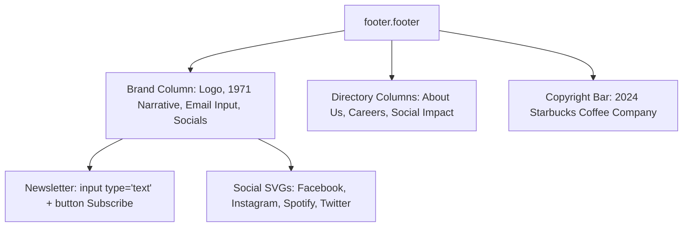

# Feature F11: Brand Footer & Newsletter Subscription

## 1. Description & User-Facing Behavior
A comprehensive corporate footer providing brand context (*"Every day, we go to work hoping to do two things: share great coffee with our friends and help make the world a little better..."*), an email subscription input, 4 social media channels, and 21 categorized company links.

## 2. Code Trace & Function Reference
- **Component File**: [`StarbucksFrontend-Clean-Project/src/layout/Footer.jsx`](file:///Users/avishjain/avishjain9-repos/50-starbugs-frontend-copy/StarbucksFrontend-Clean-Project/src/layout/Footer.jsx#L1-L83)
- **Styles File**: [`StarbucksFrontend-Clean-Project/src/styles/Footer.module.css`](file:///Users/avishjain/avishjain9-repos/50-starbugs-frontend-copy/StarbucksFrontend-Clean-Project/src/styles/Footer.module.css#L1-L80)
- **Line Trace**:
  - `section_1` ([`L15-L34`](file:///Users/avishjain/avishjain9-repos/50-starbugs-frontend-copy/StarbucksFrontend-Clean-Project/src/layout/Footer.jsx#L15-L34)): Brand logo, narrative, newsletter form, and social icons.
  - `section_2` ([`L35-L71`](file:///Users/avishjain/avishjain9-repos/50-starbugs-frontend-copy/StarbucksFrontend-Clean-Project/src/layout/Footer.jsx#L35-L71)): Three directory columns (*About Us*, *Careers*, *Social Impact*).
  - `copyright` ([`L74-L76`](file:///Users/avishjain/avishjain9-repos/50-starbugs-frontend-copy/StarbucksFrontend-Clean-Project/src/layout/Footer.jsx#L74-L76)): Copyright disclaimer.

## 3. Data Touched
- Static presentation links.

## 4. Edge Cases & Error Handling
- All internal links map through React Router `<Link to="/">` to maintain client-side routing.

## 5. Security & Performance
- Static SVG icons from `react-icons` bundled at build time with zero external network requests.

## 6. Say It Out Loud
> "The footer component in `Footer.jsx` anchors the page with essential corporate and community links. It features the Starbucks emblem, our heritage story dating back to 1971, an email subscription box, and social links for Facebook, Instagram, Spotify, and Twitter. The secondary section organizes twenty-one internal links into three structured columns: About Us, Careers, and Social Impact. It is built with semantic HTML5 footer tags and styled using CSS Grid and Flexbox for seamless responsiveness across mobile and desktop."
