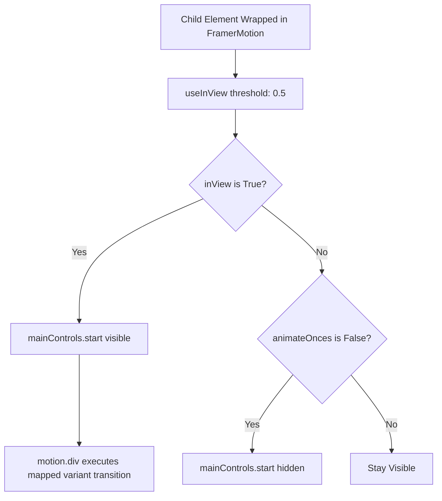

# Feature F12: Reusable Framer Motion Viewport Observer

## 1. Description & User-Facing Behavior
A reusable higher-order animation wrapper component that binds the browser's native `IntersectionObserver` to Framer Motion variants. It standardizes directional scroll-triggered animations across the application, executing animations when elements scroll 50% into view.

## 2. Code Trace & Function Reference
- **Component File**: [`StarbucksFrontend-Clean-Project/src/animation/FramerMotion.jsx`](file:///Users/avishjain/avishjain9-repos/50-starbugs-frontend-copy/StarbucksFrontend-Clean-Project/src/animation/FramerMotion.jsx#L1-L98)
- **Line Trace**:
  - `const [ref, inView] = useInView({ triggerOnce: animateOnces, threshold: 0.5 })` ([`L19-L22`](file:///Users/avishjain/avishjain9-repos/50-starbugs-frontend-copy/StarbucksFrontend-Clean-Project/src/animation/FramerMotion.jsx#L19-L22)): Initializes intersection observation.
  - `const mainControls = useAnimation()` ([`L24`](file:///Users/avishjain/avishjain9-repos/50-starbugs-frontend-copy/StarbucksFrontend-Clean-Project/src/animation/FramerMotion.jsx#L24)): Instantiates imperative animation controller.
  - Variant mapping ([`L59-L68`](file:///Users/avishjain/avishjain9-repos/50-starbugs-frontend-copy/StarbucksFrontend-Clean-Project/src/animation/FramerMotion.jsx#L59-L68)): Supports `topToBottom`, `bottomToTop`, `rightToLeft`, `leftToRight`, and `popup`.

## 3. Data Touched
- Component props: `type`, `delay`, `duration`, `xAxis`, `yAxis`, `animateOnces`, `overflowHidden`.

## 4. Edge Cases & Error Handling
- Threshold fallback gracefully animates immediately on smaller viewports where 50% height might not fit.

## 5. Security & Performance
- Uses transform translations (`y: -yAxis`, `x: xAxis`) and `opacity` to avoid triggering browser layout repaints.

## 6. Say It Out Loud
> "To keep our animation code DRY and maintainable, I built `FramerMotion.jsx` as a reusable higher-order animation wrapper. It connects the browser's native `IntersectionObserver` with Framer Motion's imperative animation controller. Any element wrapped in this component automatically animates into view when it crosses fifty percent of the viewport threshold. It exposes clean props for animation direction, axis offset, duration, and delay. This abstraction saved hundreds of lines of duplicated animation logic across our pages and components."
