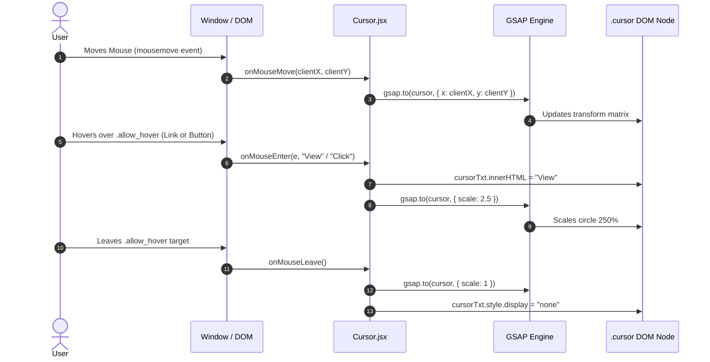

# Feature F2: Custom Interactive Follower Cursor

## 1. Description & User-Facing Behavior
A smooth, custom emerald circle (`#00c684`) tracks the mouse pointer across the screen. When the user hovers over interactive cards, buttons, or links possessing the utility class `.allow_hover`, the circle expands to 2.5 times its original size and renders contextual action text (`"View"` over product links, `"Click"` over buttons).

## 2. Code Trace & Function Reference
- **Component File**: [`StarbucksFrontend-Clean-Project/src/components/Cursor.jsx`](file:///Users/avishjain/avishjain9-repos/50-starbugs-frontend-copy/StarbucksFrontend-Clean-Project/src/components/Cursor.jsx#L1-L61)
- **Styles File**: [`StarbucksFrontend-Clean-Project/src/styles/main.css`](file:///Users/avishjain/avishjain9-repos/50-starbugs-frontend-copy/StarbucksFrontend-Clean-Project/src/styles/main.css#L161-L185)
- **Line Trace**:
  - `cursorRef` and `cursorTxtRef` ([`L6-L7`](file:///Users/avishjain/avishjain9-repos/50-starbugs-frontend-copy/StarbucksFrontend-Clean-Project/src/components/Cursor.jsx#L6-L7)): DOM element hooks.
  - `onMouseMove(event)` ([`L15-L18`](file:///Users/avishjain/avishjain9-repos/50-starbugs-frontend-copy/StarbucksFrontend-Clean-Project/src/components/Cursor.jsx#L15-L18)): Updates coordinates via `gsap.to(cursor, { x: clientX, y: clientY })`.
  - `onMouseEnter(e, text)` ([`L20-L27`](file:///Users/avishjain/avishjain9-repos/50-starbugs-frontend-copy/StarbucksFrontend-Clean-Project/src/components/Cursor.jsx#L20-L27)): Inspects `tag.classList.contains("allow_hover")` and expands cursor scale.
  - `onMouseLeave()` ([`L29-L32`](file:///Users/avishjain/avishjain9-repos/50-starbugs-frontend-copy/StarbucksFrontend-Clean-Project/src/components/Cursor.jsx#L29-L32)): Resets scale to 1.

## 3. Data Touched
- DOM transform matrix and text content properties.

## 4. Edge Cases & Error Handling
- **Touch & Mobile Screens**: On mobile viewports under 850px, `@media (max-width: 850px)` applies `display: none !important;` to ensure cursor artifacts never appear on touch devices.
- **Click Pass-Through**: `pointer-events: none` guarantees clicks register directly on underlying buttons and links.

## 5. Security & Performance
- Text insertion uses static hardcoded strings (`"View"` / `"Click"`), preventing injection risks.
- Hardware-accelerated with CSS transforms.

## 6. Say It Out Loud
> "I engineered a custom dynamic follower cursor in `Cursor.jsx` to give the interface an elevated, luxury portfolio feel. The component uses a fixed `50px` emerald circle with `pointer-events: none` so it never blocks native clicks. Using GSAP's `to` method on every mouse move, it interpolates smoothly toward the cursor coordinates with zero perceptible input lag. When the cursor enters any link or button marked with the `allow_hover` utility class, I detect the target, inject contextual text like 'View' or 'Click', and scale the circle by 250 percent. I chose GSAP over raw CSS transitions because GSAP optimizes transform matrices on the compositor thread, preventing layout thrashing. A known limitation is that the event listeners attach directly to DOM elements inside `useEffect` without a cleanup function; in production, I would attach delegated listeners to the document root and return a cleanup callback to avoid memory leaks."
