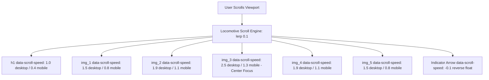

# Feature F3: Locomotive Parallax Hero Section

## 1. Description & User-Facing Behavior
The hero section opens with the bold statement *"It's not just coffee. It's Starbucks"*. Behind and around the typography float 5 high-resolution transparent coffee cups rendered at varying scales. As the user scrolls downward, each cup translates at a unique speed, producing a three-dimensional depth illusion where the center cup glides forward while side cups move subtly.

## 2. Code Trace & Function Reference
- **Component File**: [`StarbucksFrontend-Clean-Project/src/pages/Home.jsx`](file:///Users/avishjain/avishjain9-repos/50-starbugs-frontend-copy/StarbucksFrontend-Clean-Project/src/pages/Home.jsx#L41-L51), [`L173-L202`](file:///Users/avishjain/avishjain9-repos/50-starbugs-frontend-copy/StarbucksFrontend-Clean-Project/src/pages/Home.jsx#L173-L202)
- **Styles File**: [`StarbucksFrontend-Clean-Project/src/styles/Home.module.css`](file:///Users/avishjain/avishjain9-repos/50-starbugs-frontend-copy/StarbucksFrontend-Clean-Project/src/styles/Home.module.css#L21-L70)
- **Line Trace**:
  - `const scroll = new LocomotiveScroll({ el: scrollRef.current, smooth: true, lerp: 0.1 })` ([`L42-L46`](file:///Users/avishjain/avishjain9-repos/50-starbugs-frontend-copy/StarbucksFrontend-Clean-Project/src/pages/Home.jsx#L42-L46)): Instantiates the smooth scroll instance.
  - `data-scroll-speed={windowWidth > 700 ? "2.5" : "1.3"}` ([`L188`](file:///Users/avishjain/avishjain9-repos/50-starbugs-frontend-copy/StarbucksFrontend-Clean-Project/src/pages/Home.jsx#L188)): Dynamically provisions parallax velocity coefficients based on viewport width.
  - `return () => { if (scroll) scroll.destroy(); };` ([`L48-L50`](file:///Users/avishjain/avishjain9-repos/50-starbugs-frontend-copy/StarbucksFrontend-Clean-Project/src/pages/Home.jsx#L48-L50)): Safely tears down the virtual scroll listener on unmount.

## 3. Data Touched
- Cloudinary asset endpoints for transparent drink renders.

## 4. Edge Cases & Error Handling
- **Image Fallbacks**: If external Cloudinary assets experience network latency, text layout preserves space due to fixed container dimensions.
- **Scroll Hijack Recovery**: `scroll.destroy()` ensures normal native browser scrolling is restored if the component unmounts.

## 5. Security & Performance
- All hero graphics utilize `loading="eager"` to eliminate cumulative layout shifts (CLS) on initial load.

## 6. Say It Out Loud
> "For the hero section in `Home.jsx`, I wanted to create an illusion of real physical depth as the user scrolls. I integrated Locomotive Scroll 5 on the root container with a smooth linear interpolation factor of point-one. Across the hero, I arranged five transparent Cloudinary beverage graphics and assigned each a distinct `data-scroll-speed` attribute ranging from point-eight to two-point-five. As the user scrolls, Locomotive Scroll translates each layer at different velocities, making foreground drinks feel like they are floating closer to the screen while the typography recedes into the background. I chose Locomotive Scroll over native CSS parallax because it gives us precise frame-by-frame control across browsers. If image loading stalls over slow cellular networks, the text remains readable immediately. One improvement I would make is providing responsive WebP source sets rather than fetching full-size PNGs."
