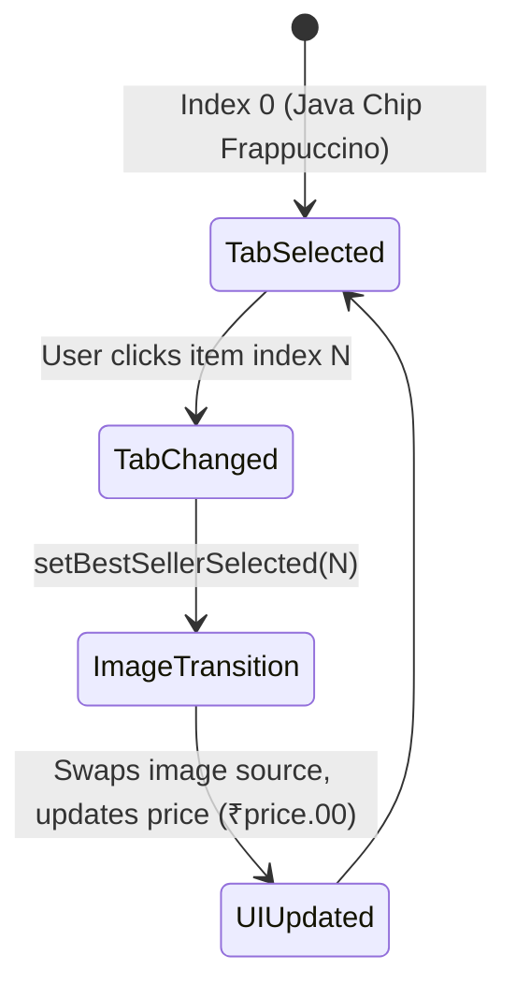

# Feature F4: Interactive Best Sellers Tabbed Showcase

## 1. Description & User-Facing Behavior
A showcase presenting Starbucks top-selling beverages. Users can click through a vertical menu of 6 drinks on the left. Clicking an item highlights its title, updates the large product showcase image with a directional slide-in animation, updates the price tag, and provides an "Add To Bag" call to action.

## 2. Code Trace & Function Reference
- **Component File**: [`StarbucksFrontend-Clean-Project/src/pages/Home.jsx`](file:///Users/avishjain/avishjain9-repos/50-starbugs-frontend-copy/StarbucksFrontend-Clean-Project/src/pages/Home.jsx#L204-L226)
- **Data File**: [`StarbucksFrontend-Clean-Project/src/json/bestSellers.json`](file:///Users/avishjain/avishjain9-repos/50-starbugs-frontend-copy/StarbucksFrontend-Clean-Project/src/json/bestSellers.json#L1-L32)
- **Line Trace**:
  - `const [bestSellerSelected, setBestSellerSelected] = useState(0)` ([`L37`](file:///Users/avishjain/avishjain9-repos/50-starbugs-frontend-copy/StarbucksFrontend-Clean-Project/src/pages/Home.jsx#L37)): Tracks active drink selection.
  - `onClick={() => setBestSellerSelected(index)}` ([`L211`](file:///Users/avishjain/avishjain9-repos/50-starbugs-frontend-copy/StarbucksFrontend-Clean-Project/src/pages/Home.jsx#L211)): Mutates active state index.
  - `src={bestSellers[bestSellerSelected].image}` ([`L218`](file:///Users/avishjain/avishjain9-repos/50-starbugs-frontend-copy/StarbucksFrontend-Clean-Project/src/pages/Home.jsx#L218)): Dynamically feeds the active image.
  - `₹{bestSellers[bestSellerSelected].price}.00` ([`L221`](file:///Users/avishjain/avishjain9-repos/50-starbugs-frontend-copy/StarbucksFrontend-Clean-Project/src/pages/Home.jsx#L221)): Renders formatted price badge.

## 3. Data Touched
- Dataset `bestSellers.json` containing 6 beverage records.

## 4. Edge Cases & Error Handling
- Index bounds are protected as array mapping dynamically bounds index references to array length (`0` to `5`).

## 5. Security & Performance
- All product links route safely through React Router DOM `<Link to="/">` without full-page reloads.

## 6. Say It Out Loud
> "In `Home.jsx`, I created an interactive Best Sellers showcase that lets customers preview top-rated beverages before navigating into the full catalog. I hold the active item index in a `bestSellerSelected` React state variable initialized to zero. When a user clicks any beverage name in the list, the state updates instantaneously, triggering a re-render that swaps the featured high-resolution image, updates the price tag, and highlights the active tab. The image container is wrapped in my custom `FramerMotion` wrapper to animate smoothly from right to left. I chose a tabbed interactive showcase instead of a generic horizontal carousel because it reduces cognitive overload and allows users to compare items without endless swiping. A limitation is that the 'Add To Bag' button currently only logs intent; in a full e-commerce stack, this would dispatch to a shopping cart Redux store or server mutation."
