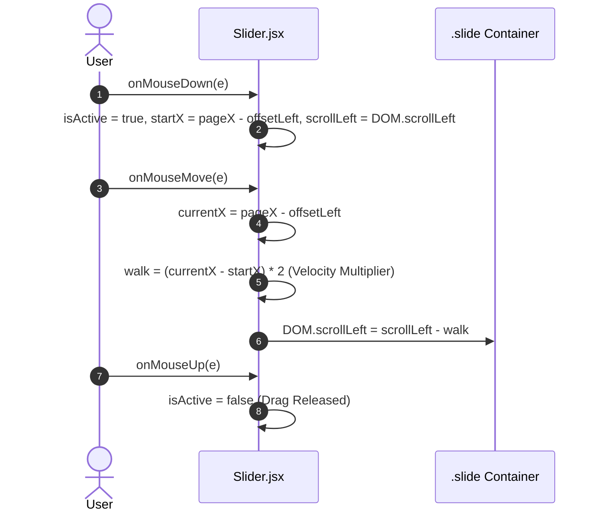

# Feature F5: Drag-to-Scroll Product & Category Sliders

## 1. Description & User-Facing Behavior
Enables users on desktop to click anywhere on product or category rows and drag horizontally to scrub through items with responsive mouse velocity. The drag calculation incorporates a 2x distance multiplier to provide a smooth, tactile scrolling feel without relying on native browser scrollbars.

## 2. Code Trace & Function Reference
- **Component File**: [`StarbucksFrontend-Clean-Project/src/layout/Slider.jsx`](file:///Users/avishjain/avishjain9-repos/50-starbugs-frontend-copy/StarbucksFrontend-Clean-Project/src/layout/Slider.jsx#L1-L95)
- **Sub-Component**: [`StarbucksFrontend-Clean-Project/src/components/ProductBox.jsx`](file:///Users/avishjain/avishjain9-repos/50-starbugs-frontend-copy/StarbucksFrontend-Clean-Project/src/components/ProductBox.jsx#L1-L22)
- **Line Trace**:
  - `sliderRef = useRef(null)` ([`L10`](file:///Users/avishjain/avishjain9-repos/50-starbugs-frontend-copy/StarbucksFrontend-Clean-Project/src/layout/Slider.jsx#L10)): DOM handle to the scrollable container.
  - `onMouseDown` ([`L22-L27`](file:///Users/avishjain/avishjain9-repos/50-starbugs-frontend-copy/StarbucksFrontend-Clean-Project/src/layout/Slider.jsx#L22-L27)): Records anchor coordinates `startX` and container `scrollLeft`.
  - `onMouseMove` ([`L13-L20`](file:///Users/avishjain/avishjain9-repos/50-starbugs-frontend-copy/StarbucksFrontend-Clean-Project/src/layout/Slider.jsx#L13-L20)): Updates `sliderRef.current.scrollLeft = scrollLeft - walk`.
  - `onMouseUp` ([`L29-L32`](file:///Users/avishjain/avishjain9-repos/50-starbugs-frontend-copy/StarbucksFrontend-Clean-Project/src/layout/Slider.jsx#L29-L32)): Disables active drag mode.

## 3. Data Touched
- Static array in `products.json` and static category list (Drinks, Foods, Merchandise, Coffee At Home, Ready to Eat).

## 4. Edge Cases & Error Handling
- `e.preventDefault()` prevents native image drag selection which would otherwise break mouse event tracking.
- Touch events remain native for seamless mobile gesture swiping.

## 5. Security & Performance
- Uses direct DOM property updates (`sliderRef.current.scrollLeft`) bypassing React state reconciliation to achieve jitter-free 60 FPS scrubbing.

## 6. Say It Out Loud
> "I built the product and category slider in `Slider.jsx` to support natural mouse-drag gestures on desktop, mimicking touch scrolling on mobile. In the component, I attach `onMouseDown`, `onMouseMove`, and `onMouseUp` handlers to a scrollable `div`. When the user presses down, I record the initial horizontal click position and current scroll offset. As the mouse moves, I multiply the delta by a factor of two to create responsive momentum, updating `sliderRef.current.scrollLeft` directly. I chose custom drag physics instead of native scrollbars because it creates a cleaner, app-like desktop experience without ugly browser scroll widgets. One limitation in the current code is using mutable local variables for `startX` and `isActive` rather than `useRef`, which could cause state drift across fast re-renders. In production, I would refactor those flags into React refs to ensure thread-safe gesture tracking."
