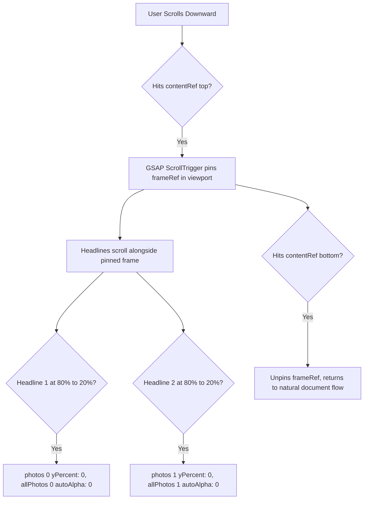

# Feature F6: Sticky Pinned GSAP ScrollTrigger Split Frame

## 1. Description & User-Facing Behavior
A split-screen storytelling experience highlighting Starbucks core values: *Fresh Ingredients*, *Hygiene Standards*, and *Handcrafted with Heart*. On desktop viewports, the right-hand image frame pins in place while narrative headlines scroll on the left. As each headline reaches the center of the viewport, the pinned frame crossfades into the corresponding photo.

## 2. Code Trace & Function Reference
- **Component File**: [`StarbucksFrontend-Clean-Project/src/pages/Home.jsx`](file:///Users/avishjain/avishjain9-repos/50-starbugs-frontend-copy/StarbucksFrontend-Clean-Project/src/pages/Home.jsx#L55-L156)
- **Styles File**: [`StarbucksFrontend-Clean-Project/src/styles/Home.module.css`](file:///Users/avishjain/avishjain9-repos/50-starbugs-frontend-copy/StarbucksFrontend-Clean-Project/src/styles/Home.module.css#L126-L173)
- **Line Trace**:
  - `const ctx = gsap.context(() => { ... })` ([`L55`](file:///Users/avishjain/avishjain9-repos/50-starbugs-frontend-copy/StarbucksFrontend-Clean-Project/src/pages/Home.jsx#L55)): Creates scoped GSAP animation context.
  - `gsap.set(photos, { yPercent: 101 })` ([`L60`](file:///Users/avishjain/avishjain9-repos/50-starbugs-frontend-copy/StarbucksFrontend-Clean-Project/src/pages/Home.jsx#L60)): Hides subsequent photos below view.
  - `ScrollTrigger.create({ trigger: contentRef.current, pin: frameRef.current, scrub: true })` ([`L125-L131`](file:///Users/avishjain/avishjain9-repos/50-starbugs-frontend-copy/StarbucksFrontend-Clean-Project/src/pages/Home.jsx#L125-L131)): Pins the photo frame across the scroll span of `contentRef`.
  - `return () => ctx.revert()` ([`L154`](file:///Users/avishjain/avishjain9-repos/50-starbugs-frontend-copy/StarbucksFrontend-Clean-Project/src/pages/Home.jsx#L154)): Reverts all ScrollTrigger instances upon component unmount.

## 3. Data Touched
- Static image files in `public/`: `features-1.webp`, `features-2.avif`, `features-3.jpg`.

## 4. Edge Cases & Error Handling
- **Window Resize**: Handled by `ctx.revert()` which recalculates trigger coordinates.
- **Mobile Screen Guard**: Disabled on mobile viewports via CSS `display: none` on `.features` and enabled on `.features_mob`.

## 5. Security & Performance
- Uses sub-pixel GPU matrix translation (`yPercent`), avoiding costly repaint operations.

## 6. Say It Out Loud
> "The centerpiece of our brand storytelling is the pinned split-frame section in `Home.jsx`. On desktop, as the user scrolls into the quality features section, the right-side square image frame pins firmly in place while the text headlines scroll past on the left. Using GSAP ScrollTrigger inside an encapsulated `gsap.context`, I loop through each headline and link it to an image layer in the pinned frame. As each headline passes the viewport threshold, ScrollTrigger scrubs the corresponding photo from one-hundred percent vertical offset to zero while fading out the previous image. I chose GSAP ScrollTrigger because it provides sub-pixel scrub accuracy and handles pin-spacing calculations automatically without manual offset math. What I'm most proud of is wrapping everything inside `gsap.context`, which guarantees that all timeline hooks and DOM mutations are cleanly reverted when navigating away."
