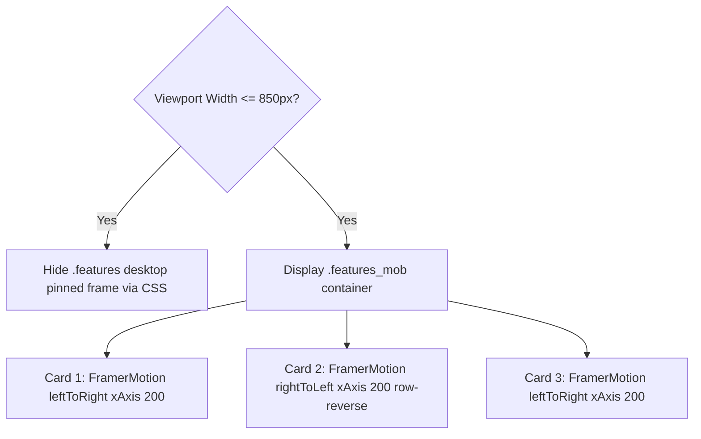

# Feature F7: Mobile Split Directional Feature Cards

## 1. Description & User-Facing Behavior
When viewed on mobile devices (`max-width: 850px`), the desktop pinned split-screen frame is hidden to avoid cramped layouts. In its place, the three brand pillars are presented as individual cards featuring alternating image-and-text orientations that slide into view directionally using Framer Motion.

## 2. Code Trace & Function Reference
- **Component File**: [`StarbucksFrontend-Clean-Project/src/pages/Home.jsx`](file:///Users/avishjain/avishjain9-repos/50-starbugs-frontend-copy/StarbucksFrontend-Clean-Project/src/pages/Home.jsx#L270-L304)
- **Styles File**: [`StarbucksFrontend-Clean-Project/src/styles/Home.module.css`](file:///Users/avishjain/avishjain9-repos/50-starbugs-frontend-copy/StarbucksFrontend-Clean-Project/src/styles/Home.module.css#L174-L219)
- **Line Trace**:
  - `FramerMotion type={"leftToRight"} xAxis={200}` ([`L271`](file:///Users/avishjain/avishjain9-repos/50-starbugs-frontend-copy/StarbucksFrontend-Clean-Project/src/pages/Home.jsx#L271)): Animates Card 1.
  - `FramerMotion type={"rightToLeft"} xAxis={200}` ([`L282`](file:///Users/avishjain/avishjain9-repos/50-starbugs-frontend-copy/StarbucksFrontend-Clean-Project/src/pages/Home.jsx#L282)): Animates Card 2 in reverse orientation (`flexDirection: "row-reverse"`).
  - `FramerMotion type={"leftToRight"} xAxis={200}` ([`L293`](file:///Users/avishjain/avishjain9-repos/50-starbugs-frontend-copy/StarbucksFrontend-Clean-Project/src/pages/Home.jsx#L293)): Animates Card 3.

## 3. Data Touched
- Static image files in `public/`: `features-1.webp`, `features-2.avif`, `features-3.jpg`.

## 4. Edge Cases & Error Handling
- Eliminates touch scrolling deadzones associated with desktop `ScrollTrigger.pin`.

## 5. Security & Performance
- Uses modern next-gen image formats (`.webp`, `.avif`) for reduced payload size and faster mobile rendering.

## 6. Say It Out Loud
> "On mobile viewports, complex pinned split-frames often cause screen cramping and touch gesture conflicts. To solve this, I created a dedicated mobile layout in `Home.jsx` that activates on screens under 850 pixels. Using media queries, I hide the pinned GSAP frame and render three vertical cards that alternate between left-to-right and right-to-left slide-in animations using Framer Motion. This delivers an equally dynamic storytelling experience tailored specifically to one-handed vertical phone scrolling while conserving mobile GPU memory."
