# Feature F8: Bidirectional Infinite Marquee (Social Proof)

```mermaid
flowchart LR
    subgraph Row1 [Row 1: direction='right']
        R1List1[Track 1: items 0-9] --> R1List2[Duplicate Track 2: items 0-9]
        R1List2 -. Reverse Keyframe Linear Infinite .-> R1Flow[Flows Right]
    end

    subgraph Row2 [Row 2: direction='left']
        R2List1[Track 1: items 10-19] --> R2List2[Duplicate Track 2: items 10-19]
        R2List2 -. Forwards Keyframe Linear Infinite .-> R2Flow[Flows Left]
    end

    Mask[CSS Mask Gradient: transparent, white 20%, white 80%, transparent] --> Row1
    Mask --> Row2
```

## 1. Description & User-Facing Behavior
A dynamic social proof showcase entitled *"From The Starbucks Community"*. Two horizontal rows of customer photos glide across the viewport without interruption. Row 1 moves continuously to the right, while Row 2 moves continuously to the left. The container features soft gradient masks on both screen edges.

## 2. Code Trace & Function Reference
- **Component File**: [`StarbucksFrontend-Clean-Project/src/layout/InfiniteScroll.jsx`](file:///Users/avishjain/avishjain9-repos/50-starbugs-frontend-copy/StarbucksFrontend-Clean-Project/src/layout/InfiniteScroll.jsx#L1-L38)
- **Styles File**: [`StarbucksFrontend-Clean-Project/src/styles/main.css`](file:///Users/avishjain/avishjain9-repos/50-starbugs-frontend-copy/StarbucksFrontend-Clean-Project/src/styles/main.css#L94-L159)
- **Line Trace**:
  - Twin lists ([`L10-L33`](file:///Users/avishjain/avishjain9-repos/50-starbugs-frontend-copy/StarbucksFrontend-Clean-Project/src/layout/InfiniteScroll.jsx#L10-L33)): Duplicates dataset inside identical `<ul>` siblings.
  - CSS keyframe `@keyframes scrollX` ([`L148-L155`](file:///Users/avishjain/avishjain9-repos/50-starbugs-frontend-copy/StarbucksFrontend-Clean-Project/src/styles/main.css#L148-L155)): Seamless `-100%` translation loop.
  - Gradient mask ([`L101-L108`](file:///Users/avishjain/avishjain9-repos/50-starbugs-frontend-copy/StarbucksFrontend-Clean-Project/src/styles/main.css#L101-L108)): `mask: linear-gradient(90deg, transparent, white 20%, white 80%, transparent)`.

## 3. Data Touched
- `community.json` dataset (20 customer image records split via `slice(0, 10)` and `slice(10)`).

## 4. Edge Cases & Error Handling
- Seamless loop calculation requires two identical sibling tracks so when track 1 reaches `-100%`, track 2 seamlessly replaces it.

## 5. Security & Performance
- Executed on the browser GPU compositor thread via pure CSS animations, avoiding JavaScript event loop contention.

## 6. Say It Out Loud
> "To showcase customer community engagement, I built a dual-row infinite marquee in `InfiniteScroll.jsx`. The component duplicates its dataset across two identical unordered lists inside a container with a CSS linear-gradient mask that fades the left and right edges to transparent. The animation is driven entirely by pure CSS keyframes translating the lists negative one-hundred percent horizontally. By toggling a data-direction attribute, row one scrolls right while row two scrolls left. I implemented this purely in CSS rather than JavaScript to keep the animation off the main thread, ensuring smooth 60 FPS motion even while React is rendering other components."
