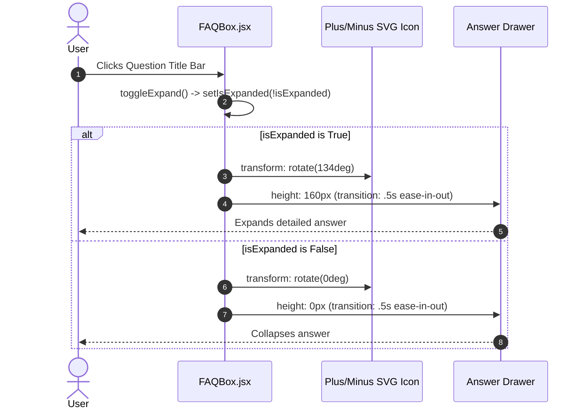

# Feature F9: Animated Accordion FAQ Engine

## 1. Description & User-Facing Behavior
An interactive Frequently Asked Questions section. Users click any question to toggle an accordion drawer. When clicked, the plus icon smoothly rotates 134 degrees to form a dismiss cross, and the answer container expands to 160px height.

## 2. Code Trace & Function Reference
- **Component File**: [`StarbucksFrontend-Clean-Project/src/components/FAQBox.jsx`](file:///Users/avishjain/avishjain9-repos/50-starbugs-frontend-copy/StarbucksFrontend-Clean-Project/src/components/FAQBox.jsx#L1-L28)
- **Data File**: [`StarbucksFrontend-Clean-Project/src/json/faqData.json`](file:///Users/avishjain/avishjain9-repos/50-starbugs-frontend-copy/StarbucksFrontend-Clean-Project/src/json/faqData.json#L1-L23)
- **Line Trace**:
  - `const [isExpanded, setIsExpanded] = useState(false)` ([`L5`](file:///Users/avishjain/avishjain9-repos/50-starbugs-frontend-copy/StarbucksFrontend-Clean-Project/src/components/FAQBox.jsx#L5)): Tracks expansion state.
  - `transform: rotate(${isExpanded ? "134deg" : "0deg"})` ([`L16`](file:///Users/avishjain/avishjain9-repos/50-starbugs-frontend-copy/StarbucksFrontend-Clean-Project/src/components/FAQBox.jsx#L16)): Rotates SVG indicator.
  - `height: isExpanded ? "160px" : "0px"` ([`L18`](file:///Users/avishjain/avishjain9-repos/50-starbugs-frontend-copy/StarbucksFrontend-Clean-Project/src/components/FAQBox.jsx#L18)): Animates container drawer height.

## 3. Data Touched
- Static `faqData.json` containing 5 Starbucks customer questions.

## 4. Edge Cases & Error Handling
- Each FAQ item maintains independent state, allowing multiple items to be opened simultaneously.

## 5. Security & Performance
- Plain text answers avoid any XSS attack surface.

## 6. Say It Out Loud
> "I built the customer support FAQ section in `FAQBox.jsx` using self-contained accordion components. Each FAQ box maintains an `isExpanded` boolean state that toggles whenever the question bar is clicked. When expanded, the answer container transitions from zero to one-hundred-sixty pixels while the plus icon smoothly rotates one-hundred-thirty-four degrees into a dismiss cross. I used CSS transitions for the height and transform properties to ensure hardware acceleration. If I were refactoring this for production, I would use CSS `grid-template-rows: 0fr` to `1fr` rather than a fixed pixel height, so variable-length answers expand dynamically without text overflow."
