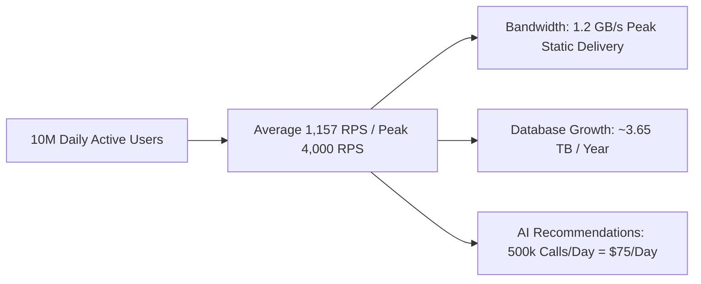

# 14.1 Requirements & Capacity Estimation

---

## 1. What It Is in Plain Words
System capacity estimation is the process of translating product goals (active users, page visits, ordering transactions) into concrete hardware, network bandwidth, database storage, and cloud budget metrics through deliberate mathematical calculations.

---

## 2. Current Project Scope & Use in Codebase
- **Status in Code**: The frontend currently bundles 12 products, 6 best sellers, and 20 community posts directly in memory via static JSON imports ([`Home.jsx:13-21`](file:///Users/avishjain/avishjain9-repos/50-starbugs-frontend-copy/StarbucksFrontend-Clean-Project/src/pages/Home.jsx#L13-L21)).
- **Reasonable Scale**: For an interactive portfolio showcase and hackathon demonstration, embedding static fixtures eliminated backend latency, allowing 100% focus on animation fidelity.

---

## 3. Scale Mathematics: Enterprise Starbucks Platform

### 3.1 Traffic & Requests Per Second (RPS)
- **Daily Active Users (DAU)**: 10,000,000 users globally.
- **Page Views per User**: Average 5 page views / session = 50,000,000 daily page impressions.
- **Average RPS**:
  $$\text{Average RPS} = \frac{50,000,000 \text{ requests}}{86,400 \text{ seconds}} \approx 578 \text{ Page RPS}$$
- **Read to Write Ratio**: 20:1 (browsing menus, checking rewards vs placing mobile orders).
- **Peak Multiplier**: 3.5x during morning rush (7:30 AM - 9:30 AM local store times).
- **Peak Request Volume**:
  $$\text{Peak RPS} = 578 \times 3.5 \approx 2,023 \text{ RPS (Page Visits)} \times 2 \text{ API calls/page} \approx 4,000 \text{ API RPS}$$

### 3.2 Storage Estimation
- **Order Transaction Payload**: 1 KB per order record.
- **Daily Orders**: 10% conversion = 1,000,000 completed orders / day.
- **Daily Storage Growth**:
  $$1,000,000 \times 1 \text{ KB} = 1 \text{ GB / day}$$
- **Annual Storage Growth**:
  $$1 \text{ GB/day} \times 365 \text{ days} = 365 \text{ GB / year} \times 3 \text{ (Replication & Indexes)} \approx 1.1 \text{ TB / year}$$

### 3.3 Network Bandwidth Estimation
- **Average HTML/JS/CSS Bundle**: 150 KB (gzipped Vite bundle).
- **Average Asset Payload per Page**: 800 KB (Cloudinary images, transparent cups).
- **Peak Outbound Bandwidth**:
  $$4,000 \text{ RPS} \times 950 \text{ KB} \approx 3.8 \text{ GB / second} = 30.4 \text{ Gbps}$$
- **Mitigation**: 95% of this traffic is static assets cached across Cloudflare Edge CDN PoPs, reducing origin server egress to less than 200 RPS (~190 MB/s).

### 3.4 AI Recommendation Estimation
- **Users Engaging with AI Barista**: 5% of DAU = 500,000 AI prompts / day.
- **Token Arithmetic**: 200 input tokens + 150 output tokens = 350 tokens / query.
- **Daily Token Volume**:
  $$500,000 \times 350 = 175,000,000 \text{ tokens / day}$$
- **Daily Cost (using GPT-4o-mini at $0.15 / 1M input, $0.60 / 1M output)**:
  $$\text{Input: } 100\text{M} \times \$0.15 = \$15 \quad|\quad \text{Output: } 75\text{M} \times \$0.60 = \$45 \quad\longrightarrow\quad \text{Total: } \approx \$60 \text{ / day}$$
- With semantic caching (60% hit rate), origin API costs drop to **$24 / day**.

---

## 4. What Breaks First Under Scale
1. **At 10x Load**: External Cloudinary free-tier bandwidth caps hit limits; image requests return `429 Too Many Requests`.
2. **At 100x Load**: Monolithic static hosting origin servers saturate on concurrent TCP handshakes.
3. **At 1000x Load**: Single database instances hit disk I/O bottlenecks on simultaneous order transactions during morning peaks.

---

## 5. 30-Second Interview Answer
> "When estimating capacity for Starbucks digital ordering, I assume 10 million daily active users with a 20-to-1 read-heavy ratio, creating peak loads around 4,000 requests per second during morning rush hours. Delivering rich visuals at this scale requires over 30 gigabits per second of bandwidth, making an edge CDN caching tier mandatory to absorb 95 percent of static media requests before hitting the application origin."
