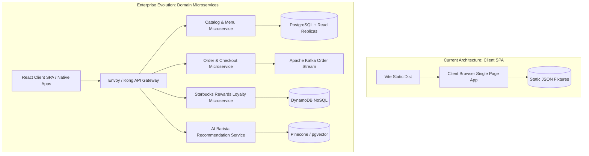

# 14.2 Architecture Styles & System Topology

---

## 1. What It Is in Plain Words
Architecture style defines the structural paradigm of how code, processes, and network boundaries are organized—ranging from single monolithic binaries to modular domain services and event-driven microservices.

---

## 2. Current Implementation in Codebase
- **Architecture**: **Client-Side Single Page Application (SPA)**.
- **File Reference**: [`src/App.jsx:9-23`](file:///Users/avishjain/avishjain9-repos/50-starbugs-frontend-copy/StarbucksFrontend-Clean-Project/src/App.jsx#L9-L23). All UI routing, view rendering, and state management execute inside the client's browser engine using bundled static JSON fixtures.
- **Reasonable Scope**: Excellent for an interactive UI portfolio; avoids distributed systems complexity and allows instant local development via `npm run dev`.

---

## 3. Comparison of Architecture Styles

| Dimension | Client-Side SPA (Current) | Modular Monolith | Microservices Architecture | Serverless Functions |
| :--- | :--- | :--- | :--- | :--- |
| **Deployment Complexity** | Trivial (upload static `dist/` to CDN) | Moderate (single deployable binary) | High (Kubernetes clusters, service mesh) | Low (per-function deployment) |
| **Scaling Characteristics** | Infinite static scaling via CDN edges | Scale whole server vertically/horizontally | Independent service autoscaling | Automatic elastic scaling |
| **Data Consistency** | Local in-memory only | ACID database transactions | Eventual consistency via Saga pattern | Distributed database queries |
| **Team Autonomy** | Single frontend team | Single unified engineering team | Independent domain feature teams | Individual function owners |
| **Cold Starts** | Zero server latency | Zero cold starts | Low | Noticeable container cold starts |

---

## 4. When and How to Split Into Services

As Starbucks expands digital ordering, the backend decomposes along business domain boundaries:
1. **Catalog & Menu Service**: Manages store-specific menu availability, pricing tiers, and ingredient recipes. Highly cacheable read-heavy workload.
2. **Order Processing Service**: High-throughput transactional service managing checkout, payment settlement, and kitchen ticket dispatch.
3. **Rewards & Loyalty Service**: Tracks star accrual, level tiers, and promotional discount redemptions.
4. **AI Barista Profiler**: Dedicated GPU-proxied service handling conversational recommendation queries.

---

## 5. 30-Second Interview Answer
> "This project currently uses a pure client-side SPA architecture, which is ideal for a high-performance UI showcase because it eliminates server round-trips and delegates rendering entirely to the browser. In an enterprise production setting, I would evolve this into an event-driven microservices topology behind an API Gateway, decoupling read-heavy menu queries from transactional order processing and real-time barista kitchen routing."
