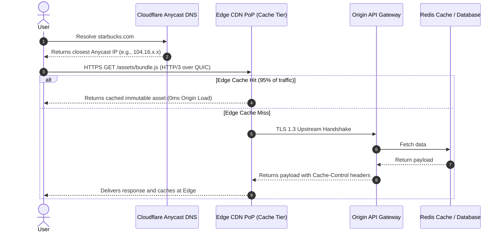

# 14.3 Networking, CDN & Communication Protocols

---

## 1. What It Is in Plain Words
Networking governs how data packets travel between client browsers, domain name servers (DNS), content delivery networks (CDNs), load balancers, and application origin servers, establishing latency budgets, transport protocols, and communication contracts.

---

## 2. Current Implementation in Codebase
- **Media CDN Delivery**: Transparent drink renders and community imagery are delivered over HTTPS via Cloudinary (`res.cloudinary.com`) and Cognizant OrderServ (`starbucksstatic.cognizantorderserv.com`).
- **Font Delivery**: Linked via Google Fonts CDN in [`index.html:8-14`](file:///Users/avishjain/avishjain9-repos/50-starbugs-frontend-copy/StarbucksFrontend-Clean-Project/index.html#L8-L14) with `preconnect` resource hints.
- **Protocol**: HTTP/2 or HTTP/3 depending on client browser and cloud CDN negotiation.

---

## 3. Protocol Comparison Matrix

| Protocol | Transport Layer | Multiplexing | Head-of-Line Blocking | Handshake Round Trips | Fit for Starbucks UI |
| :--- | :--- | :--- | :--- | :--- | :--- |
| **HTTP/1.1** | TCP | No (sequential pipelining) | Yes (single slow request blocks connection) | 2-3 RTTs (TCP + TLS) | Deprecated; causes asset loading jank. |
| **HTTP/2** | TCP | Yes (single TCP connection) | Yes (at TCP packet drop level) | 1-2 RTTs | Standard for modern web delivery. |
| **HTTP/3** | UDP (QUIC) | Yes (independent streams) | **Eliminated** (packet loss affects only that stream) | **0-1 RTT** (Fast reconnection on mobile cellular) | **Optimal** for mobile customers switching from Wi-Fi to 5G. |

---

## 4. REST vs GraphQL vs WebSockets vs gRPC

| Dimension | REST (Used for Catalog) | GraphQL | WebSockets | gRPC |
| :--- | :--- | :--- | :--- | :--- |
| **Communication Pattern** | Request / Response | Request / Response | Bidirectional Full Duplex | Bidirectional Streaming |
| **Over-Fetching Defense** | Moderate (fixed schemas) | Excellent (exact client queries) | N/A | High (Protocol Buffers) |
| **Edge Cacheability** | **Trivial** (native HTTP GET caching) | Difficult (POST body queries) | Not cacheable | Not cacheable via HTTP CDN |
| **Use Case in Starbucks** | Menu catalogs, store locator | Complex mobile app order history | Real-time order progress tracking | Inter-service microservice RPC |

---

## 5. 30-Second Interview Answer
> "For the Starbucks web platform, I leverage HTTP/3 over QUIC on an Anycast CDN tier. HTTP/3 eliminates TCP head-of-line blocking, which is critical for mobile customers switching between store Wi-Fi and 5G cellular networks. While REST endpoints provide seamless edge caching for static menu assets, I use persistent WebSockets for live barista kitchen status updates and gRPC for high-throughput inter-service microservice calls behind our gateway."
