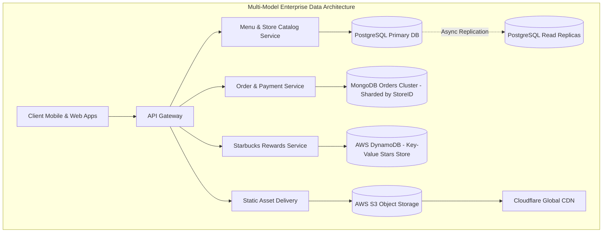

# 14.5 Databases, Storage & Cloud Asset Stores

---

## 1. What It Is in Plain Words
Data storage architecture encompasses relational databases (SQL), document stores (NoSQL), key-value databases, and object blob stores, chosen according to consistency requirements, read/write patterns, and query complexity.

---

## 2. Current Implementation in Codebase
- **Current State**: Static JSON data files bundled in client JavaScript (`bestSellers.json`, `products.json`, `community.json`, `faqData.json`).
- **Reasonable Scope**: Eliminates database maintenance, provisioning costs, and query latencies for a portfolio frontend.

---

## 3. Database Technology Comparisons for Starbucks Platform

| Database | Data Model | ACID Compliance | Horizontal Scaling | Query Complexity | Primary Starbucks Fit |
| :--- | :--- | :--- | :--- | :--- | :--- |
| **PostgreSQL** (Selected for Catalog) | Relational / Tables | Full ACID (Strong consistency) | Read replicas + Citus sharding | High (Complex JOINs, aggregates) | **Menu & Store Catalog**: Strict relationships between items, milk options, and allergens. |
| **MongoDB** (Selected for Orders) | Document / JSON BSON | ACID at Document / Multi-doc transactions | Native Sharding by shard key | Moderate (Aggregation pipelines) | **Mobile Orders**: Highly flexible order documents storing nested customizations. |
| **AWS DynamoDB** (Selected for Loyalty) | Key-Value / Wide-Column | Tunable (Strong / Eventual) | Boundless automated horizontal scale | Low (Single-digit ms PK queries) | **Rewards & Stars**: Fast lookups by `userId` to retrieve star balances. |
| **Pinecone / pgvector** | Vector Embeddings | N/A | High | Cosine similarity k-NN search | **AI Barista**: Finding drinks matching taste prompts. |

---

## 4. Normalization vs Embedding Strategy

In our order processing pipeline, we utilize a **denormalized embedding pattern** for completed orders:
- **Why?** Menu item prices and ingredient formulations change over time. If an order references `productId: 42`, updating the price of a Latte from ₹270 to ₹300 next month must not alter the historic receipt of an order placed today.
- **Solution**: The complete snapshot of the product name, unit price, size, and customizations is embedded directly inside the order record at checkout time.

---

## 5. 30-Second Interview Answer
> "For an enterprise Starbucks platform, I adopt a polyglot persistence strategy: PostgreSQL for our structured menu catalog where relational integrity and complex allergen JOINs are critical, sharded MongoDB clusters for orders to store rich nested drink customizations, DynamoDB for single-digit millisecond rewards star lookups, and S3 backed by an Anycast CDN for high-resolution beverage assets."
