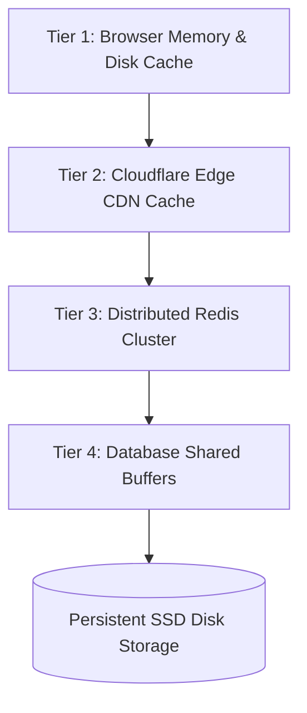
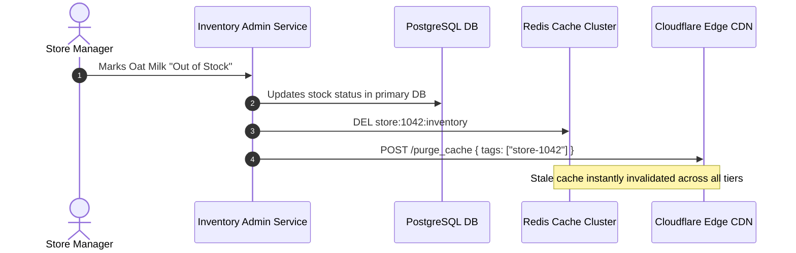

# 14.6 Multi-Tier Caching & Invalidation Architecture

---

## 1. What It Is in Plain Words
Caching stores frequently accessed data in high-speed, volatile memory tiers (RAM, Edge SSDs), intercepting requests to minimize database load, reduce network latency, and protect downstream systems from traffic spikes.

---

## 2. Current Implementation in Codebase
- **Browser Memory Caching**: React state (`bestSellerSelected` in `Home.jsx`, `isMenuOpen` in `Navbar.jsx`) retains UI view state in browser RAM.
- **CDN Edge Caching**: Media assets from Cloudinary and fonts from Google Fonts utilize long-lived HTTP caching headers.

---

## 3. Multi-Tier Enterprise Caching Hierarchy

| Tier | Technology | TTL (Time-to-Live) | Data Stored | Eviction Strategy |
| :--- | :--- | :--- | :--- | :--- |
| **Tier 1: Browser** | Browser Cache (Disk/RAM) | 1 Year (Static Assets) / 5 min (Catalog) | JS/CSS bundles, SVG icons, compiled images | Browser LRU / Cache-Control |
| **Tier 2: Edge CDN** | Cloudflare CDN PoPs | 24 Hours (Menu) / 1 Year (Images) | Menu catalogs, Cloudinary coffee graphics | Cloudflare Purge API on menu update |
| **Tier 3: App Cache** | Redis Cluster | 15 Minutes (Store Menu) / 1 Hr (User Profile) | Store-specific item inventory, price overrides | Redis volatile-LRU |
| **Tier 4: Database** | PostgreSQL Buffer Pool | Dynamic | Hot index pages, frequent SQL result rows | Internal database LRU / Clock-sweep |

---

## 4. Cache Invalidation & Thundering Herd Defense

### Cache Invalidation: Cache-Aside with Event-Driven Purge

### Thundering Herd Defense (Mutual Exclusion Lock)
When a cached menu item expires during morning peak hours, thousands of concurrent requests could overwhelm the primary database simultaneously (Cache Stampede). We implement a **Redis Mutex Lock (`SETNX`)**: the first request acquires the lock and queries the database, while subsequent requests wait 50ms and read from the repopulated cache.

---

## 5. 30-Second Interview Answer
> "We employ a four-tier caching architecture: browser memory, Cloudflare Edge CDN, Redis clusters, and database buffer pools. For catalog availability, we use a cache-aside pattern with event-driven invalidation via webhooks. To prevent thundering herd stampedes during morning peak hours when hot keys expire, we implement distributed mutex locks with probabilistic early expiration algorithms like XFetch."
