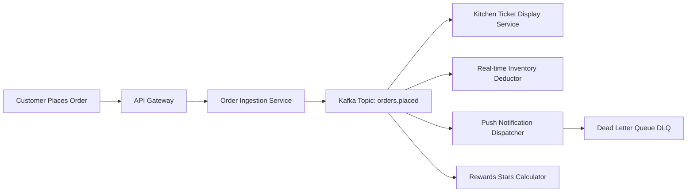

# 14.7 Messaging, Asynchronous Queues & Event Streams

---

## 1. What It Is in Plain Words
Asynchronous messaging decouples request ingestion from heavy backend processing, allowing services to publish events to persistent queues or log streams without blocking the client's HTTP response.

---

## 2. Current Implementation in Codebase
- **Status in Code**: The current frontend processes all events synchronously via React state and event listeners.
- **Reasonable Scope**: Static marketing sites have no background jobs or inter-service communications.

---

## 3. Queue Technologies Comparison Matrix

| Technology | Messaging Paradigm | Delivery Guarantee | Throughput | Persistence | Primary Use Case in Starbucks |
| :--- | :--- | :--- | :--- | :--- | :--- |
| **Apache Kafka** (Selected) | Distributed Commit Log | At-least-once / Exactly-once (Kafka Streams) | 1,000,000+ msgs/sec | Replicated disk commit log | **Order Events Spine**: Central pipeline consumed by kitchen, inventory, and rewards. |
| **RabbitMQ** | Smart Broker / Push AMQP | At-least-once | 50,000 msgs/sec | Disk & RAM queues | Complex routing keys for localized store delivery. |
| **AWS SQS** | Cloud Managed Queue | At-least-once (Standard) / FIFO | High | Cloud managed | Dead-letter queue buffering failed payment retries. |
| **BullMQ (Redis)** | In-Memory Job Queue | At-least-once | 100,000 msgs/sec | Redis persistence | Delayed cron jobs (e.g., daily star expiration warnings). |

---

## 4. Delivery Semantics & Idempotent Consumers

In mobile food ordering, network drops can cause mobile apps to retry checkout requests. We enforce **Exactly-Once Processing Semantics**:
1. Every order submission carries a client-generated **Idempotency Key** (`UUIDv4`).
2. Downstream consumers store processed idempotency keys in Redis with a 24-hour TTL.
3. If an event is re-delivered, the consumer detects the duplicate key and immediately confirms success without charging the customer twice or printing duplicate kitchen tickets.

---

## 5. 30-Second Interview Answer
> "We use an event-driven architecture powered by Apache Kafka as our central event spine. When a customer taps checkout, the order service validates payment, publishes an `orders.placed` event, and returns an immediate HTTP 201 response. Kitchen display systems, inventory decrementers, and rewards services consume this event independently. All consumers are engineered with idempotency keys to ensure that network retries never result in duplicate billing or double kitchen tickets."
