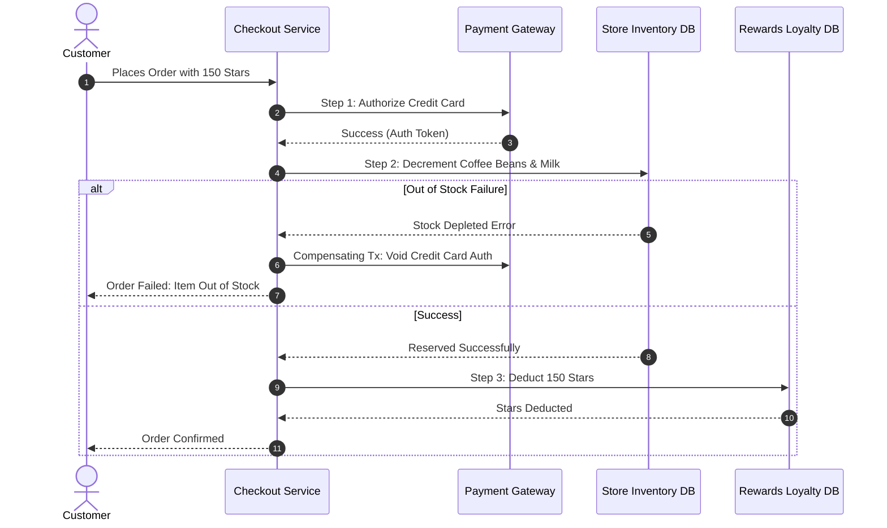
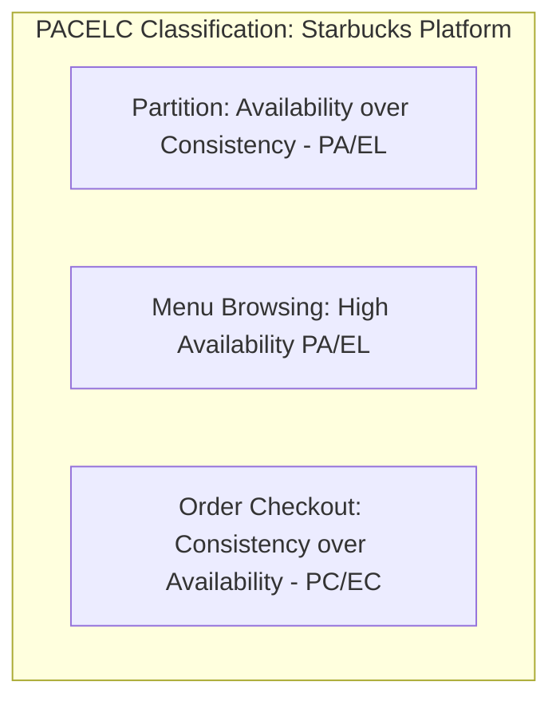

# 14.8 Consistency, Concurrency & Distributed Transactions

---

## 1. What It Is in Plain Words
Distributed consistency and concurrency control address how data integrity is maintained across multiple databases, network partitions, and concurrent write operations without data corruption, race conditions, or lost updates.

---

## 2. CAP & PACELC Theorem Placement

- **Menu Browsing & Catalog (PA/EL)**: If a network partition occurs between cloud regions, prioritize Availability: serve cached menus even if a seasonal syrup status is slightly stale.
- **Order Checkout & Star Redemptions (PC/EC)**: If a partition occurs, prioritize Consistency: refuse to deduct stars unless strong consistency guarantees the user actually possesses those stars.

---

## 3. Distributed Transactions: Saga Pattern vs Two-Phase Commit (2PC)

| Dimension | Two-Phase Commit (2PC) | Choreographed Saga (Kafka) | Orchestrated Saga (Selected) |
| :--- | :--- | :--- | :--- |
| **Locking Mechanism** | Pessimistic distributed database locks | None (Local database transactions) | None (Local database transactions) |
| **Performance** | Slow (holds locks across network latency) | Very High (asynchronous) | High (central coordinator controls steps) |
| **Failure Recovery** | Coordinator rollback | Peer-to-peer event listening | Central Orchestrator fires compensating transactions |
| **Starbucks Fit** | Poor; high latency hurts mobile checkout. | Moderate; difficult to trace edge failures. | **Optimal**: Step-by-step workflow with explicit compensating actions. |

---

## 4. Concurrency Control: Preventing Overselling

When limited-edition merchandise (e.g., Starbucks Reserve Tumblers) goes on sale:
1. **Pessimistic Locking**: `SELECT * FROM inventory WHERE item_id = 99 FOR UPDATE;`. Blocks all other transactions; poor throughput.
2. **Optimistic Locking with Versioning**: `UPDATE inventory SET stock = stock - 1, version = version + 1 WHERE item_id = 99 AND version = 3;`. If another transaction updated the row first, update count is 0; transaction retries.
3. **Redis Atomic Decrement (`DECR`)**: High-performance pre-allocation in Redis memory before database persistence.

---

## 5. 30-Second Interview Answer
> "In distributed systems, you cannot have both strong consistency and 100 percent availability during network partitions. We apply the PACELC theorem: our catalog browsing adopts an eventual consistency model for maximum availability, while financial checkouts enforce strong consistency. To manage multi-service transactions across payments, inventory, and rewards stars without distributed deadlocks, we implement an Orchestrated Saga pattern with explicit compensating transactions for graceful rollbacks."
