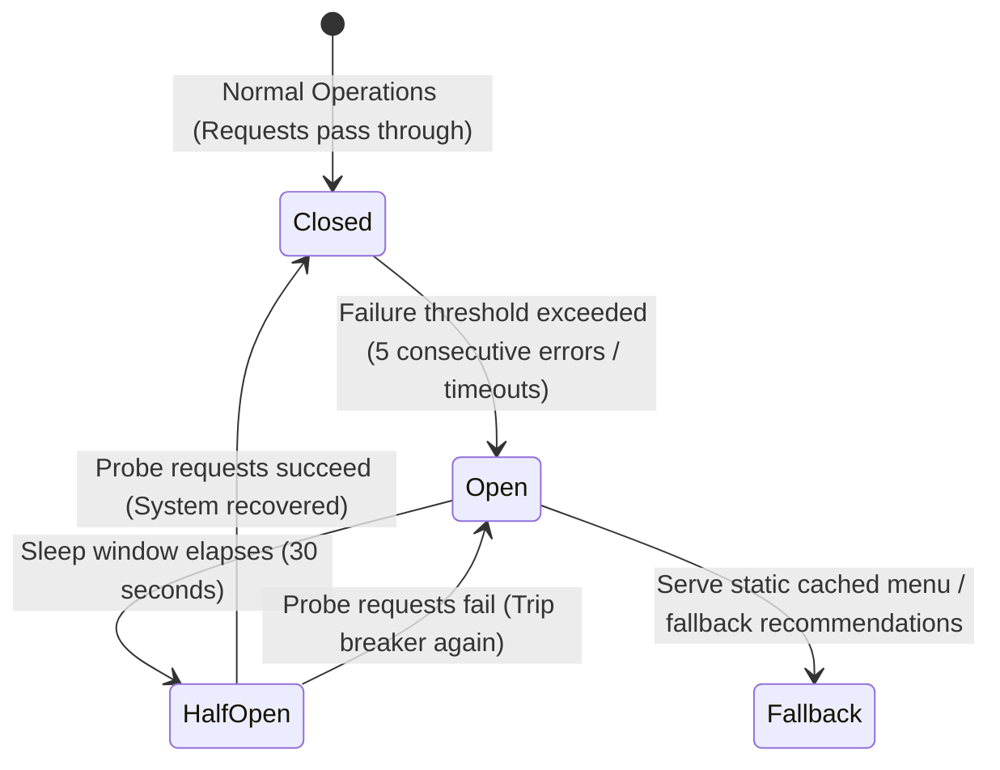

# 14.9 Reliability, Resilience & Graceful Degradation

---

## 1. What It Is in Plain Words
Reliability is the system's ability to maintain correct functionality despite hardware faults, software defects, network partitions, or dependency outages, employing defensive design patterns to isolate failures and degrade gracefully.

---

## 2. Current Implementation in Codebase
- **Defensive Timeouts**: Splash intro uses timeouts with fallback dismissal.
- **Resilient Fallback Layouts**: When desktop GSAP pinning is unsuitable on mobile viewports, [`Home.jsx:270`](file:///Users/avishjain/avishjain9-repos/50-starbugs-frontend-copy/StarbucksFrontend-Clean-Project/src/pages/Home.jsx#L270) automatically degrades into mobile directional cards without crashing.

---

## 3. Core Resilience Patterns

### 3.1 Circuit Breaker (Netflix Hystrix / Resilience4j)
- **Closed State**: Normal operations.
- **Open State**: If downstream payment gateways or the AI Barista API fail 5 consecutive times or exceed a 2000ms latency SLA, the circuit trips open. Incoming calls immediately return cached fallbacks without hitting the failing dependency.
- **Half-Open State**: After 30 seconds, a small percentage of probe requests test the upstream service.

### 3.2 Bulkhead Pattern
Isolates thread pools and connection quotas between critical and non-critical services. If the AI Barista recommendation service becomes unresponsive, its thread pool saturates, but the primary checkout and menu ordering thread pools remain 100% operational.

### 3.3 Graceful Degradation in Practice
| Failing Dependency | Degraded User Experience | Business Impact |
| :--- | :--- | :--- |
| **AI Barista Engine** | Displays curated Best Sellers instead of personalized prompt responses. | Zero revenue impact; customer continues order. |
| **Real-time Kitchen Socket** | Falls back to polling kitchen status every 30 seconds via HTTP. | Slightly higher server traffic, order completes. |
| **Loyalty Stars Service** | Allows checkout with cash/credit; queues star accrual for background sync. | Customer receives stars 10 minutes later. |

---

## 4. Availability Math: The Meaning of Nines

$$\text{Three Nines (99.9\%)} = \text{8h 45m downtime / year}$$
$$\text{Four Nines (99.99\%)} = \text{52.6m downtime / year}$$

Our production SLA targets **99.99%** for menu browsing and checkout.

---

## 5. 30-Second Interview Answer
> "We design for failure at every tier using circuit breakers, bulkheads, and graceful degradation. If our AI recommendation engine or third-party payment gateway experiences latency, circuit breakers trip open within two seconds to prevent cascading thread pool exhaustion. The client seamlessly degrades to cached menu items, ensuring that customers can always order their coffee regardless of upstream microservice disruptions."
