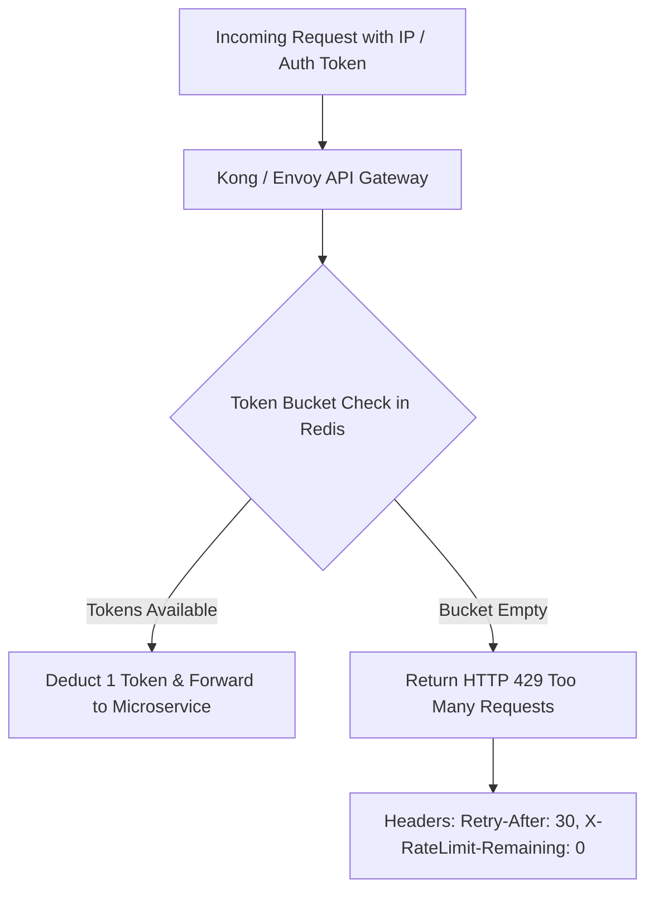

# 14.10 API Gateway, Throttling & Client Rate Limiting



---

## 1. What It Is in Plain Words
An API Gateway acts as the unified reverse-proxy entry point for all client requests, enforcing SSL termination, authentication token validation, request routing, and rate limiting to protect services against denial-of-service (DoS) attacks and abusive scrapers.

---

## 2. Rate Limiting Algorithms Comparison

| Algorithm | How It Works | Burst Traffic Handling | Memory Consumption | Production Fit for Starbucks |
| :--- | :--- | :--- | :--- | :--- |
| **Token Bucket** (Selected) | Tokens refill at constant rate up to bucket capacity. Requests consume 1 token. | **Handles bursts** smoothly up to capacity. | Low (stores token count + timestamp in Redis). | **Optimal for Checkout & AI**: Accommodates rapid multi-item cart adds. |
| **Leaky Bucket** | Requests enter FIFO buffer and leak out at strict constant velocity. | Smooths out bursts to steady rate. | Low. | Kitchen order dispatch. |
| **Fixed Window Counter** | Counts requests in fixed time windows (e.g., 60s). Resets at window boundary. | Vulnerable to 2x burst across boundary edges. | Extremely Low. | Simple static public pages. |
| **Sliding Window Log** | Stores exact timestamp of every request in sorted set. | Accurate down to millisecond. | High (stores timestamp per request). | Expensive at scale. |

---

## 3. Tiered Rate Limiting Configuration

```yaml
# API Gateway Rate Limiting Rules (Enforced in Redis)
rate_limits:
  unauthenticated_public:
    limit: 60
    window: 60s # 1 request / second
  authenticated_rewards_user:
    limit: 300
    window: 60s # 5 requests / second
  ai_barista_endpoint:
    limit: 10
    window: 60s # Protects expensive LLM token budgets
```

---

## 4. 30-Second Interview Answer
> "We enforce rate limiting at the API Gateway using a distributed Token Bucket algorithm backed by Redis. This allows legitimate customers to perform bursts of actions—like quickly configuring beverage customizations—while strictly capping unauthenticated traffic to sixty requests per minute. For resource-intensive endpoints like our AI Barista profiler, we enforce tighter per-user limits and return HTTP 429 responses with standard `Retry-After` headers to prevent scraping and abuse."
