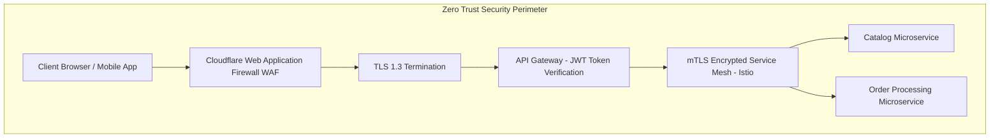

# 14.11 Security Architecture, CSP & XSS Shielding

---

## 1. What It Is in Plain Words
Security architecture is the comprehensive defense-in-depth model that protects application infrastructure, user credentials, financial transactions, and client browser environments against adversarial attacks, data theft, and unauthorized access.

---

## 2. Authentication Strategy: OAuth2 / OpenID Connect + JWT

### Token Storage Strategy
| Storage Location | XSS Vulnerability | CSRF Vulnerability | Production Recommendation |
| :--- | :--- | :--- | :--- |
| **`localStorage`** | **Critical**: JavaScript can read tokens directly via malicious scripts. | Immune to CSRF. | **Never use for auth tokens**. |
| **`httpOnly`, `Secure`, `SameSite=Strict` Cookie** | **Immune**: Inaccessible to JavaScript runtime. | Protected via `SameSite=Strict` and anti-CSRF token headers. | **Selected Standard**. |

---

## 3. Web Application Firewall (WAF) & Frontend Defenses

1. **Strict Content Security Policy (CSP)**:
   - Eliminates unauthorized script injections by blocking inline scripts and disallowing untrusted third-party origins.
2. **Clickjacking Defense**:
   - `Content-Security-Policy: frame-ancestors 'none';` and `X-Frame-Options: DENY`.
3. **Subresource Integrity (SRI)**:
   - Validates that external fonts and CDNs have not been maliciously modified.

---

## 4. 30-Second Interview Answer
> "Our security architecture enforces a Zero-Trust defense-in-depth model: Edge WAF rules filter out automated bot scrapers and SQL injection vectors, followed by TLS 1.3 termination at the API gateway. For customer authentication, we use OAuth2 with PKCE, storing short-lived JWTs in `httpOnly`, `Secure`, `SameSite=Strict` cookies to completely neutralize client-side XSS token theft. Downstream microservices communicate over an mTLS-encrypted service mesh."
