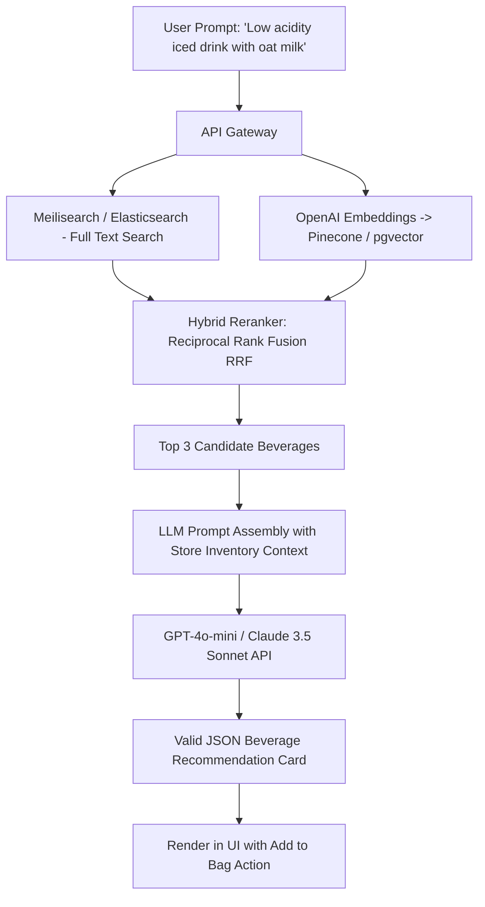

# 14.12 Search Engine & AI Recommendation Architecture

---

## 1. What It Is in Plain Words
Search and AI architecture combines keyword-based full-text search (lexical matching) with semantic vector search (understanding user intent and flavor nuances) to deliver instant catalog discovery and personalized AI recommendations.

---

## 2. Search Engines Comparison Matrix

| Technology | Indexing Engine | Search Type | Typo Tolerance | Memory Footprint | Starbucks Fit |
| :--- | :--- | :--- | :--- | :--- | :--- |
| **Meilisearch** (Selected for Catalog) | Rust / LMDB | Full-Text Lexical | **Instant (<20ms), built-in** | Low (~200MB RAM) | **Optimal for Instant Menu Search**: Sub-20ms search-as-you-type on mobile. |
| **Elasticsearch / OpenSearch** | Java / Lucene | Enterprise Search & Logs | Configurable | High (>4GB RAM) | Better suited for enterprise logging clusters. |
| **Pinecone / pgvector** | HNSW Vector Index | Semantic Vector k-NN | Semantic concept matching | Moderate | **AI Barista Taste Matching**. |
| **PostgreSQL Trigram Search** | Postgres GIN Index | Basic fuzzy text | Rudimentary | Database shared | Basic internal admin search. |

---

## 3. Hybrid Search & RAG Pipeline

1. **Lexical Search (Meilisearch)**: Matches specific product names, sizes, and keywords (e.g., "Caramel Macchiato").
2. **Dense Vector Search (pgvector)**: Translates flavor descriptions ("nutty, smooth, cold") into 1536-dimensional embeddings, retrieving drinks with high cosine similarity.
3. **Reciprocal Rank Fusion (RRF)**: Merges lexical and semantic results, prioritizing in-stock items at the customer's selected local Starbucks store.

---

## 4. 30-Second Interview Answer
> "We combine Meilisearch for sub-20ms instant full-text search with a vector similarity pipeline for our AI Barista. When a user types a subjective flavor preference, we perform hybrid search using dense vector embeddings in pgvector combined with lexical matching, passing the top candidates to a lightweight LLM. The model returns structured JSON with personalized drink recipes and verified store inventory IDs in under one second."
