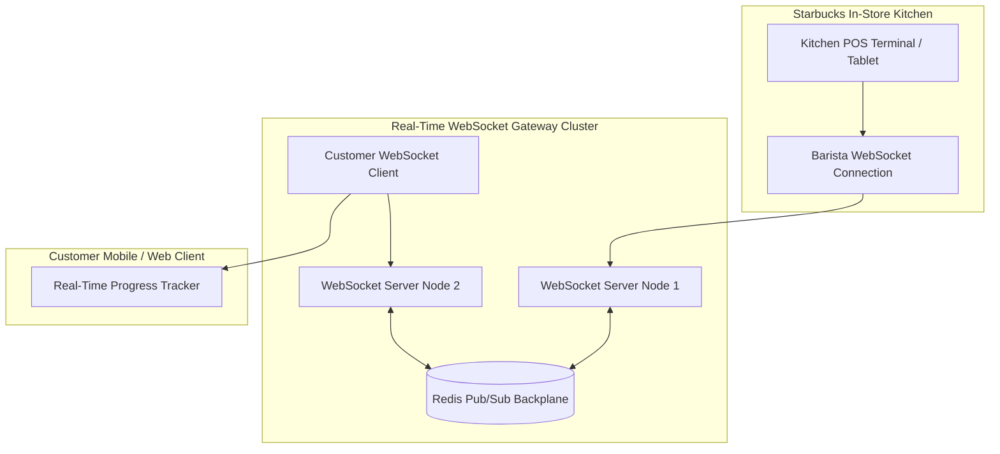

# 14.13 Real-Time Order & Location Presence Systems

---

## 1. What It Is in Plain Words
Real-time systems provide instant, bidirectional data communication between clients and servers with sub-second latency, eliminating the overhead of repeated HTTP request polling.

---

## 2. Real-Time Transport Protocols Comparison

| Transport | Connection Type | Direction | Server Push Overhead | Mobile Battery Impact | Production Use in Starbucks |
| :--- | :--- | :--- | :--- | :--- | :--- |
| **Short Polling** | HTTP/1.1 | Client pulls periodically (e.g., every 5s) | Massive (repeated TCP/TLS handshakes) | High battery drain | Obsolete. |
| **Long Polling** | HTTP/1.1 | Client holds open connection until event | High connection table overhead | Moderate | Fallback transport if WebSockets blocked by corporate firewalls. |
| **Server-Sent Events (SSE)** | HTTP/2 | Unidirectional (Server to Client only) | Very Low (Native HTTP/2 multiplexing) | Low | **Optimal for Order Status**: "Order Received" -> "Brewing" -> "Ready at Counter". |
| **WebSockets** | TCP | Bidirectional Full Duplex | Low (Minimal framing bytes) | Moderate (Requires heartbeat pings) | **Kitchen-to-Barista Communications** and real-time chat. |

---

## 3. Scaling WebSockets with a Redis Pub/Sub Backplane

Because WebSocket connections are stateful and persistent, customer connections and kitchen terminals may land on different servers in a load-balanced cluster.
- **The Backplane Solution**: When a barista taps *"Order #42 Ready"* on their kitchen terminal connected to Server 1, Server 1 publishes an event to a Redis Pub/Sub channel: `PUBLISH order:42:status "READY"`.
- Server 2 (holding the customer's active WebSocket connection) listens to the channel and immediately pushes the update down the customer's socket, updating their UI in real time.

---

## 4. 30-Second Interview Answer
> "For real-time kitchen tracking, we use Server-Sent Events for one-way order progress notifications to customer phones, which avoids WebSocket handshake complexity and runs natively over HTTP/2. For bidirectional in-store kitchen displays, we deploy a clustered WebSocket gateway backed by a Redis Pub/Sub backplane, allowing order state changes on any kitchen terminal to propagate across server nodes in under fifty milliseconds."
