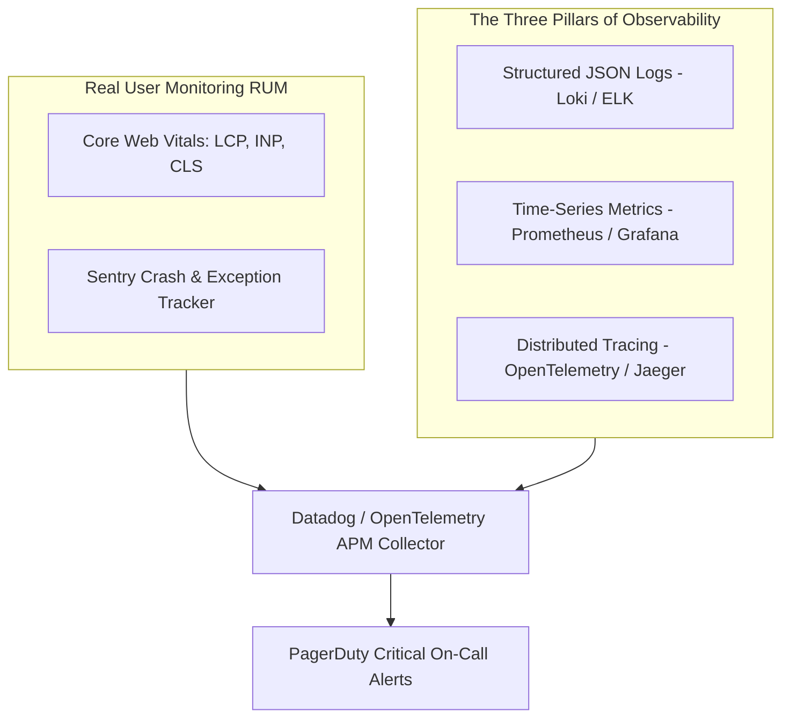

# 14.14 Observability, Core Web Vitals & Operations

---

## 1. What It Is in Plain Words
Observability measures the internal state of a complex system by analyzing its external outputs—specifically structured logs, aggregated metrics, distributed traces, and client-side Real User Monitoring (RUM).

---

## 2. Core Web Vitals Monitoring Strategy (Frontend Focus)

| Core Web Vital | Metric Threshold | Measured Experience | In-Code Optimization in Redesign |
| :--- | :--- | :--- | :--- |
| **LCP (Largest Contentful Paint)** | `< 2.5 seconds` | Initial visual loading speed | Eager image loading (`loading="eager"`) on transparent hero cups; Google Fonts preconnection. |
| **INP (Interaction to Next Paint)** | `< 200 milliseconds` | User input responsiveness | GSAP hardware-accelerated transforms; bypassing React reconciliation in drag slider handlers. |
| **CLS (Cumulative Layout Shift)** | `< 0.1` | Visual layout stability | Explicit CSS height containers on Best Seller cards and pinned storytelling frames. |

---

## 3. Distributed Tracing & Correlation IDs

When an order request fails, tracing the issue across 10 microservices requires a **Correlation ID**:
1. The client generates `X-Correlation-ID: 7f3a9b1c-842e`.
2. The API Gateway propagates this ID across HTTP headers to the Catalog, Inventory, and Payment services.
3. Every log line emitted by any service includes the correlation ID, allowing engineers to query all related logs across the entire transaction lifecycle in seconds.

---

## 4. 30-Second Interview Answer
> "We implement full-stack observability anchored around OpenTelemetry and Real User Monitoring. On the frontend, we track Core Web Vitals in real-time to ensure LCP stays under two seconds and INP stays under two hundred milliseconds during intense GSAP animations. On the backend, we inject correlation IDs into every incoming request header, linking distributed traces in Jaeger with Prometheus metrics and structured Loki logs for instant root-cause analysis during incidents."
