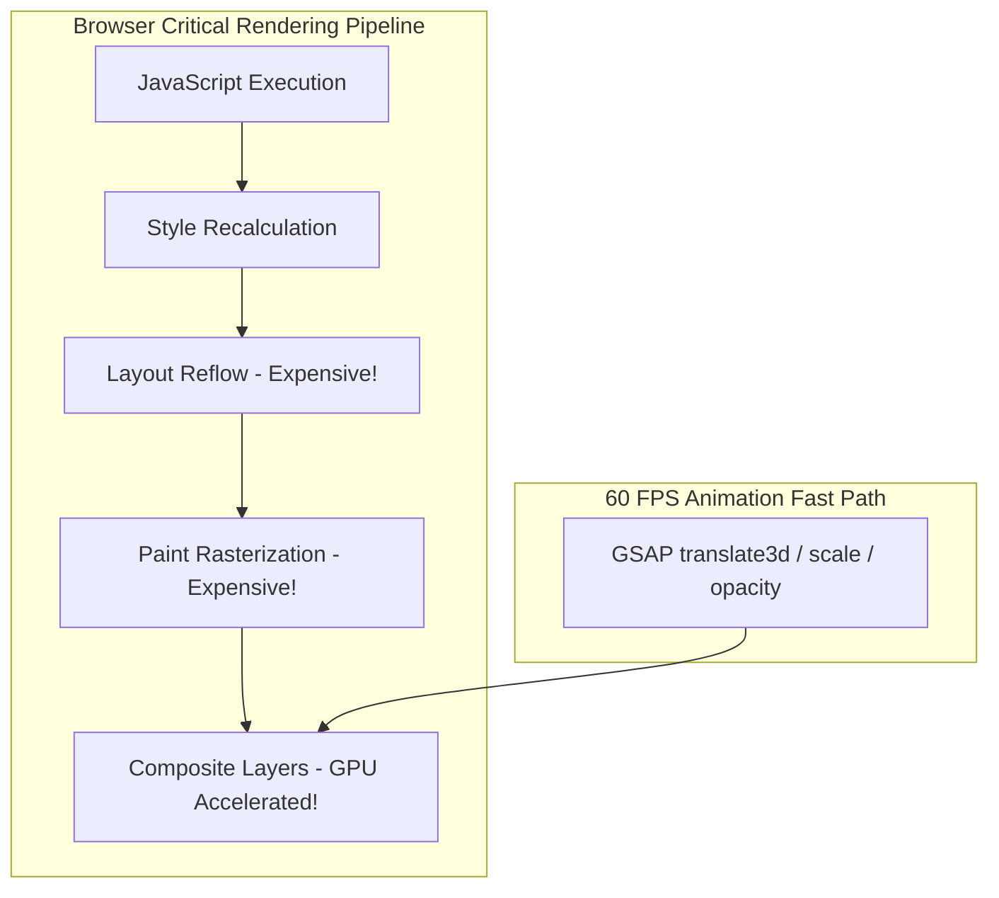

# 14.15 Performance Engineering & 60 FPS Animation Pipelines

---

## 1. What It Is in Plain Words
Performance engineering is the systematic measurement, profiling, and optimization of compute resources, rendering pipelines, memory footprints, and network payloads to minimize latency and guarantee smooth 60 FPS rendering.

---

## 2. 60 FPS Budget: The 16.6 Millisecond Rule

To render fluid animation at 60 frames per second, the browser has exactly **16.6 milliseconds** to complete all work for each frame:
- **Browser Overhead**: ~6 ms reserved for internal rendering and display sync.
- **JavaScript & Layout Budget**: Maximum **10 milliseconds** of JavaScript execution per frame.
- **Violations**: Any JavaScript task exceeding 50ms constitutes a "Long Task" that causes visual frame drops (jank) and degrades INP.

---

## 3. How This Codebase Enforces the 60 FPS Fast Path

| Component | Common Layout Thrashing Anti-Pattern | Enforced High-Performance Pattern in Code |
| :--- | :--- | :--- |
| **Follower Cursor (`Cursor.jsx`)** | Updating `top` and `left` properties (triggers Layout and Paint on every mouse move). | Updating `gsap.to(cursor, { x: clientX, y: clientY })` (compiles to `transform: translate3d()` on Composite thread). |
| **Drag Slider (`Slider.jsx`)** | Triggering React `useState` updates on every mousemove coordinate change. | Mutating `sliderRef.current.scrollLeft` directly, bypassing React Virtual DOM diffing. |
| **Pinned Stories (`Home.jsx`)** | Animating element `height` or `margin-top`. | Animating `yPercent: 0` and `autoAlpha: 0` via GSAP ScrollTrigger. |
| **Infinite Marquee (`InfiniteScroll.jsx`)** | Driving marquee loop via `setInterval` or JavaScript `requestAnimationFrame`. | Pure CSS `@keyframes scrollX` with GPU layer compositing. |

---

## 4. 30-Second Interview Answer
> "To guarantee smooth 60 FPS animation, we keep all animated properties restricted to the GPU compositor thread using CSS transforms and opacity, strictly avoiding layout-triggering properties like `top`, `height`, or `margin`. In our drag-to-scroll slider, we bypass React's Virtual DOM reconciliation loop during active mouse drag, directly updating container scroll offsets to eliminate main-thread frame drops."
