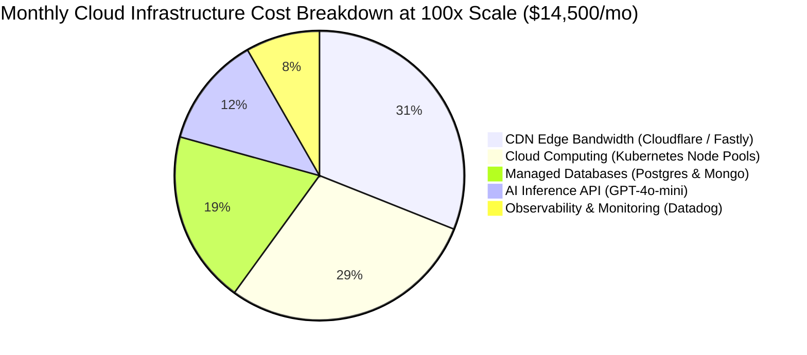

# 14.16 Cost Modeling, Cloud Budgets & Build vs. Buy

---

## 1. What It Is in Plain Words
Cost modeling quantifies the financial expenditure required to operate, scale, and secure software infrastructure across cloud compute, bandwidth, databases, managed APIs, and third-party SaaS vendors.

---

## 2. Monthly Cost Modeling: Current vs. 100x Scale

| Cloud Infrastructure Tier | Current Scale (Demonstration / Portfolio) | 100x Scale (Production Enterprise Platform) |
| :--- | :--- | :--- |
| **Static Web Hosting & CDN** | $0 / month (Vercel / Netlify Free Tier) | $4,500 / month (Cloudflare Enterprise Anycast CDN) |
| **Microservice Compute (EKS)** | $0 / month (Zero server instances) | $4,200 / month (12x `c6i.2xlarge` autoscaling nodes) |
| **Databases (RDS & Mongo Atlas)** | $0 / month (Static local JSON) | $2,800 / month (Multi-AZ Postgres + Sharded Atlas) |
| **AI Barista Inference Tokens** | $0 / month (No active AI endpoint) | $1,800 / month (500k queries/day with semantic cache) |
| **Media & Asset CDN (Cloudinary)** | $0 / month (Free tier) | $900 / month (AWS S3 + Cloudflare Images) |
| **Observability & Logging (Datadog)** | $0 / month | $1,200 / month (RUM sessions + APM traces) |
| **Total Monthly Cloud Budget** | **$0 / month** | **~$15,400 / month** |

---

## 3. Build vs. Buy Decisions

| Capability | Decision | Rationale | Alternatives Rejected |
| :--- | :--- | :--- | :--- |
| **Animation Engine** | **Buy (Use Open Source)**: GSAP 3 + ScrollTrigger | Building a proprietary sub-pixel pinning and timeline scrubbing engine would require months of specialized engineering. | Hand-rolled `requestAnimationFrame` math. |
| **Image CDN Transformations** | **Buy**: Cloudinary / Cloudflare Images | Edge image format conversion (`f_auto`) and on-the-fly resizing are commoditized cloud utilities. | Self-hosted `libvips` image server pods. |
| **LLM Inference** | **Buy**: Pre-trained API (GPT-4o-mini) | Training an in-house model requires massive compute budgets and ongoing MLOps teams. | Custom fine-tuned LLaMA model cluster. |
| **Custom Interactive Cursor** | **Build**: React Component + GSAP | Essential to proprietary brand identity and unique hover micro-interactions. | Generic NPM cursor libraries. |

---

## 4. 30-Second Interview Answer
> "At current scale, our architecture operates at zero cloud cost by utilizing static edge hosting and local data fixtures. At enterprise production scale of 10 million daily users, monthly cloud costs reach approximately fifteen thousand dollars, dominated by edge CDN egress and autoscaling compute pools. We adopt a pragmatic build-versus-buy strategy: building our distinctive proprietary UI and cursor physics in-house while buying commoditized cloud utilities like edge image optimization and pre-trained LLM APIs."
