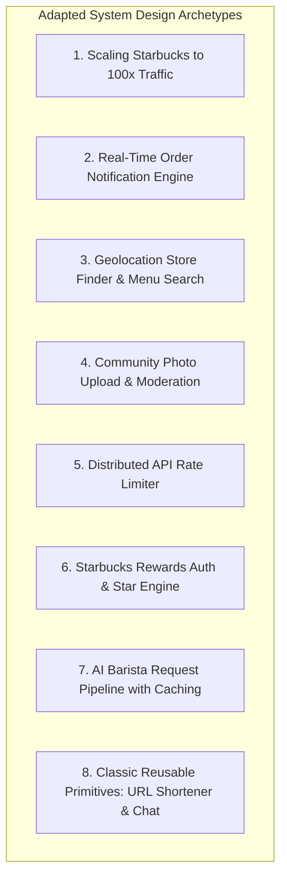
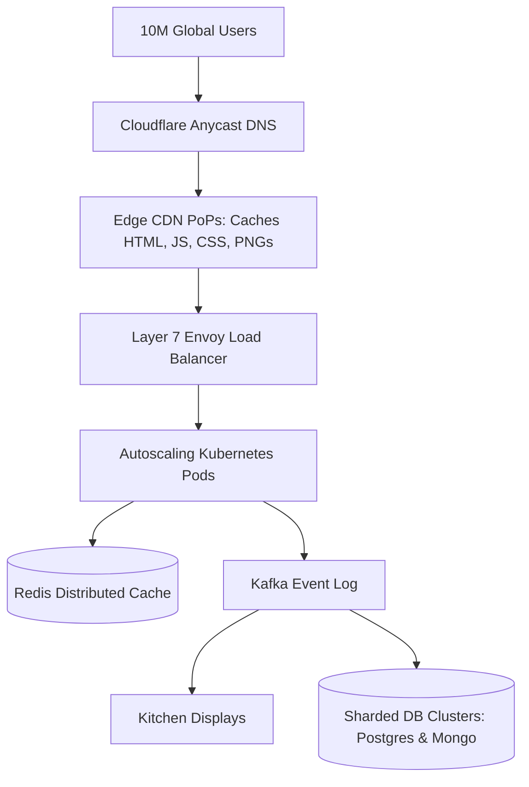
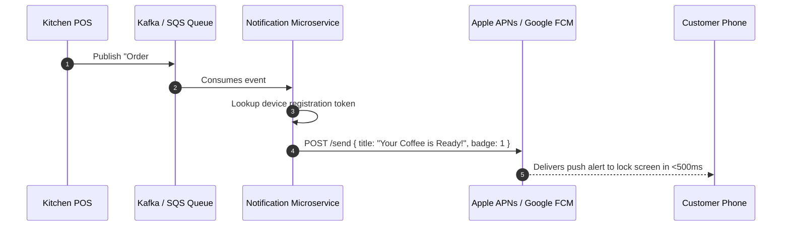

# 14.17 Classic System Design Problems Adapted



---

## 1. Design Starbucks Platform at 100x Scale



- **Requirements**: Handle 4,000 peak RPS, sub-100ms API response time, 99.99% availability.
- **Architecture**: Decouple static asset delivery to Edge CDNs, route dynamic transactions through an autoscaling Envoy API Gateway, and utilize Kafka event streams for asynchronous kitchen ticket routing.

---

## 2. Design Real-Time Order Notification Engine



- **Requirements**: Reliable push notifications to iOS and Android devices within 2 seconds of the barista tapping ready.
- **Architecture**: Worker pods consume Kafka events, lookup Apple Push Notification service (APNs) and Firebase Cloud Messaging (FCM) tokens from DynamoDB, and dispatch notifications with exponential backoff retries.

---

## 3. Design Geolocation Store Finder & Menu Search

- **Requirements**: Customer taps "Find a Store" ([`Navbar.jsx:36`](file:///Users/avishjain/avishjain9-repos/50-starbugs-frontend-copy/StarbucksFrontend-Clean-Project/src/layout/Navbar.jsx#L36)); returns closest 5 open stores with real-time drive-thru wait times within 50ms.
- **Architecture**:
  - Store geographic coordinates stored in PostgreSQL using the **PostGIS extension**.
  - Spatial indexing using **R-Trees** or **Uber H3 Hexagonal Hierarchical Spatial Index**:
    ```sql
    SELECT store_id, name, ST_Distance(geom, ST_MakePoint(:lng, :lat)::geography) AS distance_meters
    FROM starbucks_stores
    WHERE ST_DWithin(geom, ST_MakePoint(:lng, :lat)::geography, 5000)
    ORDER BY distance_meters LIMIT 5;
    ```

---

## 4. Design Community Photo Upload System

- **Requirements**: Support customer photo submissions for the Community showcase ([`InfiniteScroll.jsx`](file:///Users/avishjain/avishjain9-repos/50-starbugs-frontend-copy/StarbucksFrontend-Clean-Project/src/layout/InfiniteScroll.jsx)) with automated content moderation and resizing.
- **Architecture**:
  1. Client requests a pre-signed S3 upload URL: `GET /api/v1/uploads/presigned-url`.
  2. Client uploads image directly to S3 via HTTP PUT (bypassing backend servers).
  3. S3 event triggers an AWS Lambda function:
     - Validates image headers (strips EXIF GPS metadata for user privacy).
     - Runs AWS Rekognition for adult/inappropriate content moderation.
     - Generates square thumbnails (`320x320` WebP) and updates `community.json` storage.

---

## 5. Design a Distributed Rate Limiter

- **Requirements**: Enforce 60 requests/minute for unauthenticated IPs and 300 requests/minute for logged-in accounts across a cluster of 50 API Gateway nodes.
- **Architecture**:
  - Redis-backed **Token Bucket** evaluated via a Lua script executing atomically:
    ```lua
    local key = KEYS[1]
    local limit = tonumber(ARGV[1])
    local current = tonumber(redis.call('get', key) or "0")
    if current + 1 > limit then
        return 0
    else
        redis.call('INCRBY', key, 1)
        if current == 0 then redis.call('EXPIRE', key, 60) end
        return 1
    end
    ```

---

## 6. Design Classic Primitives Using This Stack

### 6.1 URL Shortener (e.g., `sbux.co/latte`)
- Base62 encoding on auto-incrementing 64-bit integer IDs (Snowflake ID generator).
- Key-value Redis cache stores short code to original URL mappings; HTTP 301/302 redirect.

### 6.2 Real-Time Support Chat
- WebSocket connection gateway connected to a Redis Pub/Sub room backbone.
- Message history persisted asynchronously to MongoDB or Cassandra.
