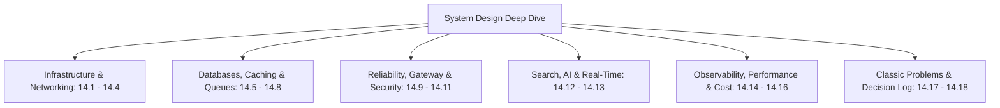

# System Design Deep Dive Curriculum

---

## Curriculum Overview

This deep dive breaks down enterprise systems architecture for the **Starbucks Digital Platform**. It transitions from the current client-side Single Page Application to a globally distributed, high-availability architecture handling millions of daily coffee orders, real-time barista order routing, edge asset delivery, and an AI-powered conversational recommendation engine.

Every chapter rigorously covers:
1. **Plain-English Definition**: Core theoretical concepts.
2. **Current Codebase Implementation**: Real file paths and function citations.
3. **Reasonable Scope Analysis**: Why this decision fit the hackathon scale.
4. **Comprehensive Alternatives Comparison**: Trade-offs across realistic cloud alternatives.
5. **Trade-offs Accepted**: Concrete engineering costs taken on.
6. **Load Failure Modes**: What breaks first at 10x, 100x, and 1000x scale.
7. **Senior Engineering Production Path**: Enterprise migration blueprint.
8. **Mermaid Diagrams**: Architecture, topology, and sequence flows.
9. **30-Second Spoken Interview Answer**: Concise, natural conversational response.

---

## Chapter Directory

- [14.1 Requirements & Capacity Estimation](./01-requirements-and-estimation.md)
- [14.2 Architecture Styles & Patterns](./02-architecture-styles.md)
- [14.3 Networking, CDN & Asset Delivery](./03-networking-and-communication.md)
- [14.4 Load Balancing & Frontend High Availability](./04-load-balancing-and-scaling.md)
- [14.5 Databases, Storage & Cloud Asset Stores](./05-databases-and-storage.md)
- [14.6 Multi-Tier Caching & Asset Caching](./06-caching.md)
- [14.7 Messaging, Async Queues & Webhooks](./07-messaging-queues-async.md)
- [14.8 Concurrency, State Race Conditions & Distributed Locks](./08-consistency-concurrency-distributed.md)
- [14.9 Reliability, Resilience & Graceful Degradation](./09-reliability-and-resilience.md)
- [14.10 API Gateway, Throttling & Client Rate Limiting](./10-api-design-rate-limiting.md)
- [14.11 Security Architecture, CSP & XSS Shielding](./11-security-architecture.md)
- [14.12 Search & AI Recommendation Engine](./12-search-and-ai-architecture.md)
- [14.13 Real-Time Order & Location Presence](./13-real-time-systems.md)
- [14.14 Observability, Core Web Vitals & RUM](./14-observability-and-operations.md)
- [14.15 Performance Engineering & Animation 60 FPS](./15-performance-engineering.md)
- [14.16 Cost, Cloud Budgets & Build vs Buy](./16-cost-and-tradeoffs.md)
- [14.17 Classic System Design Problems Adapted](./17-classic-questions.md)
- [14.18 Architectural Decision Records (ADR Log)](./decisions.md)
