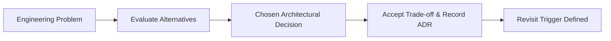

# Architectural Decision Records (ADR Log)

---

## Complete Project Decision Log

| ID | Decision Area | Chosen Option | Alternatives Considered | Deciding Factors | Trade-off Accepted | Revisit Trigger |
| :--- | :--- | :--- | :--- | :--- | :--- | :--- |
| **ADR-01** | **UI Library** | **React 18.3** | Vue 3, Svelte, Angular, Vanilla JS | Broadest animation ecosystem (GSAP, Framer Motion), declarative component model. | Larger bundle size than Svelte (~42 KB gzip). | Revisit if initial bundle size becomes a strict bottleneck on low-bandwidth networks. |
| **ADR-02** | **Bundler & Tooling** | **Vite 5.3** | Webpack 5, Parcel, Turbopack | Instant cold starts (<300ms) via native ESM, fast HMR during animation tuning. | Relies on Rollup plugins rather than extensive Webpack loader ecosystem. | Revisit if legacy enterprise build plugins are strictly required. |
| **ADR-03** | **Pinned Scroll Animations** | **GSAP 3 + ScrollTrigger** | Framer Motion Scroll, Native CSS Scroll-driven | Sub-pixel sticky pinning precision, pin-spacing calculations, robust `gsap.context()` cleanup. | Adds ~45 KB JavaScript dependency to client bundle. | Revisit when CSS Scroll-Driven Animations support pinning natively across all browsers. |
| **ADR-04** | **Smooth Scroll Engine** | **Locomotive Scroll 5 Beta** | Studio Freight Lenis, CSS `scroll-behavior: smooth` | Declarative `data-scroll-speed` parallax attributes on elements. | Virtual scroll hijacking conflicts with native browser scroll mechanics. | **Immediate candidate for migration to Lenis** to eliminate scroll hijacking bugs. |
| **ADR-05** | **Component Motion** | **Framer Motion 11** | React Spring, Pure CSS Animations | Declarative variant syntax, seamless integration with `IntersectionObserver`. | Redundant animation engine alongside GSAP. | Revisit to consolidate all animations into GSAP to reduce dual-engine bundle overhead. |
| **ADR-06** | **Styling Methodology** | **CSS Modules (`*.module.css`)** | Tailwind CSS, Styled Components, Sass 7-1 | Zero runtime overhead, clean JSX markup, automated hash-based class scoping. | Requires separate `.module.css` files for every component. | Revisit if utility-first rapid prototyping becomes team priority. |
| **ADR-07** | **Interactive Cursor** | **Custom DOM Element + GSAP** | OS Native Cursor, Third-party cursor library | Custom luxury brand aesthetics, dynamic `.allow_hover` contextual labels ("View" / "Click"). | Must be completely disabled on mobile/touch screens to avoid visual artifacts. | Maintain as brand-defining desktop interaction. |
| **ADR-08** | **Drag Carousel Physics** | **Custom Mouse Velocity Algorithm** | Swiper.js, Slick Carousel, Native overflow-x | Zero third-party carousel bloat, custom 2x momentum multiplier. | Code currently lacks touch velocity inertia and uses local variables instead of refs. | Refactor local variables to React refs with touch swipe support. |
| **ADR-09** | **Data Architecture** | **Bundled Static JSON** | REST API, GraphQL, LocalStorage | Zero backend hosting cost, offline availability, zero network latency during hackathon. | Inability to dynamically update menu prices without full redeployment. | Revisit when building real checkout and store inventory ordering. |
| **ADR-10** | **Media Hosting** | **Cloudinary CDN** | Self-hosted S3, Imgur, Local `/public` | High-bandwidth global CDN, on-the-fly image transformations, transparent PNG hosting. | Reliance on external third-party domain without SRI integrity hashes. | Implement AWS S3 origin shielding with Cloudflare edge caching. |
